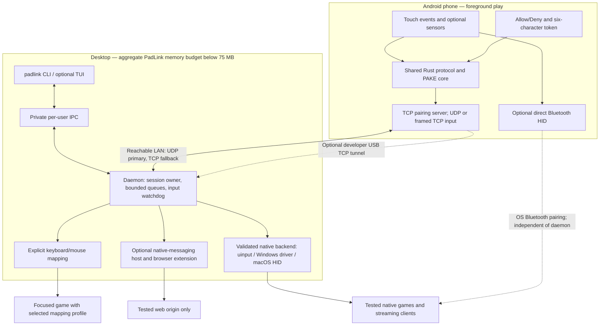

# Implementation Plan: PadLink — Android Controller App & Cross-Platform Desktop CLI (< 75 MB RAM)

---

## 0. Original Prompt

> i want to make an app for android that turns the phone into a controller that can be used to play games on mac/windows/linux for the desktop side it should be like a cli tool that has a hard cap to only use less that 75mb of ram with an option to connect / disconnect , open at login , run in background options this works when both the laptop and phone are connected on same wifi for both 5ghz and 2.4 ghz should work flawlessly with geforce now or like any other native game too and to connect to the phone and desktop once the user selects his deice on the cli and send a connection request there is a toekn generated of like 6 characters whichs needs to be entered on the cli to authenticate the connection this should be the workflow so according to this make an implementation plan and prd markdown files and also include this origanl prompt in the file

---

## 1. High-Level System Architecture

**Design reviewed on 2026-11-05; shared protocol/pairing and the app/CLI verification flow implemented on 2026-11-06.** The repository now contains Rust protocol, desktop CLI and Android/JNI projects. The architecture below includes future daemon/gameplay components; hardware validation and PRD gates G1–G5 remain requirements.



Discovery does not authenticate devices. The daemon owns pairing, all traffic keys/counters, and the virtual-device lifetime; the CLI is only a local client. Bluetooth HID bypasses the daemon and therefore has a different pairing/control lifecycle. Native, browser, and keyboard backends do not repair an unreachable Wi-Fi transport.

---

## 2. Technology Stack Selection

**Confirmed stack:** Rust for the desktop CLI and background daemon; a native Kotlin Android app developed in Android Studio. Use `clap` and Tokio's current-thread runtime on desktop, Jetpack Compose plus a custom Android View/Canvas in the app, and a shared Rust protocol/crypto library through UniFFI/JNI.

| Component | Selected technology | Validation and fallback |
| :--- | :--- | :--- |
| Desktop language/build | **Rust 2024** and Cargo, one executable with daemon/native-host subcommands | Build per OS/architecture; macOS/Windows use native dynamic system libraries. Verify RSS, code signing, and binary size rather than promising a universally static binary or a 6–12 MB footprint. |
| CLI/TUI | `clap`, optional `ratatui`/`crossterm` | Bounded display buffers; disable TUI when no terminal or insufficient optional memory budget. Hidden token input only. |
| Desktop runtime/network | **Tokio current-thread runtime** plus `socket2` | Use one async executor thread by default. Audit threads created by discovery/native dependencies; avoid unbounded task spawning, blocking pools, and queues. Thread-stack sizes and the actual process thread count require stress validation. |
| Discovery | `mdns-sd`, Android `NsdManager`, bounded UDP responder | TCP service advertisement, IPv4/IPv6 addresses, IPv4 broadcast fallback, manual endpoint. Discovery queries and results have time/size limits. |
| Crypto | Reviewed/pinned PAKE implementation, `chacha20poly1305`, `hkdf`, CSPRNG | `spake2` is a candidate, not proof of audit/RFC interoperability. Verify suite, transcript, confirmation, and test vectors before selection. Block pairing if no suitable implementation exists. |
| Shared Android core | Same **Rust** protocol crate via **UniFFI/JNI**, built with `cargo-ndk` and the Android NDK | If UniFFI fails, a small C ABI/JNI layer around the same implementation. No X25519 + token-HMAC substitute. Validate lifetimes, ABI, cancellation, and Android native-library packaging/page-size requirements. |
| Android language/runtime | **Kotlin** native Android app; Kotlin bytecode compiled to DEX and executed by **Android Runtime (ART)** | Kotlin owns Android UI, lifecycle, permissions, and hardware integration. The Rust `.so` executes natively through JNI; it does not run inside ART as bytecode. |
| Android development/build | **Android Studio**, Gradle Wrapper with Kotlin DSL (`build.gradle.kts`), Android Gradle Plugin, Android SDK/NDK | Pin compatible build-tool versions. Android Studio provides the editor, debugger, profiler, and emulator; CI must also build through the Gradle Wrapper without launching the IDE. |
| Android UI | **Jetpack Compose** for setup, device status, and pairing; custom **Android View/Canvas** for the gamepad | Touch callbacks are event-driven; device hardware controls sampling rate and touch count. Native sending loop owns packet cadence; avoid copying every packet through Compose/JNI. |
| Browser experiment | Chromium extension + registered native-messaging host | Restrict extension identity and page origins. Native host uses private daemon IPC; its memory counts toward the budget. This avoids assuming a localhost WebSocket bypasses browser network policy. |

**Runtime and implementation boundaries:** Android Studio is a development tool, not an app runtime. The installed Android app contains the Kotlin/Compose/View code and ABI-specific Rust native libraries; the desktop contains the compiled Rust CLI/daemon and required native resources. Keep Android UI work on the main thread and use bounded calls/buffers to exchange control state with the Rust core. Pairing, crypto, wire encoding/decoding, session rules, and the timing-sensitive sending loop belong in the shared core; Android permissions, network callbacks, touch, sensors, and haptics remain in Kotlin. Use the emulator for functional checks and physical phones for touch latency, Wi-Fi, Bluetooth, and thermal measurements.

Lock dependency versions and verify licenses, maintenance status, supported targets, and redistribution terms before packaging. References supporting the corrected platform assumptions are in §7.

---

## 3. Proposed Repository Structure

```text
prod/
├── PRD.md
├── IMPLEMENTATION_PLAN.md
├── docs/references/
│   └── android-controller-layout.png # Existing user-supplied default layout reference
├── Cargo.toml
├── protocol/
│   ├── SPEC.md                  # Normative messages, bounds, states, crypto suites, vectors
│   └── src/                     # PAKE, key schedule, encoding, replay and edge ordering
├── desktop/
│   └── src/
│       ├── main.rs
│       ├── allocator.rs         # Heap accounting only; not an RSS-cap claim
│       ├── memory.rs            # Aggregate metrics, optional-work admission, pressure handling
│       ├── cli.rs
│       ├── daemon/
│       │   ├── ipc.rs           # Owner-only sockets/pipes and single-instance lock
│       │   ├── lifecycle.rs     # Supervision, stop semantics, crash-loop limit
│       │   └── autostart.rs     # launchd / Scheduled Task / systemd / XDG
│       ├── net/
│       │   ├── discovery.rs
│       │   ├── pairing.rs
│       │   ├── udp.rs
│       │   ├── tcp.rs           # Bounded encrypted framing and backpressure
│       │   ├── resume.rs        # Endpoint challenge and fresh traffic epochs
│       │   ├── usb.rs           # Optional scoped adb-forward tunnel
│       │   └── doctor.rs
│       └── gamepad/
│           ├── mod.rs          # Capability trait, neutralization, 250 ms default watchdog
│           ├── linux_uinput.rs
│           ├── windows.rs      # Versioned driver adapter; initial ViGEm feasibility
│           ├── macos.rs        # API/version/entitlement capability probe
│           ├── browser.rs      # Native-messaging host and liveness checks
│           ├── kbm.rs          # Explicit focus-scoped mapping and emergency stop
│           └── select.rs       # Available capabilities and honest failure reasons
├── android/app/src/main/
│   ├── AndroidManifest.xml
│   └── java/com/padlink/controller/
│       ├── MainActivity.kt
│       ├── service/ControllerForegroundService.kt
│       ├── net/                # Permissions, discovery, pairing and Network callbacks
│       ├── bt/BluetoothHidGamepad.kt
│       ├── qr/QrConnectScanner.kt
│       └── ui/                 # Pairing, custom gamepad View, and Compose layout editor
├── browser-bridge/             # Optional; capability gated until real site tests pass
│   ├── manifest.json
│   ├── service_worker.js
│   └── inject_main_world.js
├── packaging/
│   ├── install.sh              # curl download-and-run installer for macOS/Linux
│   ├── homebrew/padlink.rb     # Formula source published to OWNER/homebrew-tap
│   ├── release-manifest.json  # Version/target/runtime requirements and artifact checksums
│   └── platform/              # Signing, OS setup, removal and rollback assets
├── .github/workflows/
│   └── release.yml            # Build/verify/publish artifacts, then update the tap
└── tests/
    ├── protocol/               # Vectors, parser fuzzing, replay/epoch/edge invariants
    ├── integration/            # Loss, lifecycle, permission and fallback fault injection
    └── compatibility/          # Dated manual device/game evidence and memory results
```

---

## 4. Detailed Technical Design

### 4.1 Resource Contract and Memory Failure Handling

The requirement is **aggregate PadLink userspace RSS < 75,000,000 bytes**, including simultaneously running daemon, CLI/TUI, native host, and PadLink-owned helpers. MB is decimal; do not use `75M` where a configuration parser means 75 MiB. Report browser/game and kernel-driver memory separately. A temporary second CLI or helper is part of the acceptance test, not an exemption.

**Critical limitation:** heap bytes, RSS, private commit, `phys_footprint`, and cgroup charges are different metrics. A tracking allocator plus a sampled watchdog cannot prove that physical memory never crosses a bound. Linux documents possible temporary `memory.max` overshoot; Windows job limits constrain commit; macOS has no equivalent generally enforceable process RSS limit. G2 stays open until the enforcement contract is demonstrated. Development builds may use labeled monitored-budget mode, which does not satisfy the strict product promise.

1. **Bound before allocating**:
   - Preallocate the hot path and use fallible reservations for growth. Initial limits: 32 discovery results, four IPC clients, one pending pairing, one active session, one endpoint-migration candidate, 32 unacknowledged digital edges, one latest analog snapshot, and 128 log records of at most 256 bytes each.
   - IPC/pre-auth TCP frames: at most 4,096 bytes. Authenticated input/control frames: at most 256 bytes. Limit accepted sockets and read deadlines before parsing peer-provided lengths.
   - Initial daemon heap budget 24,000,000 bytes; CLI budget 4,000,000 bytes; optional native host budget 4,000,000 bytes. These are starting values to measure, not evidence that total RSS fits. Refuse optional worker/TUI admission if remaining headroom is inadequate.
   - Bound logs, native callback queues, discovery TXT/name sizes, and OS socket buffers. Floods drop/reject work instead of allocating one task per packet or logging every failure.
   - Bound work per event-loop turn so packet floods cannot starve watchdog/cleanup timers. Native backend calls need measured completion bounds or a supervised isolation strategy; any additional helper counts toward aggregate memory. A blocked backend is a tested failure, not an assumed successful neutral report.
2. **Allocator guard**:
   - If retained, implement checked atomic reservation/rollback for allocation and reallocation, including allocation failure, grow/shrink, alignment, and overflow. Account transient old/new storage during realloc; “size delta only” can undercount peak memory. Do not allocate or log inside allocator callbacks.
   - A failed Rust infallible allocation normally aborts; the allocator must never be described as graceful shutdown. Normal code must detect pressure using bounded/fallible operations before the last-resort guard triggers. Native/system allocations may bypass this guard.
3. **Observe aggregate pressure**:
   - Sample at least four times per second and at optional-worker admission; measure actual peak usage independently in tests. Report RSS plus relevant OS-specific metrics. This sampling is for recovery, not mathematical enforcement.
   - At 50 MB warn, 60 MB shed optional history/caches and reject optional work, 65 MB release inputs/rumble, tear down devices, erase session state, and exit with a distinct pressure reason. Reserve cleanup buffers in advance.
   - If pressure sampling/admission fails, stop optional work and expose an error. Do not interpret a failed read as zero memory.
4. **OS containment, when available**:
   - **Linux**: systemd/cgroup v2 with explicit-byte `MemoryHigh=60000000`, `MemoryMax=70000000`, and swap policy documented separately. Verify controller delegation and actual cgroup membership/limits. A terminal-launched CLI is not automatically in the service's cgroup; account it separately or launch it in an appropriate shared scope. This containment leaves headroom but does not prove aggregate RSS < 75 MB. Non-systemd/nondelegated fallback is monitored-budget mode. Do not use `RLIMIT_AS` as an RSS substitute.
   - **Windows**: a job with aggregate committed-memory containment, plus per-process accounting if useful. Verify assignment, child membership, nesting, and breakaway behavior. Job commit and working set are reported separately. If assignment fails, expose containment as unavailable and do not claim the same guarantee.
   - **macOS**: collect resident size and `TASK_VM_INFO.phys_footprint`; use pressure handling with headroom. Do not claim `launchd` ResidentSetSize or a sampled threshold is a hard resident limit. Measure any CoreHID/Swift or extension helper too.
5. **Recovery**:
   - Orderly cleanup and abrupt death are separate tests. Closing a process-owned native-device handle often removes the device, but a game, injected keyboard key, browser page, or separate driver process may retain state. Do not promise crash safety solely from handle closure.
   - Use one supervisor per launch mode. After a crash or pressure exit, retry with delays of 1 s, 5 s, then 30 s, at most three automatic retries in five minutes. Persistent failure leaves a visible stopped/error state. A restart begins idle/unpaired with fresh counters; an explicit stop is never auto-restarted.

### 4.2 Six-Character Pairing and Key Schedule

**Defaults:** phone TCP pairing port `41337`; discover the actual bound endpoint. The desktop daemon initiates the normal TCP connection; the CLI never owns the live session.

1. The app must be listening in an allowed foreground state with LAN permission. It accepts a bounded request containing protocol/suite offers, request ID, random nonce, and desktop label. Labels are sanitized for terminal/control characters and marked unverified.
2. Show Allow/Deny on the phone. After Allow, sample each of six symbols uniformly from `23456789ABCDEFGHJKLMNPQRSTUVWXYZ` using the CSPRNG. Start a monotonic 60 s deadline. CLI input is case-insensitive, may ignore separators, and must normalize to exactly six valid characters.
3. Use a pinned, reviewed PAKE suite with fresh ephemeral state. Bind roles, offered/selected version and suite, both peer identities/nonces, request ID, and negotiated capabilities/endpoints into the authenticated transcript. A name supplied over discovery is not a trusted identity.
4. Require **mutual key confirmation** before accepting a session or creating a virtual device. Each PAKE attempt counts against the token's maximum of three failed attempts; reopening a connection does not replenish attempts. Expiry, cancel, deny, success, or replacement invalidates the token. Apply phone-wide and per-source five-requests/minute limits, short pre-auth read deadlines, and one pending request.
5. Derive a session root/resume secret and independent keys using HKDF with explicit labels for direction, transport, epoch, and purpose. Use a full random 128-bit session ID bound to confirmation. Neither session secret nor token is sent in plaintext or stored in config/logs. Erase temporary token and ephemeral material when no longer needed.
6. Allocate separate traffic keys and four-byte nonce prefixes for `phone→desktop/UDP`, `desktop→phone/UDP`, `phone→desktop/TCP`, and `desktop→phone/TCP` in each epoch. A nonce is `prefix[4] || seq_num_le[8]` (96 bits). All packet types sharing a key use one monotonic counter. Do not concatenate a 64-bit session ID and 64-bit counter into a ChaCha20-Poly1305 nonce.
7. Before counter exhaustion, rekey through the authenticated control protocol or disconnect. Never reset a counter under its old key, including after retries, Wi-Fi changes, a backend switch, or process restart. Process restart loses the root secret and requires a new token.

The shared Rust library needs test vectors on desktop and every shipped Android ABI. If UniFFI is unavailable, use C ABI/JNI around the same library. If the PAKE itself is unsuitable, select another reviewed PAKE and revalidate; do not substitute an ad hoc X25519/HMAC or commit-reveal handshake. RFC 9382 describes SPAKE2, but the chosen crate's wire suite and confirmation behavior must be checked rather than assumed.

### 4.3 Discovery, Routing, Permissions, and Transport Fallback

#### Endpoint and interface rules

- Publish `_padlink._tcp.local.` (Android service type `_padlink._tcp.`). The SRV record identifies the **TCP pairing port**; version/capability hints in TXT are untrusted until confirmed. The UDP endpoint is negotiated after pairing. Default UDP input port is `41338`, but desktop/phone reply endpoints may be ephemeral.
- Enumerate eligible active LAN interfaces and show the selected interface. Use route/network-change callbacks to refresh addresses. Do not choose VPN, container, or link-local routes merely because they enumerate first. `--interface` and manual scoped IPv6 endpoints handle ambiguity.
- Start mDNS; after a short initial interval such as 500 ms, also try a small bounded IPv4 discovery request on UDP `41337`. Continue listening for delayed mDNS results for a total scan window of approximately 3 s. Compute directed broadcast from address/netmask, never by appending `.255`. Use a hop-limited IPv6 mDNS path; IPv6 has no broadcast or practical subnet sweep.
- `scan --probe-subnet` is explicit: on-link IPv4 only, cap 1,024 candidate addresses and 32 concurrent probes with a five-second overall deadline. Do not scan other subnets or the Internet. Keep replies bounded and rate-limited to avoid amplification.
- If a default pairing/input port is occupied, bind an available port and publish/show the actual endpoint. If the fixed UDP discovery port is occupied, that fallback is unavailable; an undiscovered ephemeral responder cannot magically be found by fixed-port broadcast.
- Manual `IP:port` / `[IPv6%scope]:port` is P0. QR is only a discovery convenience. A phone-displayed endpoint QR uses the normal connection direction. To support `padlink connect --qr`, the daemon must start an explicit short-lived LAN TCP rendezvous listener and encode its chosen interface/port, request ID, 128-bit one-time nonce, and 60 s expiry; the phone dials it and the same phone-consent/token/PAKE roles run over that connection. Implement this reversed socket direction before advertising the flag. QR possession is not authentication.

#### Permission and reachability rules

- A shared SSID or gateway does not prove peer reachability; bands may map to isolated VLANs. Failed ping does not prove AP isolation. `doctor` reports observed probes, selected routes and errors, and distinguishes `permission denied`, `unreachable`, and `suspected isolation`. QR/manual IP do not bypass routing or permission blocks.
- Android declares ordinary Internet/network/Wi-Fi access as needed; request multicast access only for the raw multicast discovery path and release `MulticastLock` when done. Lock acquisition does not fix router filtering and is not a blanket requirement for every NsdManager operation or broadcast implementation.
- For Android 17 / target SDK 37+, declare/request `ACCESS_LOCAL_NETWORK` for the app's raw LAN sockets and handle revocation. Android 16's opt-in compatibility behavior used `NEARBY_WIFI_DEVICES`; do not treat that as the current permission for every target. Permission denial blocks manual unicast too. Test JNI-created sockets as well as Kotlin APIs.
- On macOS, follow TN3179: Terminal/SSH command-line children and system `launchd` daemons have exemptions; a per-user **LaunchAgent does not inherit the daemon exemption**. Sign code with a stable identity. Validate responsible-code attribution for the actual shipped LaunchAgent; use a minimal signed bundle/`AssociatedBundleIdentifiers` or embedded Info.plist where required. Supply accurate local-network usage/service declarations for that packaging. Running `setup` from Terminal alone does not prove the login agent can obtain access. Keep a permission-pending agent alive long enough for the OS flow; do not diagnose all `EHOSTUNREACH` errors as denial or run as root to evade the issue.

#### UDP primary and TCP fallback

1. After key confirmation, the daemon sends an authenticated UDP path probe from the socket that will receive phone data. The phone replies to its observed endpoint. Reverse-direction probes validate both paths. Outbound traffic may help a stateful firewall, but cannot override OS privacy settings, explicit rules, or AP isolation.
2. With no successful probe after a bounded retry window (initially 1 s), keep input neutral. If the authenticated pairing TCP connection works, offer framed TCP input on it. Set `TCP_NODELAY`; use directional TCP traffic keys, a bounded writer, and the same input watchdog. Never tunnel raw UDP by assuming TCP preserves datagram boundaries.
3. Each TCP data frame has a two-byte length and an authenticated message of at most 256 bytes; bind length/header into AEAD AAD. Validate length before reading/allocating, reject truncation, apply read/write progress deadlines, and close stalled streams. Handshake frames have the separate 4,096-byte limit.
4. TCP head-of-line blocking can make old input arrive late. Keep only the latest pending analog snapshot, preserve the bounded digital-edge queue, and abandon/reset a stale connection instead of replaying a backlog. A transport change uses a new confirmed epoch and neutral rearm; preserve the token-free session only while its 30 s resume deadline is live.
5. `setup-firewall` explains the application/port/interface rules and uses OS elevation for a requested change. Scope to the actual program, private LAN/local subnet, and actual selected ports; record how to undo PadLink's own rules. Dynamic endpoint changes must be reflected in rules. Never disable the firewall or silently open public profiles.
6. If both peers lack a reachable LAN path, suggest a reachable private network/hotspot. Only independent, implemented BT/USB transports can help; TCP, QR, browser, and keyboard backends alone cannot.

### 4.4 Packet Format, Lost Input, and QoS

#### State packet: 56 bytes

The previous 36-/40-byte descriptions disagreed. The revised **State** packet is **56 bytes**: 12-byte authenticated clear header, 28-byte encrypted payload, and 16-byte tag. An eight-byte digital-edge ID identifies missing short press/release transitions; an eight-byte sample timestamp distinguishes recently sampled state from delayed traffic. Other message types have their own exact bounded lengths; they are not all State packets.

| Offset | Field | Type / size | Meaning |
| :--- | :--- | :--- | :--- |
| `0..1` | `magic` | u8 / 1 B | `0x50` |
| `1..2` | `ver_type` | u8 / 1 B | Version nibble + type nibble; version 1 State type 1 |
| `2..4` | `session_tag` | u16 LE / 2 B | Routing hint from full session ID; never an authenticator |
| `4..12` | `seq_num` | u64 LE / 8 B | Per-direction/transport/epoch packet counter |
| `12..20` | `latest_edge_id` | u64 LE / 8 B | Latest digital transition incorporated into this snapshot |
| `20..28` | `sample_time_us` | u64 LE / 8 B | Sender monotonic sample time, checked against authenticated clock bounds |
| `28..30` | `buttons` | u16 LE / 2 B | A/B/X/Y, LB/RB, Back/Start/Guide, L3/R3, D-pad; unused bit zero |
| `30..31` | `left_trigger` | u8 / 1 B | 0–255 |
| `31..32` | `right_trigger` | u8 / 1 B | 0–255 |
| `32..34` | `lx` | i16 LE / 2 B | Left stick X |
| `34..36` | `ly` | i16 LE / 2 B | Left stick Y |
| `36..38` | `rx` | i16 LE / 2 B | Right stick X |
| `38..40` | `ry` | i16 LE / 2 B | Right stick Y |
| `40..56` | `tag` | bytes / 16 B | Full ChaCha20-Poly1305 authentication tag |

Freeze axis sign conventions, deadzones, trigger defaults, reserved bits, and canonical encoding in `protocol/SPEC.md`; do not serialize native Rust structs with padding. UDP receive buffers must detect oversized datagrams (for example a 257-byte buffer for the 256-byte accepted maximum, plus platform truncation handling). Reject wrong lengths/versions/types before processing. Never advance replay counters, rebind an endpoint, or refresh a watchdog from an unauthenticated header.

#### Digital transitions and backpressure

- Touch callbacks maintain an ordered journal of button bitmaps with increasing `edge_id`, including a press and release occurring between state ticks. State snapshots alone cannot recover such a tap.
- Define separate authenticated `Edges` and `Ack` frames. Proposed Edges payload: one-byte count, one reserved byte, then up to 12 entries of `edge_id:u64`, `buttons:u16`, `event_time_us:u64`; maximum packet length 246 bytes including header/tag. Ack carries the highest contiguously delivered edge ID. Finalize this and Ping, Disconnect, Rumble, Resume, and Epoch-confirm schemas and vectors in Phase 1 **before** implementation relies on them.
- Retransmit unacknowledged entries using a new packet counter; deduplicate/order by edge ID independently of packet sequence. A State snapshot may update axes immediately, but apply its digital bitmap only at the receiver's corresponding contiguous edge cursor. A snapshot ahead of that cursor requests/retries missing edges; one behind cannot roll buttons back.
- Bound the journal to 32 transitions, receiver reorder storage to the same bound, and sender retry lifetime to `min(200 ms, watchdog.neutral_ms)`. Check event age using the authenticated clock bounds below, including transit and receiver wait. An age/queue/freshness failure clears pending work, neutralizes, and starts fresh-epoch recovery rather than replaying a stale press. Each edge is a distinct backend report; transport acknowledgment is not proof that a game's polling loop observed it.
- Send state at 120 Hz by default (60–240 Hz negotiated). Button changes may trigger immediate sends and up to three bounded retransmissions; every new encryption uses a fresh counter. Do not promise Android timers can space transmissions exactly 1.5 ms apart. Cap state + retry + control traffic initially at 512 datagrams/s per direction; rate limiting must not postpone neutralization.
- Three independent copies at 10% random loss still have a 0.1% all-lost probability; real Wi-Fi bursts are correlated. Measure missing edges and delay in the specified fault tests. Never claim guaranteed lossless buttons on arbitrary networks.

#### QoS, power, and timing

DSCP EF is codepoint 46; `0xB8` is its IP traffic-class byte with ECN zero. OS/router support and mapping to WMM queues vary; permission/socket-option failure falls back to ordinary traffic. Android low-latency Wi-Fi locks depend on API, screen/foreground state, and hardware support. They do not reserve airtime. API 28 can request the older high-performance lock where available. Thermal pressure or Bluetooth-audio coexistence may trigger a lower rate and a 5 GHz recommendation.

Measure RTT using authenticated pings on one local monotonic clock. One-way latency requires clock-offset/error characterization; dividing RTT by two is an estimate, not a measured one-way p95. Touch acquisition, rendering, scheduling, native injection, and game sampling are separate from LAN transit.

**Input age is separate from replay protection.** A previously unseen sequence number can still contain seconds-old input, especially after TCP buffering. Establish a conservative interval for the peers' monotonic clock offset through authenticated timestamp exchanges during path setup; refresh it periodically and include measured uncertainty and a drift allowance. Reject future/impossible timestamps and input whose maximum possible age reaches its deadline. Anchor the hold deadline to the conservative sample time, not a full new timeout after receipt. If clock uncertainty itself is too large to establish freshness, stay neutral and re-probe. This does not require accurate one-way latency reporting; freeze the interval calculation and drift policy in the protocol specification and test delayed trickle delivery after a sender dies.

### 4.5 Input Watchdog, Resume, and Session States

| State / trigger | Action |
| :--- | :--- |
| `IDLE` | No session keys or mounted controller. Discovery may be enabled. |
| `PAIRING` | One consented request and bounded PAKE exchange; no injected input. |
| `ACTIVE` | Validated path/backend, confirmed epoch, and neutral baseline; apply fresh authenticated input. |
| Last fresh input age ≥ 250 ms (default) | Neutralize all controls and rumble; latch output off and clear queued edges. Begin bounded fresh-epoch recovery. |
| Last fresh input age ≥ 5 s | Display `RECONNECTING`; keep the neutral virtual device mounted if backend allows. |
| Last fresh input age ≥ 30 s | Remove device, close paths, erase root/session secrets, return to idle. |
| Explicit disconnect, desktop lock/suspend, backend removal, or phone pause notification | Neutralize immediately. Explicit disconnect erases the session; temporary interruption may resume only while the original deadline remains live. |

Only valid input with a verified recent sample time on the active authenticated path updates input freshness; a newer sequence number alone is insufficient. Ping/Ack/Rumble/Resume, malformed packets, and duplicate sequence numbers cannot keep a held button alive. Configure neutral delay only within 100–250 ms; no automatic extension. A heartbeat resamples the current state with a new monotonic sample time even when controls are unchanged.

For resume or endpoint migration:

1. Discover a candidate through network callbacks, authenticated control traffic, or rediscovery. A 16-bit routing tag, name, IP, or replayed packet is insufficient proof.
2. Keep the backend neutral. Run a bounded mutually authenticated challenge under the live resume secret, with fresh 128-bit challenges bound to session ID, roles, selected path/transport, and a new epoch identifier. Allow one candidate at a time; a two-second candidate timeout does not extend the 30 s session expiry.
3. Verify the new return path before replacing the old endpoint. Derive fresh directional traffic keys/prefixes for the new epoch and confirm them before activating it. Sequence counters may restart only under these new keys; retire old traffic keys and reject old in-flight State/Edges packets.
4. Clear touch state on the phone and accept a neutral baseline (`edge_id = 0`) for the new epoch, then new touch input. A missing confirmation keeps output neutral. Challenge replays cannot rearm the controller.
5. If either process restarted, lost its counters/secret, or the deadline expired, perform the original six-character pairing flow. No persistent trust or token bypass is introduced by autostart.

### 4.6 OS Gamepad Backends and Capability Selection

A backend exposes capabilities such as native gamepad, analog triggers, rumble, platform recognition, and required permissions. Probe setup/readiness separately from a game/client play test. Do not call a controller “Xbox compatible” solely because its descriptor contains Microsoft's vendor/product IDs.

#### Linux: uinput

- Create an evdev gamepad with the necessary EV_KEY/EV_ABS axes, trigger ranges, and D-pad hats. Validate SDL/Steam/browser mappings and device classification; identifier selection requires testing, not a guarantee of xpad/XInput equivalence.
- If exposing `FF_RUMBLE`, implement effect upload, erase, play/stop, and bounded callback lifetime; advertising the capability alone is insufficient. Report no game rumble until that path works.
- `padlink setup` can generate a reviewed uinput module/udev rule. Prefer active-user ACLs or a dedicated PadLink group; avoid membership in the broad `input` group and never grant world-writable access. Keep the daemon unprivileged. Document that access to uinput permits synthetic system input.
- Test seat changes, logout, SteamOS packaging, sandboxed browsers/Flatpak/Snap, and device visibility. Keyboard mapping through uinput shares the same permission requirement and is not a fallback for its absence.

#### Windows: signed virtual-XInput driver

- Initial spike: `vigem-client` with a pinned, signature-verified ViGEmBus release and `Xbox360Wired` target. ViGEmBus/client retirement is a release maintenance risk, not a solved dependency choice.
- Verify installed architecture/version, driver security policy, user-mode access, install privilege/reboot, and all four XInput slots occupied. A successful target allocation does not prove a particular game accepts it.
- Before release, assess a maintained, signed, redistributable replacement and licensing/support cost. Windows VHF is driver-building infrastructure, not a drop-in XInput replacement. ARM64 requires an actual compatible kernel-driver path; x64 emulation alone is insufficient.
- Signed setup uses normal OS elevation and must not disable security policies. Never remove a shared driver automatically on PadLink uninstall. Map rumble callbacks with bounded lifetime and stop motors on disconnect.
- `SendInput` mapping can be blocked by UIPI/integrity levels and application policy; it is optional and does not make an unsupported controller game compatible.

#### macOS: versioned feasibility spike first

- Distinguish legacy `IOHIDUserDevice`, newer CoreHID `HIDVirtualDevice`, and DriverKit HID system extensions. Their API availability, signing, entitlements, and packaging differ; an entitlement string in a plist alone is not proof that distribution/use is authorized or functional.
- Check the installed SDK's availability declarations for every targeted macOS release. CoreHID is not assumed available on the macOS 13 baseline. Verify the applicable virtual-HID entitlement and provisioning on a normally signed distribution build; a developer/root-only demo is insufficient.
- Test whether a created device reaches IOHID, SDL/Steam, browsers, **GameController.framework**, and GeForce NOW separately. Generic HID or copied Xbox/DS4 IDs do not guarantee all layers recognize it.
- Karabiner's virtual keyboard/pointing implementation is not an off-the-shelf gamepad backend. If a custom DriverKit component is necessary, explicitly budget its implementation, approval/install flow, helper memory, signing, maintenance, and system-version coverage.
- If this spike fails, record native macOS controller support as blocked under G1. A tested BT/web/mapping alternative may be offered with its reduced coverage; do not label it native parity.

#### Optional fallback backends

- **Bluetooth HID (P1)**: Android `BluetoothHidDevice` requires a supported profile, registration callback success, and foreground operation; it can unregister when backgrounded. Request the appropriate Android 12+ Bluetooth permissions, use OS host pairing, and test the report descriptor on each host/game. Generic Bluetooth HID is not XInput. This direct mode can work without LAN but cannot depend on a LAN command to disconnect; the phone and OS Bluetooth UI own stop/unpair. Probe rumble separately.
- **Browser bridge (P1, experimental)**: registered native-messaging host restricted to the intended extension ID; extension restricted to explicit supported origins and enabled by the user. Inject only after proving compatibility with the actual site's frames, document-start timing, cached APIs, permissions policy, and user-activation rules. Overriding `navigator.getGamepads()` does not create a real browser/OS device and may fail on GeForce NOW. Preserve physical-controller slots, do not replace unrelated pages' APIs, and test connection events, reloads, focus and extension updates. Use bounded messages and liveness watchdogs in daemon, host, and page; terminate stale output. Service-worker suspension/restart is a tested failure case. If a localhost WebSocket variant is later used, it needs loopback binding, explicit origin validation, and a short-lived high-entropy session capability; no unauthenticated listener or claimed browser-policy exemption.
- **Keyboard/mouse mapping (P1)**: explicit selection, per-game mapping and focus guard, accessible emergency stop, platform permission checks (macOS Accessibility, Windows integrity restrictions, Linux uinput). Track only keys/buttons injected by PadLink and release them on focus loss, stop, crash recovery, or backend switch. Held inputs after abrupt failure require dedicated validation. Analog sticks mapped to keys lose controller semantics.
- **Selection failure**: if no configured backend satisfies the requested capabilities, return `unavailable` with the failed probe and viable setup path. Do not automatically start Bluetooth pairing, install a driver, or inject keyboard events. No duplicate virtual devices during switching.

### 4.7 Android Lifecycle and Optional Hardware

- `minSdk 28` is a compatibility target, not a guarantee that every phone exposes ten touches, low-latency Wi-Fi, Bluetooth HID, a gyroscope, or a vibrator. Probe capabilities, use pointer IDs, and reset on `ACTION_CANCEL`, app/window focus loss, rotation, and permission revocation.
- Keep the screen on during foreground play; release Wi-Fi/multicast/wake resources when not needed. Avoid a permanent partial wake lock. If a connected-device foreground service is required, implement the actual target-SDK service type, permission prerequisites, start restrictions, and notification behavior. It does not make screen-off play or Bluetooth HID registration guaranteed.
- Use `ConnectivityManager` network callbacks and bind sockets to the intended Wi-Fi network when appropriate; handle VPN policies and phone/desktop address changes through the resume protocol. If frequency/SSID data needs an unavailable permission, display “band unknown” and allow play.
- Haptic predefined effects are not uniformly available on API 28; use supported waveform/one-shot feedback or no-op. Clamp incoming rumble and include duration/deadline so a missing stop packet cannot vibrate indefinitely. Rumble does not keep an input session alive.
- Gyroscope failure falls back to touch aiming. Thermal/battery pressure lowers rendering/transmission rate with a visible status. Touch cancellation and neutralization are never disabled for performance.

#### 4.7.1 Reference Controller Layout and Editable Controls

Use [the supplied controller image](docs/references/android-controller-layout.png) and PRD §5.3 as the default layout contract. The reference is 526 × 237 pixels. Preserve its circular red controls, dark background/outlines, pale joystick caps, light labels, and landscape arrangement. **Replace the upper-center `2` with a settings gear** as explicitly requested; preserve the original reference file for comparison.

Approximate reference-space anchors below describe the default, not fixed screen pixels. Fit them to the available landscape content area with safe-area/touch-target padding; keep circles circular and preserve the relative groups.

| Control/group | Reference center(s), in the 526 × 237 canvas |
| :--- | :--- |
| LT / RT | (36, 33) / (489, 33) |
| LB / RB | (89, 69) / (437, 69) |
| D-pad | (63, 147) |
| Left / right stick bases | (174, 178) / (352, 178) |
| L3 / R3 (`Left Stick` / `Right Stick`) | (236, 130) / (289, 130) |
| Y / X / B / A | (463, 115) / (431, 147) / (495, 147) / (463, 179) |
| View / settings gear / Menu | (210, 60) / (263, 60) / (316, 60) |
| App close `×` | (263, 14) |

- **Rendering/model:** render gameplay in the Kotlin custom View/Canvas. Share one validated `ControllerLayout` geometry model between drawing, hit-testing, the Compose editor preview, and accessibility virtual controls so visible and interactive bounds cannot diverge. Precompute paths/hit regions after layout changes, not per input frame. Expose readable accessibility labels including Left Trigger, L3, Layout Settings, and Disconnect.
- **Mapping:** View icon → Back, horizontal-lines icon → Start, small Left/Right Stick circles → L3/R3. The gear and top close are app actions, distinct from the face-button X. Guide/Home is an optional control enabled through the editor; do not send it from settings. The reference's unlabeled black dot has no input mapping.
- **Touch behavior:** capture pointer IDs independently for simultaneous sticks, face buttons, shoulders, and triggers. Stick motion is radial/clamped and returns to neutral on release/cancel; cap size and movement range follow the configured stick size. Use the D-pad's eight sectors for diagonal slides. Preserve the round LT/RT appearance with a defined analog drag adjustment and visible value feedback, plus full-pull tap behavior; never depend on touch-pressure hardware. Release always resets a trigger to zero.
- **Settings/editor (P0):** tapping the gear first sends neutral, stops rumble and clears all captured touches, then opens a Compose layout/size screen. Users select a control, drag its position, and change its size with a slider or accessible step controls; stick base/cap resize together and buttons keep their circular aspect. Include Preview, Apply, Cancel, and Reset to Default. Apply stores a validated layout; Cancel restores the prior applied state; Reset stages the reference arrangement with a settings gear. Only gameplay controls are movable/resizable; settings and close stay reachable navigation anchors.
- **Persistence:** store a versioned layout in app-private storage, with stable control IDs, normalized safe-area positions, control size, visibility of optional controls, and a last-valid layout. Bound control count and validate finite numbers, size limits, known IDs and schema version. Save atomically; on write failure retain the previous layout and show the failure. Invalid or incompatible saved data falls back to the last valid/default layout, never off-screen or overlapping hit regions. Layout changes remain local to the phone and do not alter the wire protocol.
- **Screen adaptation:** request landscape and handle both landscape directions, cutouts, gesture insets, window resize and large-screen orientation behavior. Revalidate geometry on size/density changes; reserve at least 48 dp touch targets and accessible navigation, with no ambiguous hit overlap. Reject invalid edits before Apply and make Reset reachable. If even the default cannot fit usable targets, keep input neutral and explain the required orientation/window size.
- **Input isolation:** settings/preview gestures must never produce controller packets with non-neutral controls. Keep any surviving session neutral; the normal 30 s expiry rule still applies if it cannot be kept live. Leaving settings clears touch state again and performs a fresh confirmed input epoch/neutral rearm before accepting gameplay gestures. Closing the controller neutralizes/disconnects and returns to the connection screen.

### 4.8 Daemon, IPC, Login, and Installation

- Ship one `padlink` executable with `daemon run` as the foreground worker. `daemon start` delegates to the configured OS supervisor or starts a detached worker with an explicit lifecycle strategy; do not double-fork under a supervisor or combine incompatible Windows creation flags blindly.
- Unix IPC lives in an owner-only `0700` runtime directory with a `0600` socket. A temporary-directory fallback must be a validated private per-user directory, not a predictable shared `/tmp/padlink-$UID.sock`. Validate ownership/type, reject symlinks, and take the singleton lock before removing a verified stale endpoint.
- Windows pipe/mutex names include the user SID; DACLs allow the current user and necessary OS principals only. Reject remote named-pipe clients. Enforce frame limits/read timeouts and authorize commands before they can access session state or setup operations.
- LaunchAgent/systemd/Scheduled Task runs under the interactive user without automatic elevation. `autostart enable` affects login behavior; enabling does not pair a phone. `disable` prevents subsequent login starts but leaves a current session alone unless explicitly stopped. `daemon stop` suppresses supervisor restart for the current run while preserving the configured next-login preference; test the OS-specific implementation.
- **macOS**: LaunchAgent in `~/Library/LaunchAgents`, stable signed executable/bundle path, tested responsible-code LAN permission flow, explicit launchctl start/stop semantics. Do not use unconditional KeepAlive that undoes a user stop.
- **Windows**: user Scheduled Task at login with a single-instance policy and bounded restart behavior. Do not install both a Run key and task. Session changes, lock, and suspend neutralize input.
- **Linux**: systemd user unit with failure-only restart, start-rate limits and supported memory settings; graphical XDG fallback where no systemd user manager exists. Headless non-systemd environments use foreground `daemon run` and a documented user supervisor.
- Updates/setup are idempotent. Stop/neutralize before binary or driver changes; retain a known-good artifact and config migration backup for rollback. Validate config/schema and actual launch paths; corruption returns an actionable error or safe defaults without silently enabling input, pairing, or autostart.
- Uninstall removes only PadLink-owned login entries, IPC/config as requested, and its recorded firewall/udev rules. Shared drivers, ADB server, and unrelated OS settings remain under their respective owners' control.

### 4.9 Optional USB Developer Transport

USB is P1 and must not be described as a working consumer fallback until implemented and tested.

- Requires an authorized Android debugging connection, data-capable cable, platform tools, explicit device serial if more than one phone is attached, and the PadLink app running with a loopback TCP listener.
- The **phone hosts the pairing/input server**, so use `adb -s SERIAL forward tcp:0 tcp:PHONE_PORT`; capture the assigned host port and connect the daemon to `127.0.0.1:HOST_PORT`. `adb reverse` would require a server on the desktop and is the wrong direction for this architecture.
- Use the same PAKE and encrypted framed TCP protocol; ADB forwards TCP, not UDP. If resuming a live session, perform the same fresh-epoch challenge instead of assuming the cable authenticates the app session.
- Track and remove only this forwarding rule (`adb -s SERIAL forward --remove tcp:HOST_PORT`). Handle device offline/unauthorized, wrong serial, port conflicts, cable pull, and stalled input. Do not enable network ADB, kill the user's ADB server, or revoke unrelated device authorizations.
- Report ADB process overhead and TCP latency. This developer fallback is not evidence for the primary aggregate-memory or native-backend gates.

### 4.10 CLI Distribution Through curl and Homebrew (P0)

The desktop CLI/backend must be downloadable through **curl and Homebrew**, with the same commands and daemon behavior through both channels. Use the illustrative commands in PRD §8.1. `OWNER`, release repository, and `downloads.padlink.example` are publishing placeholders, not existing endpoints; choosing them and publishing the artifacts/tap is required before advertising installation.

#### Release artifacts and publishing

- Build versioned artifacts for each validated macOS/Linux architecture and native Windows target. The release manifest records version, OS/CPU, minimum OS/libc requirements, artifact URL, size, SHA-256, and signing metadata. Use immutable versioned release URLs; a stable installer may resolve a release only through verified metadata.
- Ship prebuilt binaries plus any required signed bundle, native libraries, or helper resources. Preserve the complete layout and signing identity established in the macOS feasibility spike; a lone copied executable is not sufficient if the backend requires bundled resources. Supported installs must not need a local Rust build.
- Verify signed release metadata with a documented publisher trust key and check each archive's SHA-256 before extracting/installing. Hashes alone from the same untrusted download do not authenticate a publisher. The HTTPS installer host and Homebrew tap are part of the distribution trust boundary; keep their publishing credentials controlled. Use platform signing/notarization where applicable without stripping quarantine or bypassing OS checks.
- CI builds and validates all promised artifacts first, publishes them with checksums/signatures, then updates the stable installer metadata and Homebrew formula. Do not publish a formula/manifest referencing missing files. Keep an approved previous release available for explicit rollback and record protocol compatibility with the Android app.

#### curl installer

- Provide an HTTPS POSIX-shell installer for tested macOS/Linux targets. Document download-then-run with curl failure handling as the standard flow; never run a truncated response. A direct archive download remains available when scripting is unsuitable.
- Detect the real OS/CPU, translated macOS processes, and Linux runtime requirements. Select a tested native artifact; if none matches, stop with supported-target guidance. Detect required download, extraction, hash and signature-verification tools before changing the installation. A missing verifier is an error, not permission to skip verification.
- Default to `~/.local/bin/padlink` with versioned payloads beneath `~/.local/share/padlink/versions/`. Support explicit `--version` and `--prefix` for repeatable installs and alternate user-writable destinations. Store the installation channel, managed paths and current/previous version in a manifest. Do not write Homebrew's Cellar/opt/bin locations or silently request root installation.
- Use an owner-only temporary directory, bounded network retries/timeouts, and cleanup traps. Reject unexpected archive paths/symlinks and verify before executing any downloaded payload. Stage a new version on the destination filesystem and atomically switch the managed launcher only after verification and a CLI smoke check; a failed install retains the old launcher/version.
- Report the installed executable and a shell-appropriate PATH instruction if `~/.local/bin` is absent. Do not silently edit every shell startup file. Confirm that `padlink --version` resolves to the new install; if another copy shadows it, explain the exact paths before claiming success.
- Support rerunning the installer to upgrade the curl-owned installation, explicit version selection for rollback, and `--uninstall` to remove only manifest-owned files after lifecycle cleanup. Retain user configuration unless explicitly selected for removal. A pinned old version may be incompatible with the phone and must still obey the protocol-version check.

#### Homebrew tap

- Publish a project-owned `OWNER/homebrew-tap` with `Formula/padlink.rb`; initial install is `brew install OWNER/tap/padlink`. A Homebrew core submission is optional and does not block this distribution path.
- The initial formula selects immutable **prebuilt release archives** per supported OS/CPU and declares their SHA-256 values. It installs the required binary/resources and provides a `test do` block for `padlink --version` plus a nonprivileged smoke check. Do not add runtime build tools merely to install the CLI. If later using Homebrew bottles, build/test matching bottles and signed-resource relocation separately; a generic release tarball is not a Homebrew bottle.
- Limit formula support to the intersection of Homebrew's supported environments and validated PadLink artifacts. Respect Homebrew's detected prefix instead of assuming `/usr/local`; test Apple Silicon/Intel macOS and supported Linux targets independently. Homebrew under WSL does not install a native Windows controller driver/backend.
- Use `brew upgrade OWNER/tap/padlink` and `brew uninstall padlink` for Homebrew-owned files. The curl installer must refuse to overwrite that installation; channel switching requires a documented stop/uninstall/PATH procedure. Do not add a second self-update mechanism for brew-owned files.
- Keep `padlink autostart` as the sole owner of service/login registration in the initial release; do not simultaneously introduce a `brew services` registration. Generated startup entries use a stable Homebrew opt path and the proper signed bundle identity, not a version-specific Cellar path that breaks after cleanup.

#### Upgrade, removal, and failure behavior

- Installation prints version, architecture, path/channel and next steps (`doctor`, required `setup`, `connect`, optional `autostart enable`). It does not start a daemon or install drivers/firewall/udev rules automatically. Installer/package-manager transient memory is measured separately from the runtime budget; any resident updater/helper would count toward that budget.
- Before an active installation is upgraded, use the owning lifecycle command to neutralize and stop the daemon, then switch versions and verify the replacement. Restart only if it was running before the requested update; restart remains unpaired. Preserve the login preference and prevent overlapping old/new workers. For Homebrew, document the stop → brew upgrade → verify → optional restart procedure rather than assuming formula install hooks control a running user's daemon.
- Removal first disables the PadLink login entry and stops its daemon, then uses the owning channel's removal path. Explain this order for `brew uninstall`; do not assume Homebrew cleans up PadLink-managed LaunchAgent/systemd files. Leave shared gamepad drivers and unrelated shell/OS configuration intact.
- Missing Homebrew: offer curl/manual artifacts without automatically installing Homebrew. Unsupported host: offer only a compatible published artifact. Network/verification failure, unwritable prefix, insufficient disk space, or duplicate PATH/channel: fail with a concrete remedy and preserve the working install. Rollback must include any required config migration backup and restart with a new pairing token.

---

## 5. Phased Implementation Roadmap

### Implementation status — 2026-11-06

The shared Rust core implements codecs, directional keys/replay, fixed 32-entry
edge storage, sample freshness/watchdog rules, authenticated clock estimation,
SPAKE2 pairing, bounded TCP framing/adapters, consent/admission limits,
30-second memory-only leases and two-second authenticated endpoint/epoch
resumption. The selected pakery 0.6.2 P-256 suite matches RFC 9382 Appendix B;
conformance testing does not replace independent security review.

The Android app now listens on Wi-Fi, shows the actual endpoint and Allow/Deny,
issues a token/countdown, and clears state on stop/background/network change.
Its checked JNI bridge packages the same core for all four ABIs with 16 KiB ELF
alignment. `padlink pair ENDPOINT` uses hidden code entry, retries, and an
encrypted Ping/Pong, then closes. Session/resume ownership is exposed through
Rust and Kotlin; automatic transport migration/gameplay are future integration.
Rust heap budgets and metrics are implemented, but aggregate RSS containment
and pressure/backend cleanup remain open. Local Android instrumentation covers
API 36 ARM64; Android 17 permission revocation and all-ABI physical/runtime
coverage are not inferred. Discovery, daemon/IPC and gamepad backends are absent.
See `protocol/SPEC.md` for the implemented wire contract.

Phases are ordered by dependency and risk. Every PRD P0 requirement needs implementation and evidence; optional modes do not close a failed native-compatibility or hard-memory gate.

### Phase 0: Feasibility and Release Contract

- [ ] Record G1–G5 status and exact tested OS/architecture targets. Fix the single-phone initial scope, decimal aggregate memory definition, default 120 Hz, and 250 ms neutral / 5 s reconnect / 30 s expiry thresholds.
- [ ] Record the confirmed Rust/clap/Tokio desktop and Kotlin/Android Studio/ART app stack; pin compatible Cargo, Kotlin, Gradle/Android Gradle Plugin, SDK and NDK versions and validate the shared JNI boundary.
- [ ] Spike Linux uinput and a signed Windows XInput target; evaluate ViGEm retirement, Windows ARM64 feasibility, install privileges, and maintained alternatives.
- [ ] Spike macOS API availability, distribution signing/entitlement and GameController/GeForce NOW recognition on oldest/current targets. Stop promising native Mac parity if not demonstrated.
- [ ] Measure baseline Rust runtime, native libraries, concurrent CLI/helper launch, and available OS memory containment. Produce the G2 enforcement argument or explicitly leave strict compliance blocked.
- [ ] Select/pin a reviewed PAKE suite and Android binding strategy; test library vectors and shared-library packaging on target ABIs. No binding-driven cryptographic downgrade.
- [ ] Choose the release publisher/repository, HTTPS curl installer host, Homebrew tap owner, signing trust root, and supported artifact/runtime matrix; replace publishing placeholders before release.
- [ ] Time-box Bluetooth/actual GeForce NOW browser-injection feasibility before relying on them as fallbacks. Record failed/unavailable paths too.

**Exit:** evidence-backed architecture decisions and explicit unresolved gates. Implementation may continue for feasible targets, but cross-platform/hard-cap release claims remain blocked until their gates pass.

### Phase 1: Protocol, Session State, and Bounded Core

- [x] Initialize the Cargo Rust workspace and Android Studio Kotlin project with Gradle Wrapper/Kotlin DSL, Compose, pinned SDK/NDK, checked JNI binding harness and four-ABI packaging. Define `protocol/SPEC.md` with exact frame schemas, bounds, axes, key schedule and confirmation/versioning.
- [ ] Implement 56-byte State encoding and bounded variable control frames; shared golden vectors, parser fuzzing, invalid lengths, reserved fields, and overflow cases.
- [x] Implement six-character consent-bound PAKE, attempt/expiry limits, mutual confirmation, directional/transport/epoch keys and 96-bit nonce construction.
- [x] Implement fixed edge journal/reordering and contiguous acknowledgments, input assembler, authenticated Ping/Pong clock bounds, freshness/watchdog primitives, authenticated resume with new-key neutral epoch, and 30 s secret lease. Validate through shared Rust and JNI tests.
- [ ] Integrate these input primitives with the gameplay sender/receiver loops, edge retry-age checks, backend reports and lifecycle drivers in Phase 3.
- [x] Implement fixed transport/edge storage, fallible wire-batch growth and checked heap accounting with reservation/rollback, reallocation and concurrency tests.
- [ ] Implement aggregate memory metrics/pressure callbacks and verify OS/backend failure cleanup separately from allocator abort; validate every ABI at runtime and add coverage-guided parser fuzzing.

**Exit:** protocol interoperability and safety tests pass without a real game backend. Unknown protocol/suite and compromised framing fail closed.

### Phase 2: Reachable CLI-to-Phone Vertical Slice

- [x] Implement foreground Android listener, consent/token/countdown UI, bounded socket adapters and the `padlink pair` verification command with hidden token entry/cancel, wrong-code retries and encrypted round trip.
- [ ] Build the Kotlin/Jetpack Compose listening, device-status, consent and token screens, with actual target-SDK permission handling including Android 17 LAN permission grant/deny/revoke.
- [ ] Implement per-user daemon lifecycle/IPC and singleton protections; CLI discovery/selection/hidden token entry/cancel/status.
- [ ] Implement `_padlink._tcp` mDNS, bounded IPv4 fallback, explicit subnet probe, actual endpoint display, scoped IPv6/manual connect, interface selection, and network-change callbacks.
- [ ] Implement authenticated UDP path probing and bounded encrypted TCP fallback using the same pairing socket; test routing/firewall/port-conflict failures.
- [ ] Build `doctor` and requested setup/firewall actions using the PRD's exact command names; output observed evidence and uncertainty.

**Exit:** real Android ↔ desktop authenticated session, both transports and permission/port failures tested, with input held neutral until a backend is ready.

### Phase 3: Native Controls, Android Play, and Lifecycle

- [ ] Implement capability-probed Linux/Windows/macOS backends only where Phase 0 established a viable path; all controls, correct player slots, and bounded rumble handling.
- [ ] Implement the Kotlin custom Android View/Canvas gamepad matching the user reference in §4.7.1, with the center settings gear, correct mapping, multi-touch/cancellation, foreground/screen-on behavior, Wi-Fi locks and rate adaptation; local haptics/sensors degrade when unsupported.
- [ ] Build the P0 Compose layout/size editor, shared rendering/hit-test geometry, move/resize controls, Apply/Cancel/Reset, app-private saved layouts, safe-area validation, and neutral input isolation/rearm. Validate against the reference and custom layouts on supported physical screens (AC-11).
- [ ] Integrate input watchdog, backend removal, phone pause, desktop lock/suspend, fresh-epoch resume and neutral rearm.
- [ ] Implement LaunchAgent/Scheduled Task/systemd/XDG lifecycle and signed permission attribution; verify explicit stop is not undone by supervision.
- [ ] Implement bounded crash/pressure retries and no automatic trust after restart; test foreground mode on non-systemd/headless hosts.

**Exit:** usable native-controller gameplay on each claimed target; unsupported targets still reported as such. Primary P0 behavior does not depend on unbuilt P1 features.

### Phase 4: Distribution and Optional Fallbacks

- [ ] Implement only successful P1 spikes: Bluetooth HID with its separate OS pairing/stop flow; extension/native host with scoped access and page watchdog; explicit focus-safe keyboard mapping.
- [ ] Implement phone QR/manual endpoint convenience and desktop `--qr` reverse rendezvous before exposing that flag.
- [ ] Implement developer USB `adb forward` framing and scoped cleanup; document prerequisites and memory/latency limitations.
- [ ] Package signed artifacts per OS/architecture, Android native libraries, versioned config, login assets and setup helpers; verify dependency redistribution and driver install/rollback paths.
- [ ] Implement the P0 curl installer, verification/staging, user-prefix/PATH handling, pinned-version upgrade/removal, and the prebuilt-artifact Homebrew formula/tap. Publish artifacts before updating installer metadata or formula URLs; provide native Windows archive instructions.
- [ ] Document and test curl/Homebrew ownership, stable login paths, active-daemon stop/update/restart, clean removal, and rollback. Installation must not enable login startup or pair a phone.
- [ ] Probe missing dependencies/permissions so unavailable P1 modes are clearly disabled, not silently selected.

**Exit:** both required curl and Homebrew installation channels pass their supported-host checks, independently of optional backend work. Each shipped fallback has prerequisite detection, capability disclosure, lifecycle cleanup, memory accounting, and a real compatibility result. Unshipped fallbacks are not advertised.

### Phase 5: Release Verification and Gate Review

- [ ] Run the failure matrix in §6 against release artifacts; no test result is inferred from a mocked success or a descriptor/driver opening successfully.
- [ ] Benchmark aggregate and OS-specific memory under startup, simultaneous CLI/native host, loss/reconnect storms, discovery/IPC floods and an eight-hour soak. Review G2 enforcement proof separately from observed peaks.
- [ ] Measure LAN RTT/qualified one-way latency and touch-to-device timing on 2.4/5/mixed-band networks with GeForce NOW streaming, including independent/correlated loss and short taps.
- [ ] Record exact OS, architecture, phone/API/target SDK, router/band, driver/API, game/client/browser, transport and backend for compatibility. Test supported Linux GeForce NOW native configuration as well as Windows/macOS native and supported web clients.
- [ ] Recheck upstream permission/driver/browser guidance; exercise install, upgrade rollback, denied elevation, unavailable services, and uninstall.
- [ ] Install published releases through curl and Homebrew on clean supported hosts without Rust; verify hashes/signatures, platform selection, PATH, login identity, channel conflicts, interrupted/tampered downloads, upgrade/removal and rollback. Validate the native Windows download path separately (AC-10).
- [ ] Review every PRD acceptance criterion and G1–G5. Publish only evidence-backed support; list any unmet original requirement explicitly.

---

## 6. Validation and Failure-Injection Plan

| Test area | Required scenarios and observable result | PRD coverage |
| :--- | :--- | :--- |
| Pairing/security | Allow/deny, invalid alphabet, expired token, three failures, cancelled CLI, request/IP churn, RNG failure, PAKE mismatch, transcript/confirmation tamper. No session/input before mutual confirmation; no secrets in logs. | AC-2/9; F14 |
| Packet invariants | Golden State/Edges/control vectors; cross-direction/transport/epoch replay, forged high sequence, tag collision, malformed/oversized frames and counter exhaustion. Invalid traffic never advances replay or watchdog state. | AC-9; F14/F22 |
| Short taps and loss | Press/release between ticks; 1/5/10% independent loss; 100–500 ms burst loss, duplication/reorder, Ack loss, journal overflow, stalled TCP and old packets trickling after sender death. Test timestamp uncertainty/drift and event-loop starvation. Measure delivery/delay; no stale press or extended hold deadline. | AC-4; F22 |
| Discovery/ports | Filter mDNS, filter broadcast, delay replies, use non-/24 IPv4, IPv6-only/link-local, port conflicts and hostile TXT/names. Actual endpoint/manual path works when routing permits; diagnostics do not overclaim isolation. | AC-6; F1/F5/F16 |
| Routing/firewall | UDP-only block with working TCP; block all peer routing; VPN/multiple adapters; deny platform LAN access. TCP only helps when TCP is reachable; QR never bypasses denial. | AC-4/6; F2/F3/F4/F15/F16 |
| Resume/watchdog | Gaps around 250 ms, 5 s, and 30 s; phone and desktop address changes; old-epoch replay; reconnect challenge failure; ping-only traffic; either peer restart. Neutral first, deadline not extended by retries, new token after expiry/restart. | AC-7; F6/F11/F23 |
| Backend readiness | Missing uinput, wrong ACL/seat/sandbox; missing/retired/policy-blocked Windows driver and full XInput slots; missing Mac API/entitlement or game recognition. No unsafe or capability-losing silent switch. | AC-3/6; F7/F8/F9/F13 |
| Android lifecycle | Oldest/current API, denied/revoked LAN/BT permissions, `ACTION_CANCEL`, phone lock/rotation, OEM termination, absent sensors/haptics/HID and thermal throttling. Touch/rumble clears and available features continue safely. | AC-8; F11/F15/F17/F21 |
| Controller layout/editor | Compare default screen with the saved image plus the settings-gear override. Test face-button order, L3/R3, trigger/stick mapping, concurrent pointers, accessibility labels, move/resize, Apply/Cancel/Reset, process restart, save failure, malformed layouts, insets and small windows. Settings remain reachable; editor gestures send no gameplay input and exit rearms from neutral. | AC-8/11; F11/F23/F27 |
| Background/IPC | Start/stop/login/logout, stale socket/symlink/wrong owner, remote or wrong-user pipe client, second instance, malformed/slow RPC, permission-pending launch agent, no user systemd, repeated crash. Explicit stop persists; limits prevent restart/flood loops. | AC-5/9; F12/F20 |
| Memory | Aggregate startup/steady-state/peak/concurrent helper, native allocations, hot-loop allocation count, failed sampling, allocator abort and OS containment rejection. Early bounded cleanup; report budget-only mode and strict-gate failure honestly. | AC-1; F10 |
| Optional transports | BT registration loss/pairing/wrong mapping; USB absent/unauthorized/multiple phones/cable pull; QR replay/expired nonce and reversed socket flow. Clean only owned resources; unavailable mode is explicit. | AC-6/8; F17/F19 |
| Browser/mapping | Extension worker/host/page loss, reload/iframe/CSP/API caching, wrong origin/extension, physical pad coexistence, focus loss, desktop lock and blocked key injection. Output neutralizes; actual GFN play test required. | AC-3/6/9; F13/F18/F23 |
| Distribution | Clean curl/Homebrew installs without Rust; wrong OS/CPU/libc, missing Homebrew/verifier, interrupted/TLS-failed/tampered download, no disk space, unwritable prefix, PATH/channel conflict, invalid config, active-daemon upgrade and rollback. Test native Windows archives and remove own login assets before binaries. No orphaned service, duplicate worker or auto-pair on reinstall. | AC-5/6/10; F7/F8/F12/F20/F24/F25/F26 |

Tests should verify behavioral invariants and actual failure recovery. Documentation review cannot replace hardware/gameplay results; capture dated evidence in the proposed `tests/compatibility/` directory when implementation exists.

---

## 7. Source References and Review Notes

Reviewed 2026-11-05. Recheck mutable platform/driver support before implementation and release.

- [Android local network permission](https://developer.android.com/privacy-and-security/local-network-permission): current target-SDK LAN gating applies to both managed/native sockets and direct-IP traffic.
- [Android BluetoothHidDevice](https://developer.android.com/reference/android/bluetooth/BluetoothHidDevice): profile registration, foreground behavior, and Bluetooth permission requirements.
- [Android Debug Bridge](https://developer.android.com/tools/adb): host-to-device TCP forwarding for a phone-hosted server.
- [Apple TN3179: Understanding local network privacy](https://developer.apple.com/documentation/technotes/tn3179-understanding-local-network-privacy): Terminal/system-daemon exemptions, LaunchAgent attribution, and signing/permission behavior.
- [Apple CoreHID HIDVirtualDevice](https://developer.apple.com/documentation/corehid/hidvirtualdevice) and [virtual HID entitlement](https://developer.apple.com/documentation/bundleresources/entitlements/com.apple.developer.hid.virtual.device): virtual-device APIs do not certify game recognition or availability on all deployment targets; confirm SDK/provisioning in the spike.
- [ViGEm end-of-life statement](https://docs.nefarius.at/projects/ViGEm/End-of-Life/) and [installation guidance](https://docs.nefarius.at/projects/ViGEm/How-to-Install/): retired dependency, signed installation and obsolete updater-domain handling.
- [NVIDIA GeForce NOW requirements](https://www.nvidia.com/en-us/geforce-now/system-reqs/): current native Linux/Windows/macOS and browser requirements; no certification of PadLink's virtual controller.
- [Linux cgroup v2](https://docs.kernel.org/admin-guide/cgroup-v2.html) and [Windows Job Object memory limits](https://learn.microsoft.com/en-us/windows/win32/api/winnt/ns-winnt-jobobject_extended_limit_information): accounting scope, temporary Linux overshoot and Windows committed-memory semantics.
- [RFC 9382: SPAKE2](https://www.rfc-editor.org/rfc/rfc9382) and [RFC 8439: ChaCha20-Poly1305](https://www.rfc-editor.org/rfc/rfc8439): PAKE/confirmation and nonce/key requirements; implementation conformance still needs verification.
- [W3C Gamepad API](https://www.w3.org/TR/gamepad/) and [Chrome extension service-worker lifecycle](https://developer.chrome.com/docs/extensions/develop/concepts/service-workers/lifecycle): web API exposure/liveness constraints; a JavaScript override is not a native device.
- [Homebrew tap maintenance](https://docs.brew.sh/How-to-Create-and-Maintain-a-Tap), [installation](https://docs.brew.sh/Installation), and [bottles](https://docs.brew.sh/Bottles): project tap distribution, prefix/platform requirements, and the distinction between prebuilt release archives and Homebrew bottles.
