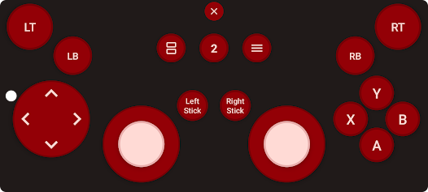

# Product Requirements Document (PRD): PadLink — Low-Latency Android-to-Desktop Gamepad & CLI Daemon

---

## 0. Original Prompt

> i want to make an app for android that turns the phone into a controller that can be used to play games on mac/windows/linux for the desktop side it should be like a cli tool that has a hard cap to only use less that 75mb of ram with an option to connect / disconnect , open at login , run in background options this works when both the laptop and phone are connected on same wifi for both 5ghz and 2.4 ghz should work flawlessly with geforce now or like any other native game too and to connect to the phone and desktop once the user selects his deice on the cli and send a connection request there is a toekn generated of like 6 characters whichs needs to be entered on the cli to authenticate the connection this should be the workflow so according to this make an implementation plan and prd markdown files and also include this origanl prompt in the file

---

## 1. Executive Summary & Product Vision

**PadLink** turns an Android phone into a game controller for a desktop through a native CLI and background daemon. Wi-Fi on 2.4 GHz or 5 GHz is the primary transport. The primary pairing workflow remains: select the phone in the CLI → allow the request on the phone → read its six-character token → enter the token in the CLI.

The product targets GeForce NOW and native games on Windows, macOS, and Linux, with **less than 75 MB of desktop RAM**. These are requirements to prove, not established capabilities. A virtual HID descriptor alone does not establish compatibility with XInput, Apple's GameController framework, or a streaming service.

### Validation status — 2026-11-05

This repository currently contains planning documents and a user-supplied controller layout reference; there is no application, benchmark, driver integration, or device test result. The [implementation plan](IMPLEMENTATION_PLAN.md) defines the work and evidence needed. The original prompt above is preserved verbatim.

The following gates remain open:

| Gate | Requirement and release decision |
| :--- | :--- |
| **G1 — Controller compatibility** | Prove controller recognition and gameplay for each advertised OS, architecture, backend, and game/client combination. macOS native gamepad support and a maintainable Windows driver path are early feasibility gates. Browser-only or keyboard/mouse support does not meet the native-gamepad requirement. |
| **G2 — Memory ceiling** | Prove the resource contract in §6.1. A heap allocator and periodic monitor cannot guarantee a hard RSS ceiling. Portable monitoring is a development fallback, not evidence that the strict requirement is met. |
| **G3 — Pairing and packet security** | Validate the PAKE implementation, mutual key confirmation, directional keys, nonce uniqueness, replay rejection, and authenticated reconnection before mounting a controller. No improvised weaker authentication fallback. |
| **G4 — Network and input safety** | Pass measured latency, packet-loss, short-tap, stale-input, permission-denial, and reconnect tests. Wi-Fi frequency alone cannot guarantee connectivity or latency. |
| **G5 — Fallback readiness** | A fallback must be implemented, capability-probed, and tested for the requested use case before it is offered as working. P1 experiments cannot close P0 release gates. |

---

## 2. Goals & Non-Goals

### 2.1 Goals

1. **Controller compatibility**: Provide a standard gamepad to supported GeForce NOW clients and native games without per-game keyboard mapping. Publish tested combinations and limitations.
2. **Desktop resource ceiling**: Keep the complete PadLink desktop workload below the §6.1 budget, including concurrent CLI and helper processes; prove enforcement separately from benchmark results.
3. **Dual-band resilience**: Support reachable peers on 2.4 GHz, 5 GHz, and mixed-band LANs, with measured latency, bounded retries, and safe input release on failure.
4. **CLI-first pairing**: Require phone consent and a six-character token for every new Wi-Fi or USB session. Resume only a still-live authenticated session.
5. **Lifecycle controls**: Provide connect, disconnect, foreground/background operation, and opt-in open-at-login without automatic re-pairing after a process restart.

### 2.2 Non-Goals and Initial Scope

- Cloud relay, internet remote access, and video streaming are excluded.
- No heavy desktop GUI runtime. Platform signing, native libraries, and optional drivers remain permitted dependencies whose memory must be measured.
- Initially support **one active phone/controller per desktop user**. It may coexist with physical controllers; multiple PadLink phones require later slot arbitration.
- Bluetooth HID and USB are optional P1 fallbacks. Bluetooth uses OS pairing and a direct phone-to-host input path, so it does **not** preserve the CLI token flow or daemon-managed disconnect. Disclose that difference before switching.
- Browser API injection is an experimental web-only mode. Keyboard/mouse mapping is an explicit mapping mode. Neither is advertised as universal gamepad support.

### 2.3 Confirmed CLI and Android Technology Stack

| Layer | Selected stack | Responsibility |
| :--- | :--- | :--- |
| Desktop CLI and background daemon | **Rust 2024**, `clap`, **Tokio current-thread runtime**, `socket2`; optional `ratatui`/`crossterm` TUI | CLI commands, asynchronous networking, session ownership, platform gamepad integration, and resource management. Distribute native builds through the curl/Homebrew channels in §8.1. |
| Native Android app | **Kotlin**, developed in **Android Studio**, built with Gradle Kotlin DSL and the Android SDK | App lifecycle, permissions, connectivity callbacks, touch/sensor input, and Android hardware services. Kotlin app code runs on the phone's **Android Runtime (ART)**. |
| Android interface | **Jetpack Compose** for setup, device status, and pairing; custom **Android View/Canvas** for the multi-touch gamepad | Keep setup UI declarative and controller touch processing independent of Compose recomposition. |
| Shared protocol and crypto | **Rust** library, exposed to Kotlin through **UniFFI/JNI** and built for Android with `cargo-ndk` and the Android NDK | Share pairing, encryption, packet encoding/decoding, and session rules with the desktop. The Android Rust library executes as native code. |

Android Studio is the IDE with build/debugging and emulator tooling; it is not the runtime shipped to the phone. ART runs the Kotlin application's compiled Android bytecode, while JNI connects it to the native Rust library. Users install the built app/CLI without Android Studio or a Rust compiler. The Rust choice supports the resource target but does not by itself close the hard-memory or platform-compatibility gates.

---

## 3. Target Personas & Use Cases

| Persona | Scenario | Key requirement |
| :--- | :--- | :--- |
| Cloud gamer | Uses a phone instead of carrying a controller for GeForce NOW. | Tested controller recognition in the selected native app or browser while streaming. |
| Couch co-op gamer | Adds one controller alongside existing physical controllers. | Predictable player-slot selection, full controls, and no duplicate input. |
| Resource-conscious desktop user | Prefers a terminal companion and background service. | Low measured memory, honest enforcement status, and reliable login/stop behavior. |

---

## 4. End-to-End User Workflow

```mermaid
sequenceDiagram
    autonumber
    actor User
    participant CLI as Desktop CLI
    participant Daemon as Per-user Daemon
    participant Phone as Android App
    participant OS as Gamepad Backend
    User->>Phone: Open app and grant required LAN access
    Phone-->>Daemon: Advertise pairing service and actual endpoint
    User->>CLI: Select phone with padlink connect
    CLI->>Daemon: Pair request over private local IPC
    Daemon->>Phone: Bounded request with desktop name and request ID
    Phone->>User: Allow or deny this unverified desktop request
    User->>Phone: Allow
    Phone->>Phone: Generate and display six-character token (60 seconds)
    User->>CLI: Enter token using hidden terminal input
    CLI->>Daemon: Pass token over private IPC
    Daemon->>Phone: PAKE exchange and mutual key confirmation
    Phone-->>Daemon: Confirm session and negotiated capabilities
    Daemon->>OS: Create selected, supported gamepad in neutral state
    Phone-->>Daemon: Confirm fresh neutral input epoch
    loop Default 120 Hz; 60–240 Hz based on device and network
        Phone->>Daemon: Authenticated state and bounded digital-edge journal
        Daemon->>OS: Apply current axes and ordered button transitions
        OS-->>Daemon: Rumble if supported
        Daemon-->>Phone: Authenticated, bounded-duration rumble
    end
    User->>CLI: padlink disconnect
    Daemon->>OS: Neutralize and remove controller
    Daemon->>Phone: End session and erase secrets
```

The daemon owns all network sockets, session keys, sequence counters, and device handles. Closing the CLI after successful pairing must not interrupt play. Cancelling before pairing succeeds invalidates the pending request and token. Unsupported backends leave the session inactive with a specific next step; they do not show a success message.

---

## 5. Functional Requirements

### 5.1 Desktop CLI & Daemon

| ID | Feature | Requirement | Priority |
| :--- | :--- | :--- | :--- |
| **DT-01** | Discovery | Advertise/discover `_padlink._tcp.local.` for the phone's TCP pairing service; negotiate UDP endpoints after authentication. Use IPv4/IPv6 mDNS, bounded IPv4 broadcast, and manual `IP:port` or `[IPv6%scope]:port`. Broader subnet probes require `scan --probe-subnet`. | P0 |
| **DT-02** | Token authentication | Phone consent, six-character PAKE pairing, mutual confirmation, and protocol/capability validation before any input injection. No token in arguments, logs, QR payloads, or saved config. | P0 |
| **DT-03** | Connect/disconnect | Explicit connect/disconnect and optional TUI; one active session. Release input and rumble before teardown, cancellation, or a backend change. | P0 |
| **DT-04** | Background daemon | Start/stop/restart/status, one instance per user, private IPC, bounded requests, stale-endpoint recovery, and supervised restart with a crash-loop limit. An intentional stop must remain stopped. | P0 |
| **DT-05** | Open at login | Opt-in LaunchAgent on macOS, user Scheduled Task on Windows, and systemd user service on Linux. XDG login fallback is available on graphical Linux sessions; headless non-systemd users use foreground execution with their own supervisor. | P0 |
| **DT-06** | Resource contract | Apply §6.1 consistently to daemon, CLI, and PadLink helpers. Report actual memory metrics and whether OS containment is available. A budget-only mode must not be labeled a hard cap. | P0 / G2 |
| **DT-07** | Gamepad backends | Linux uinput; Windows validated signed virtual-XInput driver; macOS validated virtual-HID API/entitlement path. Select only supported capabilities for the target client. Native controller support remains a gate where unavailable. | P0 / G1 |
| **DT-08** | Input watchdog | With no **fresh authenticated input**, hold for less than 250 ms; at 250 ms neutralize buttons/axes/triggers and latch input off; at 5 s display `RECONNECTING`; at 30 s destroy the virtual device and session. Deadlines run from the last fresh input, not the latest retry. Rearm through a confirmed fresh epoch and neutral state. | P0 |
| **DT-09** | Network diagnostics | Check interfaces, routes, permissions, actual endpoints, and paired bidirectional probes. Outbound UDP may help stateful firewalls but is not a bypass. Report suspected isolation separately from proven permission denial. | P0 |
| **DT-10** | Session resume | Within 30 s, use the live in-memory resume secret and full session identity for mutual challenge/response, endpoint validation, and new traffic keys. A process restart, expired deadline, or explicit disconnect requires a new token. | P0 |
| **DT-11** | TCP input fallback | If pairing TCP succeeds but authenticated UDP probes fail, offer authenticated framed input over the existing TCP connection. Bound queues, discard stale analog snapshots, report transport and latency, and preserve watchdog behavior. | P0 |
| **DT-12** | Focus/input stop | Immediately neutralize on desktop lock/suspend and backend loss. Keyboard/mouse mode also stops on loss of the selected game's focus and has a local emergency stop. Never silently switch to desktop-wide key injection. | P0 |
| **DT-13** | CLI distribution | Distribute the desktop CLI and daemon through an HTTPS curl installer and a project-owned Homebrew tap on supported macOS/Linux hosts. Install tested prebuilt artifacts, verify downloads, explain PATH/setup, and support versioned upgrades/removal. Provide native Windows release archives; Homebrew inside WSL is not the native Windows backend. See §8.1. | P0 |

The neutral timeout is configurable only in the validated **100–250 ms** range. Jitter may produce a recommendation to change it; automatic tuning must never extend held input beyond the configured limit. Freshness includes sample age, checked using authenticated monotonic-clock bounds; a previously unseen sequence number can still carry stale input. Use the conservative sample time for the hold deadline, and remain neutral when freshness cannot be established. Ping, rumble, discovery, duplicate, and invalid packets do not refresh input freshness.

### 5.2 Android Application

| ID | Feature | Requirement | Priority |
| :--- | :--- | :--- | :--- |
| **AN-01** | Listening/discovery | Foreground listening screen advertises actual endpoints and shows permission/connectivity state. Wi-Fi band is optional metadata; unavailable frequency data must not block pairing. | P0 |
| **AN-02** | Token | Generate six characters uniformly from `23456789ABCDEFGHJKLMNPQRSTUVWXYZ` after consent. Expire after 60 s or three failed verification attempts; invalidate on cancellation, success, or a replaced request. | P0 |
| **AN-03** | Controls | Use the user-approved landscape layout in §5.3: two sticks with separate L3/R3 buttons, eight-way D-pad, A/B/X/Y, shoulders, analog triggers, and Back/Start. Guide/Home is available as an optional control in the layout editor. Track pointer IDs and available touch capability; reset on `ACTION_CANCEL`, focus loss, rotation, screen off, and app pause. Support up to ten touches where hardware permits. | P0 |
| **AN-04** | Power/lifecycle | Foreground play with screen kept on; request low-latency Wi-Fi lock on API 29+ and supported fallback on API 28. Locks are best effort and released on exit. Use a compliant connected-device foreground service only if needed; handle OS start restrictions and notification/service permissions. | P0 |
| **AN-05** | Haptics | Capability-probed local feedback; API-appropriate fallback on API 28 and no-op when absent/disabled. Remote rumble is optional, time-limited, and cancelled on pause/disconnect. | P1 |
| **AN-06** | Gyroscope | Optional sensor-based aiming with calibration and manual disable; fall back to touch when the sensor is unavailable. | P2 |
| **AN-07** | Consent/rate limits | Allow/Deny with unverified name and observed address; one pending request. Apply phone-wide and per-source limits (five requests/minute), bounded connections, and cooldown after rejection/failures. A new socket/IP does not reset the global limiter. | P0 |
| **AN-08** | Bluetooth HID | Probe the HID Device profile, OS permissions, host pairing, foreground registration, mapping, and rumble separately. Explain direct Bluetooth mode and its different pairing/disconnect behavior. No fallback promise for devices without this profile. | P1 |
| **AN-09** | QR discovery | Prefer a QR displayed by the phone containing its actual pairing endpoint and short-lived discovery nonce. Desktop scanning is optional; manual endpoint entry is always available. A CLI-generated QR instead requires the reverse-rendezvous implementation in the plan. QR does not replace token authentication. | P1 |
| **AN-10** | LAN permissions | Handle grant, denial, and revocation for the shipping target SDK. Android 17 / target SDK 37+ requires `ACCESS_LOCAL_NETWORK` for this raw-socket workflow; Android 16 opt-in used `NEARBY_WIFI_DEVICES`. QR/manual IP cannot bypass LAN permission denial. | P0 |
| **AN-11** | Layout and size settings | Replace the reference image's center `2` with a settings gear that opens a layout editor. Let users move and resize sticks and gamepad buttons, preview changes, apply/cancel, and reset to the supplied default arrangement. Persist valid custom layouts locally and keep settings/exit reachable. Editing sends neutral input, not gameplay commands. | P0 |

Android behavior above is based on the current [LAN permission documentation](https://developer.android.com/privacy-and-security/local-network-permission) and [Bluetooth HID Device API](https://developer.android.com/reference/android/bluetooth/BluetoothHidDevice); test exact OS/target-SDK combinations before release.

### 5.3 Controller Screen Layout and Customization

**The user's supplied image defines the default controller screen layout.** Preserve its landscape arrangement, charcoal background, deep-red circular controls with dark outlines, pale-pink joystick caps, and light labels/icons. The explicit requested change is to **replace the center `2` with a settings gear** for changing control positions and sizes.



The saved image is the original 526 × 237 reference, unchanged. Its `2` is superseded by the settings behavior below; it is not a player-number display or a Guide/Home button in PadLink.

| Control | Default placement from reference | Behavior |
| :--- | :--- | :--- |
| LT / RT | Large circles at the upper-left / upper-right corners | Left/right analog trigger input, returning to zero on release. |
| LB / RB | Smaller circles below and inward from the triggers | Left/right shoulder buttons. |
| D-pad | Large circle on the left, below LB | Eight-way input including diagonals, with the four visible direction chevrons. |
| Left / right analog sticks | Two large circles across the lower half, left and right of center | Movable pale-pink caps; axes recenter on release/cancel. |
| `Left Stick` / `Right Stick` | Two small circles between and above the analog sticks | Separate momentary L3/R3 buttons; moving a stick does not automatically press its click button. |
| Face buttons | Diamond on the right: **Y top, X left, B right, A bottom** | Standard face-button mapping. |
| View / Back icon | Small upper-center-left button with stacked rectangles | Gamepad Back/View action. |
| Menu / Start icon | Small upper-center-right button with horizontal lines | Gamepad Start/Menu action. |
| Settings gear | Upper center, between View and Menu; replaces `2` | Local layout/size settings only; sends no gamepad button. |
| Close `×` | Small control at the very top center | Neutralize controls and rumble, disconnect, and return to the app's connection screen. |

**Customization:** the gear opens a Compose settings screen with a live layout preview, drag-to-position editing, and size controls for each selected gamepad control. Joystick resizing scales its base/cap together; button resizing preserves its circular shape and label readability. Support Apply, Cancel, and Reset to Default, and retain the last applied layout across app restarts. Guide/Home can be enabled as an additional gamepad control from this editor without overloading the settings gear. The settings and close controls remain accessible app navigation controls.

**Input and screen-size rules:** enter settings by neutralizing current inputs and clearing captured touches. Preview/editor touches never reach the game; returning to play uses the existing fresh-epoch/neutral-rearm flow. Scale the default layout within landscape safe-area insets, preserve left/right grouping and circular proportions, and keep touch targets at least 48 dp without ambiguous overlaps. Validate custom positions/sizes before Apply; on a smaller screen or invalid saved configuration, adapt safely or restore the default with an explanation. Never leave settings/exit off-screen. Hardware cutouts, gesture insets, and the small unlabeled black dot in the reference are not interactive gamepad controls.

---

## 6. Non-Functional Requirements

### 6.1 Memory & CPU Footprint

- **Budget definition**: Interpret the desktop-side requirement as **aggregate PadLink userspace RSS < 75,000,000 bytes** (decimal MB), including concurrent daemon, CLI/TUI, native-messaging host, and any PadLink-owned supervisor/helper. This resolves the previous per-process versus combined ambiguity. Shared RSS pages may be double-counted; use this conservative sum consistently. Report kernel-driver and external browser/game memory separately. An ADB-based developer mode must disclose ADB memory and cannot claim to meet the primary budget without measuring it.
- **Targets, pending measurement**: Active daemon < 15 MB, typical combined daemon + CLI < 20 MB; active CPU < 1.5% of one core at 240 Hz. Benchmark release builds including signing/native framework overhead. A stripped CLI binary < 5 MB is a packaging target, not a static-linking guarantee.
- **Pressure behavior**: At aggregate 50 MB warn; at 60 MB shed optional caches/TUI history and refuse new optional workers; at 65 MB neutralize and perform controlled shutdown with reserved cleanup headroom. Do not wait for a 75 MB breach to begin cleanup. Heap and queue budgets are subordinate limits, not RSS measurements.
- **Containment**: Linux cgroup limits cover only their members and may transiently overshoot; Windows job memory limits measure committed memory; macOS footprint monitoring is sampling. Measure RSS and report cgroup usage, Windows commit, and macOS `phys_footprint` separately. Neither these metrics nor a 1 Hz watchdog prove an absolute cross-platform RSS ceiling.
- **G2 remains open**: Produce a bounded-memory design and platform-specific enforcement argument, plus peak/stress evidence. If only monitored budget compliance is feasible, explicitly record that the original hard-cap requirement is unmet; do not silently declare the gate passed. Supervisor restart is recovery, not proof of compliance.

See [Linux cgroup semantics](https://docs.kernel.org/admin-guide/cgroup-v2.html) and [Windows Job Object limits](https://learn.microsoft.com/en-us/windows/win32/api/winnt/ns-winnt-jobobject_extended_limit_information).

### 6.2 Network & Latency

- Default state transmission is **120 Hz**, selectable within **60–240 Hz** according to hardware, jitter, battery, and thermal load. Touch callbacks are event-driven; a fast sender does not imply equally fast touch sampling.
- Laboratory one-way phone-to-daemon targets: **5 GHz < 8 ms p95 / < 4 ms median**; **2.4 GHz < 20 ms p95 / < 8 ms median**. Synchronize clocks with a measured error bound before reporting one-way results; otherwise publish RTT. Measure touch-to-virtual-device latency separately, including sampling, scheduling, and backend delay.
- Validate same-band and mixed-band conditions while GeForce NOW streams, including correlated loss/reordering. Three transmissions reduce independent loss probability but cannot guarantee zero missed presses; snapshots alone lose short press/release pairs. Use the bounded digital-edge delivery design in the implementation plan and report residual loss and recovery latency.
- DSCP EF (46; traffic-class byte `0xB8` with ECN zero) and Wi-Fi locks are best effort. Correctness cannot depend on router queue mapping, driver support, or permission to set QoS.
- If peers cannot route to each other, QR, manual IP, browser injection, and keyboard mapping do not repair the transport. Suggest a reachable private LAN/hotspot, then a tested independent transport.

### 6.3 Compatibility and Evidence

| Target | Planned path | Validation limit |
| :--- | :--- | :--- |
| Windows 10/11 x64 | Signed ViGEmBus integration initially; replacement-driver evaluation | Legacy Windows versions are compatibility targets, not OS maintenance claims. Test driver security policy, installation/reboot, occupied XInput slots, and actual games. |
| Windows ARM64 | Architecture-specific driver spike; optional BT/web/mapping modes | No native virtual-XInput commitment until a supported ARM64 kernel driver and client are demonstrated. x64 process emulation does not supply a kernel driver. |
| Linux kernel 5.4+, x86_64/aarch64 | uinput/evdev, tested permission and sandbox configuration | PadLink's architecture support does not imply GeForce NOW supports that architecture or distribution. Validate Steam Input/Proton and packaged browsers separately. |
| macOS 13+ Intel/Apple Silicon | Version-appropriate virtual-HID API and signing/entitlement spike | No claim that CoreHID exists on all target releases, or that device creation guarantees GameController recognition. Native support remains G1 until measured. |
| Android API 28+ | Capability-tested touch, LAN sockets, and optional hardware features | Test the oldest supported API and current Android 17 / SDK 37 permission behavior; an untested version is not certified. |

NVIDIA now lists a **native Linux client with Ubuntu 24.04 LTS requirements**. Validate it on the documented hardware/window-system configuration; do not extend that claim to every Linux distribution or to ARM64. Native Windows/macOS and browser support must likewise follow the current [GeForce NOW requirements](https://www.nvidia.com/en-us/geforce-now/system-reqs/). Generic virtual controllers and injected web objects require additional PadLink tests regardless of vendor lists.

---

## 7. Security & Authentication Specification

1. **Threat model**: Untrusted LAN peers may spoof discovery, flood prompts, guess tokens online, replay traffic, or attempt unauthorized input. Discovery names/addresses are not identities. A compromised desktop/phone is outside this pairing protocol's protection.
2. **Pairing**: Six characters from a 32-symbol alphabet provide 30 bits of token entropy. Use a vetted PAKE with fresh ephemeral state, transcript/role binding, explicit mutual key confirmation, and global attempt limits. A 256-bit derived key does not turn the token into a 256-bit password. Pin the actual library/suite and verify its security properties; do not assume crate names establish RFC conformance.
3. **Safe implementation fallback**: Share the Rust protocol/crypto core through UniFFI. If binding generation fails, use a small C ABI/JNI wrapper around the **same** core. If no validated PAKE implementation is available, block pairing. Plain X25519 plus token-keyed HMAC/commit-reveal is not an approved substitute for an analyzed PAKE.
4. **Traffic protection**: HKDF derives separate keys and four-byte nonce prefixes for each direction and transport/epoch. ChaCha20-Poly1305 nonce = four-byte prefix + eight-byte sequence counter (96 bits), with the full 16-byte authentication tag. Authenticate headers; update replay/freshness state only after successful verification. All packet types in one key domain share a counter. Never reset a counter under an existing key.
5. **Resume**: Keep a full random session identity and resume secret in memory only. Rebind addresses through an authenticated bidirectional challenge, not a short session tag or source IP. Derive fresh traffic keys on rearming or transport changes; expire old epochs and reject old queued input. Lost secrets/counters require new pairing.
6. **Local boundaries**: Restrict IPC to the current OS user. The optional extension bridge uses a registered native-messaging host with an allowlisted extension identity and tightly scoped page access. Never expose unauthenticated LAN/loopback endpoints that can control input.
7. **Protocol errors**: Reject unsupported versions, suites, malformed sizes, unrecognized mandatory capabilities, expired requests, and failed confirmation. Show an actionable update/setup error without falling back to plaintext. Redact tokens, traffic/resume keys, and pairing transcripts from logs.

Protocol references: [SPAKE2, RFC 9382](https://www.rfc-editor.org/rfc/rfc9382) and [ChaCha20-Poly1305, RFC 8439](https://www.rfc-editor.org/rfc/rfc8439).

---

## 8. CLI Interface Specification

```text
padlink --version
padlink [tui]                         Interactive dashboard; plain help if not a TTY
padlink scan [--interface NAME] [--probe-subnet]
padlink connect [DEVICE_OR_ENDPOINT] [--ip ADDR] [--port PORT]
                [--transport auto|udp|tcp|usb] [--qr]
padlink disconnect
padlink status [--json]
padlink daemon start|stop|restart|status|run
padlink autostart enable|disable|status
padlink doctor
padlink setup                         Explain and perform requested platform setup
padlink setup-firewall                 Install narrowly scoped rules through OS elevation
padlink backend auto|native|bt-hid|browser|kbm
padlink config get|set                 Validated, versioned settings
```

`usb`, `bt-hid`, `browser`, and `--qr` remain unavailable or explicitly experimental until their P1 gate passes. `--ip` takes an address and can be combined with `--port`; positional endpoints may include a port. No token flag. `connect` needs a terminal for hidden token input; without one it returns a clear error. Do not invoke missing setup helpers such as the old `setup-udev` command.

`status` reports session state, transport, backend and limitations, last fresh input age, measured RTT/loss, memory metrics, enforcement availability, and recovery/crash-loop reason. Examples and screenshots must be labeled illustrative until measured; do not print a fabricated RAM/latency value or “game ready” before a backend is usable.

### 8.1 Download and Installation

**Both curl and Homebrew are required release channels for the desktop CLI/backend.** Installing either channel provides the same `padlink` commands and daemon. There is no separate always-running installer/updater process. Measure transient installation/package-manager resources separately; the runtime RAM budget continues to include the installed CLI/daemon and every resident PadLink helper.

| Channel | Supported hosts | Planned behavior |
| :--- | :--- | :--- |
| Homebrew | macOS/Linux combinations supported by both Homebrew and PadLink | `brew install OWNER/tap/padlink` from the project's `homebrew-tap` repository. Use prebuilt release archives with pinned hashes; no Rust compiler required for supported installs. Update with `brew upgrade OWNER/tap/padlink`. |
| curl installer | Tested macOS/Linux targets, including supported PadLink hosts without Homebrew | Download the HTTPS install script, detect OS/CPU and Linux runtime compatibility, verify the matching release, and install under a user-writable prefix. Default command location: `~/.local/bin/padlink`; explain how to add it to PATH. |
| Direct download | All published native targets, including Windows | Verified versioned archive and manual instructions when a package manager or shell installer is unavailable. Windows uses a native Windows artifact, optionally downloaded with `curl.exe`, plus PowerShell/manual extraction. |

Illustrative commands only: `OWNER` and `downloads.padlink.example` are placeholders. Choose the actual publisher/tap/HTTPS host before release; these endpoints do not currently exist as PadLink distribution channels.

```sh
# Homebrew, once the project tap is published:
brew install OWNER/tap/padlink

# Alternative: download the curl installer successfully before executing it.
# Run in a new working directory; the installer itself uses private staging.
curl --fail --show-error --location --proto '=https' --tlsv1.2 \
  https://downloads.padlink.example/install.sh -o padlink-install.sh &&
  sh ./padlink-install.sh

# After either installation method:
padlink --version
padlink doctor
padlink setup                 # Only when doctor identifies required platform setup
padlink connect
padlink autostart enable      # Optional: open at login
```

Installation must report the version, platform/architecture, install location, and channel. It does not automatically install a gamepad driver, change firewall/udev rules, pair a phone, start the daemon, or enable login startup. Those actions use the existing setup/lifecycle commands. A successful download does not establish native-controller compatibility.

Keep Homebrew-owned files under Homebrew management. Curl upgrades must detect an existing Homebrew install or conflicting PATH entry, explain how to update/switch channels, and avoid silently creating a second daemon installation. Failed verification/download or an unsupported target leaves the current install usable. Both channels need tested upgrade, rollback guidance, and removal that cleans up PadLink login/service entries before binaries disappear while retaining user configuration by default. Homebrew OS support can be narrower than PadLink's runtime support; use a tested curl/direct artifact where that distinction applies.

---

## 9. Success Metrics & Acceptance Criteria

- [ ] **AC-1 / G2 — Memory**: Document aggregate scope and distinct OS metrics; measure startup, concurrent CLI/helper launch, reconnect storms, discovery/IPC floods, active streaming, and an eight-hour soak. Verify pressure cleanup and peak usage. Separately establish the hard-ceiling enforcement argument; sampled success alone cannot pass G2.
- [ ] **AC-2 / G3 — Pairing**: On a reachable test LAN show the phone's consent prompt within 500 ms, then display a token after consent. Authenticate within one second after submission, excluding first-time driver/permission setup. Exercise denial, wrong/expired tokens, cancellation, rate limits, mismatched versions, and mutual-confirmation failure.
- [ ] **AC-3 / G1 — Game compatibility**: Record exact OS/CPU, driver/API, game/client/browser versions, and all control mappings. Test native and web clients separately, including supported Linux GeForce NOW configuration, macOS GameController titles, and Windows player slots. No checked compatibility row without a successful play test.
- [ ] **AC-4 / G4 — Network/input**: Meet §6.2 latency targets on documented routers. Test no loss, 1/5/10% independent loss, 100–500 ms burst loss, duplicates/reordering, a short press/release wholly between regular state ticks, and buffered packets trickling after sender death. Validate sample-age rejection with clock uncertainty/drift. No stuck controls or stale replay; record delivered/lost edges and recovery delay rather than asserting perfect delivery on arbitrary Wi-Fi.
- [ ] **AC-5 — Lifecycle**: Verify start/stop/restart, login enable/disable, logout, lock, suspend/resume, user switching, abrupt kill, stale IPC, and second-instance behavior. Intentional stop/disconnect must not be undone by the supervisor.
- [ ] **AC-6 / G5 — Fallbacks**: Inject each applicable F1–F27 failure below. Show the observed evidence, uncertainty, usable alternatives, and any lost capabilities. A missing optional fallback returns `unavailable`, never a success claim.
- [ ] **AC-7 — Resume**: Force phone/desktop IP changes and outages below/above 30 s. Verify fresh challenge/key epochs and neutral rearm; duplicates/pings cannot extend held-input deadlines. Either peer restarting always requires new pairing.
- [ ] **AC-8 — Android**: Exercise multi-touch cancellation, background/screen-off, thermal throttling, missing sensors/vibrator/HID profile, LAN denial/revocation, Bluetooth permission denial, and foreground-service failure on oldest/current supported Android versions.
- [ ] **AC-9 — Security boundaries**: Negative tests for nonce reuse, cross-direction replay, forged high sequence numbers, invalid packet lengths, malicious discovery text, unauthorized IPC/native messaging, and stale input after backend/transport changes.
- [ ] **AC-10 — Installation/distribution**: On clean supported hosts, install through curl and Homebrew, confirm the same published version and working CLI/daemon commands without a Rust toolchain, then upgrade and remove. Test CPU/runtime mismatch, unavailable Homebrew, missing PATH entry, interrupted download, bad checksum/signature, blocked install directory, duplicate channels, and an active/login-enabled daemon during upgrade/removal. Validate native Windows archives separately. Installation leaves pairing and autostart opt-in.
- [ ] **AC-11 — Controller layout/editor**: Match §5.3's reference arrangement and visual treatment with the center `2` replaced by a working settings gear. Verify face-button order, separate L3/R3, trigger/stick behavior, and View/Start mapping. Move/resize controls, Apply/Cancel/Reset, restart the app, and resize the window on supported screens. Validate safe areas, minimum touch targets, accessible settings/close, invalid saved-layout recovery, and zero game input during editing followed by neutral rearm.

---

## 10. Fallback Matrix & Risk Register

### 10.1 Backend Selection

`auto` chooses an already configured and tested backend that satisfies the requested capabilities. It must not install drivers, launch OS pairing, or switch to keyboard/mouse input silently. A backend change first neutralizes/detaches the old device and then rearms from neutral; avoid duplicate controllers.

| Mode | Prerequisites | Coverage and limitations | Priority |
| :--- | :--- | :--- | :--- |
| Native virtual gamepad | OS-specific driver/API, access, and recognition tests | Primary native + browser goal; support is measured per client, not inferred from vendor/product IDs. | P0 |
| Phone Bluetooth HID | Phone HID Device profile, foreground registration, host Bluetooth, OS pairing | Generic HID mapping; not automatically XInput. Independent transport, different authentication/lifecycle, game/rumble support varies. | P1 |
| Browser bridge | Explicitly enabled extension, native host, tested page/browser versions | Experimental supported web origins only. No system controller, native-game support, or guarantee that GeForce NOW accepts injected objects. Still needs phone-to-daemon transport. | P1 |
| Keyboard/mouse mapping | Game profile plus OS injection permissions and focus control | Loses true analog/controller semantics. Linux uinput permission is still required; Windows elevation/UIPI and macOS Accessibility can block it. Still needs transport. | P1 |

### 10.2 Failure Scenarios & Fallbacks

| ID | Failure / detection | Required behavior and fallback |
| :--- | :--- | :--- |
| **F1** | mDNS discovery timeout | Continue bounded broadcast; offer manual actual endpoint, optional subnet probe, then implemented QR. A timeout is not proof of multicast filtering. |
| **F2** | Peer unreachable / possible client isolation | Check both peers' routes and permissions. Report isolation as suspected unless independently established. Move to a reachable LAN/hotspot or tested BT/USB; QR, TCP, and backend changes cannot cross a blocked LAN. |
| **F3** | Pairing succeeds but UDP probe fails | Send authenticated bidirectional UDP probes; offer framed TCP input if reachable, or narrowly scoped firewall setup. Never disable the firewall. |
| **F4** | macOS Local Network access blocked | Distinguish Terminal, LaunchAgent, and system-daemon launch contexts. Guide access for the responsible signed code and retry after grant; `EHOSTUNREACH` alone is inconclusive. See implementation §4.3. |
| **F5** | Port conflict / discovery port unavailable | Advertise actual selected TCP/UDP ports; show manual `IP:port` on phone. If fixed broadcast discovery cannot bind, disable that path and use mDNS/manual/QR; do not advertise a stale default. |
| **F6** | Band hop / IP change / Wi-Fi loss | Neutral watchdog, authenticated endpoint challenge and fresh epoch within 30 s; otherwise new pairing. Never trust an IP or short tag alone. |
| **F7** | Windows driver unavailable, policy-blocked, or incompatible architecture | Explain signed-driver/reboot requirements; offer only tested alternatives. Do not disable Secure Boot or driver security. Occupied XInput slots require freeing a slot. |
| **F8** | uinput missing, inaccessible, or sandbox-hidden | User-approved module/udev setup or compatible packaging. Keyboard mapping through uinput has the same dependency. No root daemon or world-writable input device. |
| **F9** | macOS HID API/entitlement/recognition fails | Mark native gamepad unavailable. Offer a tested BT/web/mapping mode with reduced coverage; keep native support gate open. |
| **F10** | Memory pressure / containment unavailable | Shed at 60 MB, controlled shutdown at 65 MB, report budget-only status where applicable. Rate-limit recovery; a breach is a failed memory acceptance test. |
| **F11** | Phone paused, locked, killed, or revoked permission | Send neutral if possible; desktop watchdog handles abrupt loss. Clear phone touches/rumble, reacquire permitted resources, and rearm safely or re-pair after process death. |
| **F12** | Daemon crash / stale socket / second instance | Per-user lock and owner-checked IPC cleanup; bounded supervisor retries, idle unpaired restart, and crash-loop diagnostic. Never delete another user's endpoint. |
| **F13** | Game ignores virtual pad | Test correct backend/player slot, game restart, and Steam Input configuration; offer an explicit supported mapping profile. No anti-cheat/security bypass. |
| **F14** | Version/suite mismatch or PAKE unavailable | Clear compatible-version error or disabled pairing; binding fallback retains the same reviewed crypto. No insecure downgrade. |
| **F15** | Android LAN permission denied | Explain and retry after grant. Manual IP/QR are not bypasses; independent BT may be offered only with its own permissions. |
| **F16** | VPN, multiple adapters, IPv6-only LAN, or stale scope | Select an eligible interface, show routed endpoint, use scoped IPv6 unicast/mDNS, and explain VPN route conflicts. No IPv6 broadcast/subnet sweep or automatic VPN disable. |
| **F17** | Bluetooth HID profile/permission/foreground registration fails | Mark BT unavailable and return to a reachable Wi-Fi/TCP or tested USB path. Host pairing alone does not prove game compatibility. |
| **F18** | Extension unavailable, injection rejected, page reload, or host disconnected | Neutralize and stop bridge output; reconnect explicitly to a tested page or choose a working native/BT path. Native messaging and page liveness each have a watchdog. |
| **F19** | USB cable/ADB absent, unauthorized, wrong device, or disconnected | Developer-only setup guidance and explicit device selection; use `adb forward` for the phone-hosted server. Remove only the created tunnel. Fall back to a reachable Wi-Fi path; do not enable wireless debugging. |
| **F20** | Login manager missing / permission prompt unavailable at login | Foreground run with actionable setup guidance; XDG only for graphical Linux login. Do not endlessly restart a permission-blocked process. |
| **F21** | QoS/low-latency lock unsupported, thermal load, or touch hardware limits | Best-effort untagged traffic, lower negotiated rate, simpler rendering, optional features off, and a visible capability warning. Preserve release/cancel behavior. |
| **F22** | Correlated loss, stalled TCP, or exhausted edge journal | Bound queues and retries; release and rearm instead of replaying old commands. Report degraded latency/loss and offer transport/network change. |
| **F23** | Desktop lock/suspend, focus loss in mapping mode, or backend switch | Neutralize, clear pending edges/rumble, and require a fresh input epoch before reactivation. Test abrupt process loss separately from orderly cleanup. |
| **F24** | Homebrew absent/unsupported, no matching artifact, or incompatible OS/CPU/runtime | Offer a tested curl/direct-download artifact where available. Otherwise report the unsupported target; do not install a different architecture or treat WSL as native Windows support. |
| **F25** | Download interrupted, TLS/checksum/signature failure, or release unavailable | Abort before replacing the installed version, clean private staging, and provide a bounded retry or verified direct-download path. Never disable verification or execute a partially downloaded installer. |
| **F26** | PATH/install-permission conflict, mixed install channels, or active daemon during update/removal | Show the exact conflicting paths/channel and remediation. Use a writable prefix, preserve package-manager ownership, coordinate neutral stop/restart and login cleanup, and retain a known-good version for documented rollback. No duplicate daemon or automatic re-pairing. |
| **F27** | Saved layout is corrupt/incompatible, controls overlap or leave the safe area, or window becomes too small | Reject invalid edits, preserve the last valid layout, and offer Reset to Default. Adapt/revalidate after screen changes; if usable controls cannot fit, remain neutral and request landscape/a larger window. Settings and close must stay reachable. |

### 10.3 Key Risks

| Risk | Impact | Mitigation / gate |
| :--- | :--- | :--- |
| macOS HID recognition/signing | Native Mac games may remain unsupported despite device creation. | Early API/entitlement/game spike; no assumption that Karabiner supplies a gamepad. G1. |
| Retired Windows dependency | ViGEmBus and client libraries no longer receive updates. | Pin a verified signed release and source; assess maintained, licensable replacements and architecture coverage before release. Follow the maintainer's [end-of-life guidance](https://docs.nefarius.at/projects/ViGEm/End-of-Life/), including obsolete updater domains. G1. |
| Impossible or undefined absolute RAM claim | Monitoring and kernel accounting may not meet the requested physical-memory guarantee. | Keep scope/units explicit and G2 open until the enforcement contract is resolved. |
| External platform changes | Android permissions, browser/service behavior, and driver policies invalidate tested paths. | Versioned compatibility matrix, denial tests, and revalidation on upgrades. G1/G5. |
| Fallback scope/effort | BT, USB, and browser work can each become separate projects. | Time-box feasibility first; ship only tested optional modes and retain a useful `unavailable` result. |
