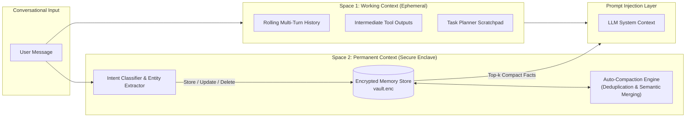
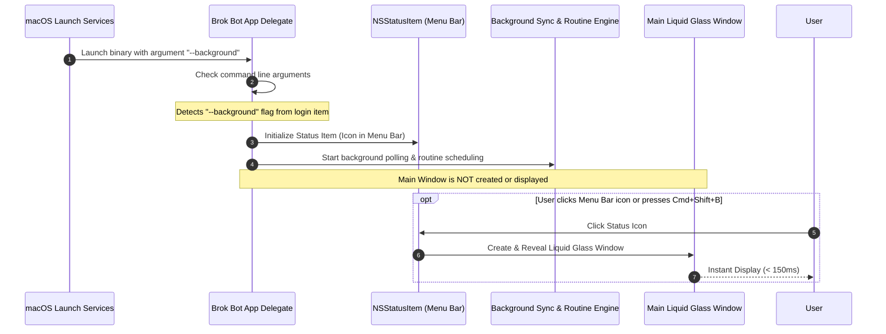
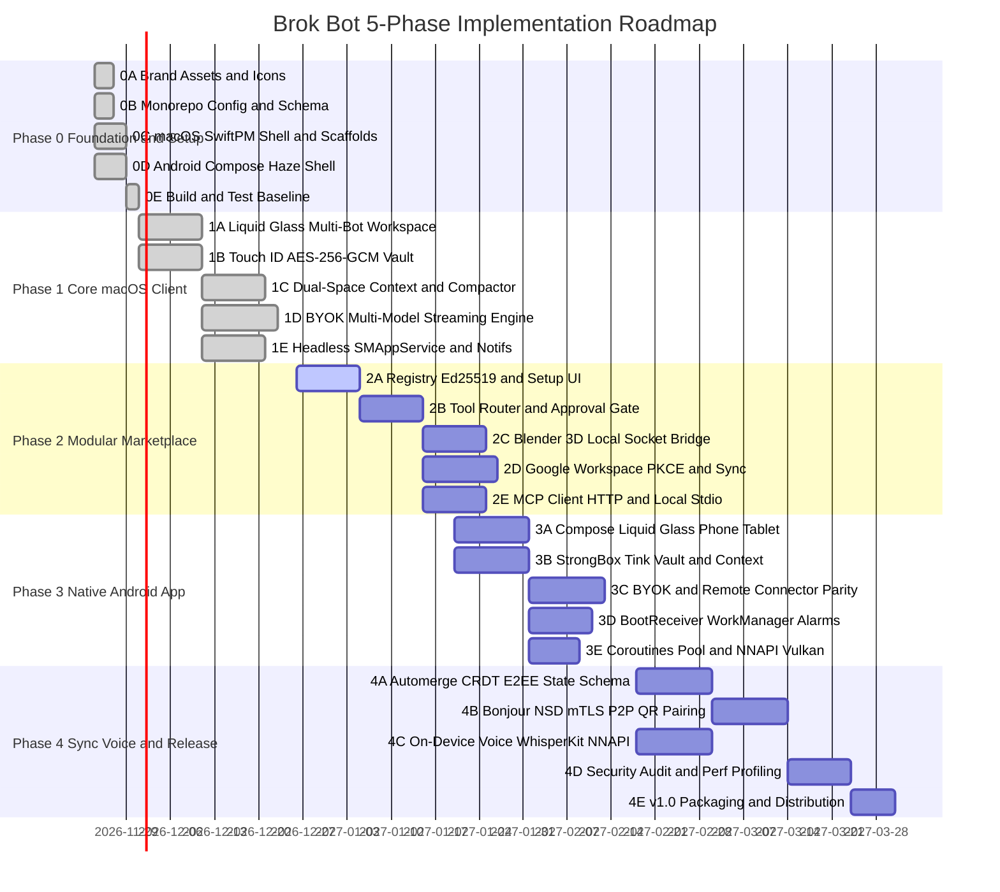

# Brok Bot: Technical Architecture & Implementation Plan

**Project Codename:** Brok Bot  
**Document Version:** 1.3.0  
**Authors:** Brok Bot Core Engineering Team  
**Target Release:** v1.0 MVP  

---

## 1. System Architecture & Component Design

Brok Bot is structured as a dual-client system (macOS Native Swift App & Android Jetpack Compose App) communicating with external LLM endpoints, local tool bridges, and remote MCP servers through a unified runtime architecture.

```mermaid
flowchart TB
    subgraph UI_Layer["Presentation Layer (Clean Minimal Liquid Glass UI)"]
        MacOS_UI["macOS SwiftUI AppKit Shell\n(NSVisualEffectView + .liquidGlass Modifier)"]
        Android_UI["Android Jetpack Compose Shell\n(Haze Library + RenderEffect Blur)"]
    end

    subgraph Core_Runtime["Brok Bot Core Runtime (Shared Logic Architecture)"]
        Orchestrator["Bot Orchestrator\n(Chief of Staff & Specialist Bots)"]
        ModelAdapter["BYOK Model Adapter\n(OpenRouter, Gemini, Claude, OpenAI, NIM)"]
        ToolRouter["Dynamic Tool Router & Approval Gate"]
        SyncEngine["Automerge CRDT P2P Sync Engine\n(Bonjour / mDNS + mTLS WebSocket)"]
        RoutineScheduler["Client-Side Routine & Polling Engine"]
        
        subgraph DualContextEngine["Dual-Space Context Management"]
            WorkingContext["Working Context Space (Ephemeral Scratchpad)"]
            PermanentContext["Permanent Memory Enclave (Auto-Compacting)"]
            MemoryRouter["Natural Language Memory Router\n('Store', 'Update', 'Delete')"]
            Compactor["Semantic Auto-Compactor Engine"]
            
            MemoryRouter --> PermanentContext
            PermanentContext <--> Compactor
        end

        subgraph ComputeSettings["Compute & Concurrency Engine"]
            ThreadPool["Worker Thread Pool (1, 2, 4 Threads)"]
            HWAccel["Hardware Acceleration (Metal / ANE / NNAPI)"]
        end
    end

    subgraph Security_Layer["Hardware Security Layer"]
        MacVault["macOS LocalAuth Vault\n(Touch ID + Argon2id + AES-256-GCM)"]
        AndroidVault["Android StrongBox Vault\n(Android Keystore + Tink + Biometrics)"]
    end

    subgraph Background_Layer["Silent Background Daemons"]
        MacDaemon["macOS SMAppService Headless Daemon\n(Open at Login, No Window)"]
        AndroidDaemon["Android WorkManager + BootReceiver\n(BOOT_COMPLETED Silent Start)"]
    end

    subgraph Connectors_Layer["Tool & Connector Bridges"]
        MarketplaceClient["Marketplace Manifest Client\n(Remote Catalog Poller & Dynamic Config)"]
        BlenderBridge["Blender Socket Bridge\n(TCP JSON-RPC to localhost:9876)"]
        GoogleBridge["Google Workspace REST Client\n(OAuth 2.0 PKCE + Delta Polling)"]
        MCPClient["Model Context Protocol Client\n(Streamable HTTP / Local Stdio)"]
    end

    MacOS_UI --> Orchestrator
    Android_UI --> Orchestrator
    Orchestrator --> DualContextEngine
    Orchestrator --> ComputeSettings
    Orchestrator --> ModelAdapter
    Orchestrator --> ToolRouter
    Orchestrator --> SyncEngine
    Orchestrator --> RoutineScheduler

    PermanentContext --> MacVault
    PermanentContext --> AndroidVault

    RoutineScheduler --> MacDaemon
    RoutineScheduler --> AndroidDaemon

    ToolRouter --> MarketplaceClient
    ToolRouter --> BlenderBridge
    ToolRouter --> GoogleBridge
    ToolRouter --> MCPClient
```



### 1.1. Repository & Monorepo Layout

Brok Bot uses a single monorepo organized by platform client, shared specifications, brand assets, dynamic connector manifests, and build automation:

```text
.
├── .gitignore
├── LICENSE
├── README.md
├── assets/                                    # Master logo, PNG derivatives, platform icons & SVG suite
│   ├── README.md                              # Brand & 17-icon SVG asset catalog
│   ├── logo.jpg                               # Untouched canonical 1024x1024 brand mark
│   ├── logo.png / logo-512.png / logo-256.png
│   └── icons/
│       ├── macos/                             # AppIcon.iconset/ + compiled AppIcon.icns
│       ├── android/                           # mipmap-{mdpi..xxxhdpi}/ic_launcher.png + drawable/brok_logo.png
│       └── svg/                               # 17-icon Liquid Glass SVG suite (brok-mark, menu bar template, 15 UI icons)
├── docs/                                      # Product & engineering specifications
│   ├── PRD.md
│   └── IMPLEMENTATION_PLAN.md
├── macos/                                     # Native macOS SwiftPM package (Swift 6, macOS 14+)
│   ├── Package.swift
│   ├── Sources/
│   │   ├── BrokBotCore/                       # Core runtime library
│   │   │   ├── Compute/BrokComputeEngine.swift
│   │   │   ├── Context/
│   │   │   │   ├── DualSpacePromptAssembler.swift
│   │   │   │   ├── PermanentMemoryStore.swift
│   │   │   │   └── WorkingContextStore.swift
│   │   │   ├── Marketplace/ConnectorManifest.swift
│   │   │   ├── Models/
│   │   │   │   ├── BotPersona.swift
│   │   │   │   ├── ChatMessage.swift
│   │   │   │   └── ConversationThread.swift
│   │   │   ├── Notifications/LocalNotificationSpec.swift
│   │   │   ├── Providers/
│   │   │   │   ├── BYOKModelClient.swift
│   │   │   │   ├── BYOKProvider.swift
│   │   │   │   ├── BYOKTypes.swift
│   │   │   │   └── SSEStreamParser.swift
│   │   │   └── Vault/BrokVaultManager.swift
│   │   └── BrokBotApp/                        # Native Liquid Glass AppKit & SwiftUI client
│   │       ├── App/
│   │       │   ├── BrokBotAppDelegate.swift
│   │       │   ├── GlobalHotkeyManager.swift
│   │       │   ├── LocalNotificationManager.swift
│   │       │   └── MenuBarPopoverView.swift
│   │       ├── Resources/
│   │       │   ├── AppIcon.icns
│   │       │   ├── brok-menubar-template.svg
│   │       │   └── logo.png
│   │       └── UI/
│   │           ├── LiquidGlassModifier.swift
│   │           ├── MainWorkspaceView.swift
│   │           ├── PersonaEditorSheet.swift
│   │           ├── SettingsSheetView.swift
│   │           └── WorkspaceViewModel.swift
│   └── Tests/BrokBotCoreTests/                # XCTest suite
│       ├── BYOKModelClientTests.swift
│       ├── BrokBotCoreTests.swift
│       └── VaultAndContextTests.swift
├── android/                                   # Native Android Gradle project (Kotlin 2.2, Compose, Min SDK 28)
│   ├── settings.gradle.kts
│   ├── build.gradle.kts
│   ├── gradle/libs.versions.toml
│   ├── gradlew / gradlew.bat
│   └── app/src/
│       ├── main/
│       │   ├── java/org/brokbot/android/      # UI, core runtime, WorkManager & BootReceiver
│       │   └── res/drawable/ic_brok_notification.xml  # Monochrome status-bar vector drawable
│       └── test/java/org/brokbot/android/     # JVM unit tests
├── marketplace/                               # Server-side modular connector schema & catalog
│   ├── catalog.json
│   ├── schema/connector-manifest.schema.json
│   └── manifests/                             # Individual connector manifests (blender-3d, google-workspace)
└── scripts/                                   # Build, signing, and release scripts
    └── build-macos.sh                         # Release build + BrokBot.app bundle + ad-hoc codesign
```

| Directory / File | Responsibility | Primary Owner / Phase |
| :--- | :--- | :--- |
| `assets/` | Untouched source `logo.jpg`, PNG exports, macOS `.icns`, Android launcher icons, and `icons/svg/` (17-icon Liquid Glass SVG suite) | Phase `0A`, `1` |
| `docs/` | Product Requirements (`PRD.md`) and Technical Architecture (`IMPLEMENTATION_PLAN.md`) | Phase `0B`, `1` |
| `marketplace/` | JSON Schema Draft 2020-12 manifest validation, remote catalog index, connector manifests | Phase `0B`, `2A`–`2E` |
| `macos/` | `BrokBotCore` (`Vault/`, `Context/`, `Models/`, `Providers/`, `Notifications/`), `BrokBotApp` (`App/`, `UI/`, `Resources/`), `XCTest` suite | Phase `0C`, `1A`–`1E`, `2B`–`2E`, `4A`–`4E` |
| `android/` | Jetpack Compose `haze` Liquid Glass client, `res/drawable/ic_brok_notification.xml`, StrongBox Vault, `WorkManager` / `BootReceiver` | Phase `0D`, `1`, `3A`–`3E`, `4A`–`4E` |
| `scripts/` | macOS `.app` bundle assembly, ad-hoc signing (`codesign -s -`), and release packaging | Phase `0C`, `4E` |
| `.gitignore`, `LICENSE`, `README.md` | Repo hygiene (ignoring `.build/`, `dist/`, `.gradle/`, `vault.enc`), Apache 2.0 license, onboarding | Phase `0B`, `1` |

---

## 2. Technology Stack & Dependency Selection

### 2.1. macOS Client (Swift & SwiftUI)
| Component | Library / Framework | Version / Requirement | License | Justification |
| :--- | :--- | :--- | :--- | :--- |
| **Language & SDK** | Swift 6 / macOS SDK | macOS 14.0+ (Sonoma, Sequoia) | Apple | Native performance, memory safety, concurrency. |
| **UI Framework** | SwiftUI + AppKit | macOS 14.0+ | Apple | Translucent glass effects, modern lifecycle. |
| **Glass Effects** | `NSVisualEffectView` + Custom ViewModifier | AppKit Native | Apple | True system-level backdrop blur & specular highlights. |
| **Model Connectivity** | URLSession (Native async/await) | Native Foundation | Apple | Zero external dependencies for HTTP/SSE streaming. |
| **MCP Integration** | `modelcontextprotocol/swift-sdk` | Official MCP Swift SDK | MIT | Direct support for MCP tool calling & Streamable HTTP. |
| **Local Speech / Audio** | `Argmax/WhisperKit` | Latest Release | MIT | Fast, on-device Whisper speech recognition via CoreML. |
| **Hardware Accel** | Metal & Apple Neural Engine (ANE) | CoreML / Accelerate | Apple | High-speed local embeddings & audio inference. |
| **Decentralized Sync** | `automerge/automerge-swift` | Latest Release | MIT | Battle-tested CRDT for local-first peer synchronization. |
| **Local Notifications** | `UserNotifications.framework` | Built-in | Apple | Zero server push; supports interactive notification actions. |
| **Background Daemon** | `ServiceManagement` (`SMAppService`) | macOS 13.0+ | Apple | Silent "Open at Login" headless execution. |

### 2.2. Android Client (Kotlin & Jetpack Compose)
| Component | Library / Framework | Version / Requirement | License | Justification |
| :--- | :--- | :--- | :--- | :--- |
| **Language & SDK** | Kotlin 2.2+ / Android SDK | Android 9.0+ (Min SDK 28, Target 35) | Google | Modern Android standard with Compose compiler plugin. |
| **UI Framework** | Jetpack Compose | Compose BOM 2025.09.00+ | Apache 2.0 | Declarative UI, reactive state binding. |
| **Glass Effects** | `chrisbanes/haze` | `1.3.1` | Apache 2.0 | Real-time dynamic backdrop blur (`hazeSource` / `hazeEffect`). |
| **Hardware Accel** | Android NNAPI / Vulkan | Android NDK / MediaPipe | Google / Khronos | Hardware accelerated local ML & graphics. |
| **Background Tasks** | AndroidX `WorkManager` | `2.10.1`+ | Apache 2.0 | Battery-optimized periodic execution. |
| **Precise Alarms** | `AlarmManager` | Native Android | Google | Schedules morning briefings and routines down to the second. |
| **Vault & Crypto** | Android Keystore + Google Tink | Security Crypto 1.1+ | Apache 2.0 | Hardware-backed key management and encrypted DataStore. |
| **Decentralized Sync** | `automerge/automerge-kt` | Latest Release | MIT | Kotlin bindings for Automerge CRDT. |

---

## 3. Dual-Space Context Management Architecture



### 3.1. Space 1: Working Context Engine
- **Lifecycle:** Session-bound and ephemeral. Scoped to the current thread or sub-agent task.
- **Sliding Context Window:** Implements a token-bounded FIFO queue. When the conversation exceeds the model's target threshold (e.g., 8,000 tokens for working context), an automated background summarizer compresses older turns into a single synthetic turn while preserving tool call references.

### 3.2. Space 2: Permanent Context Enclave Manager
- **Storage:** Persisted strictly inside the hardware-backed encrypted vault (`vault.enc`) via AES-256-GCM. Unlocked in memory via Touch ID or Android Biometrics.
- **Natural Language Memory Commands:**
  The runtime interceptor classifies user prompts for memory intents before invoking the model:
  1. **Store Intent:** Pattern `/(?:store|remember|save)\s+(?:this\s+)?(?:in\s+(?:your\s+)?memory:?\s*)(.+)/i`
     - Action: Extracts facts, generates semantic embeddings, and stores in the enclave memory table with category tags (`preference`, `identity`, `routine`, `credential_reference`).
  2. **Update Intent:** Pattern `/(?:update\s+(?:my\s+)?memory\s+(?:about\s+)?)(.+)\s+(?:to|with)\s+(.+)/i`
     - Action: Queries existing memories with vector similarity > 0.85, updates the content in place, and logs a revision timestamp.
  3. **Delete / Forget Intent:** Pattern `/(?:forget|delete\s+(?:from\s+)?(?:your\s+)?memory:?\s*)(.+)/i`
     - Action: Locates matching records, securely overwrites the memory record with zeros, and purges the vector index.

#### Swift Implementation: Memory Intent Handler
```swift
import Foundation

public struct MemoryEntry: Codable, Identifiable {
    public let id: UUID
    public var category: String
    public var content: String
    public var lastUpdated: Date
    public var confidence: Float
}

public actor PermanentContextEnclaveManager {
    private let vault: BrokVaultManager

    public init(vault: BrokVaultManager) {
        self.vault = vault
    }

    public func executeMemoryCommand(_ input: String) async throws -> String? {
        let trimmed = input.trimmingCharacters(in: .whitespacesAndNewlines)
        
        // Match Store
        if let match = trimmed.range(of: #"(?i)^store (?:this in your )?memory:\s*(.+)"#, options: .regularExpression) {
            let fact = String(trimmed[match]).replacingOccurrences(of: #"(?i)^store (?:this in your )?memory:\s*"#, with: "", options: .regularExpression)
            try await saveFact(fact, category: "user_preference")
            return "Saved to your permanent memory in secure storage."
        }
        
        // Match Forget
        if let match = trimmed.range(of: #"(?i)^forget (?:about )?(.+)"#, options: .regularExpression) {
            let target = String(trimmed[match]).replacingOccurrences(of: #"(?i)^forget (?:about )?"#, with: "", options: .regularExpression)
            let deletedCount = try await purgeFacts(matching: target)
            return "Removed \(deletedCount) record(s) from your permanent memory."
        }
        
        return nil // Normal conversation
    }

    public func autoCompact() async throws {
        // Runs deduplication, merges conflicting records, and clusters related facts
        var entries = try await fetchAllDecryptedEntries()
        entries = SemanticCompactor.consolidate(entries)
        try await overwriteEncryptedEntries(entries)
    }
}
```

---

## 4. Clean Minimal Liquid Glass UI Architecture

### 4.1. macOS SwiftUI Liquid Glass Modifier
The macOS interface utilizes `NSVisualEffectView` with `.behindWindow` blending, complemented by a delicate specular stroke and ambient persona glow:

```swift
import SwiftUI
import AppKit

public struct LiquidGlassModifier: ViewModifier {
    var cornerRadius: CGFloat = 18.0
    var glowColor: Color = Color.cyan

    public func body(content: Content) -> some View {
        content
            .background(
                ZStack {
                    // Frosted system material
                    VisualEffectBackground(material: .sidebar, blendingMode: .behindWindow)
                    
                    // Ambient Bot Glow
                    RadialGradient(
                        colors: [glowColor.opacity(0.12), Color.clear],
                        center: .topLeading,
                        startRadius: 10,
                        endRadius: 280
                    )
                }
            )
            .clipShape(RoundedRectangle(cornerRadius: cornerRadius, style: .continuous))
            .overlay(
                // Specular Light Gradient Border
                RoundedRectangle(cornerRadius: cornerRadius, style: .continuous)
                    .strokeBorder(
                        LinearGradient(
                            stops: [
                                .init(color: Color.white.opacity(0.20), location: 0.0),
                                .init(color: Color.white.opacity(0.04), location: 0.5),
                                .init(color: Color.white.opacity(0.10), location: 1.0)
                            ],
                            startPoint: .topLeading,
                            endPoint: .bottomTrailing
                        ),
                        lineWidth: 1.0
                    )
            )
            .shadow(color: Color.black.opacity(0.15), radius: 15, x: 0, y: 8)
    }
}

public struct VisualEffectBackground: NSViewRepresentable {
    let material: NSVisualEffectView.Material
    let blendingMode: NSVisualEffectView.BlendingMode

    public func makeNSView(context: Context) -> NSVisualEffectView {
        let view = NSVisualEffectView()
        view.material = material
        view.blendingMode = blendingMode
        view.state = .active
        return view
    }

    public func updateNSView(_ nsView: NSVisualEffectView, context: Context) {}
}
```

### 4.2. Android Jetpack Compose Liquid Glass Surface
Using Chris Banes' `haze` (`1.3.1`) library on Jetpack Compose:

> **Haze 1.3.1 API Note:** `hazeEffect` (and legacy `hazeChild`) do **not** accept a `shape` parameter. Mark the ambient backdrop with `Modifier.hazeSource(state = hazeState)` and clip foreground glass cards with `Modifier.clip(shape).hazeEffect(state = hazeState)` before applying the translucent fill and specular border.

```kotlin
import androidx.compose.foundation.background
import androidx.compose.foundation.border
import androidx.compose.foundation.layout.Box
import androidx.compose.foundation.layout.BoxScope
import androidx.compose.foundation.shape.RoundedCornerShape
import androidx.compose.runtime.Composable
import androidx.compose.ui.Modifier
import androidx.compose.ui.draw.clip
import androidx.compose.ui.graphics.Brush
import androidx.compose.ui.graphics.Color
import androidx.compose.ui.unit.dp
import dev.chrisbanes.haze.HazeState
import dev.chrisbanes.haze.hazeEffect
import dev.chrisbanes.haze.hazeSource
import dev.chrisbanes.haze.rememberHazeState

@Composable
fun LiquidGlassBackdropContainer(
    modifier: Modifier = Modifier,
    backdropContent: @Composable BoxScope.() -> Unit,
    foregroundContent: @Composable BoxScope.(HazeState) -> Unit
) {
    val hazeState = rememberHazeState()
    Box(modifier = modifier) {
        Box(modifier = Modifier.matchParentSize().hazeSource(state = hazeState)) {
            backdropContent()
        }
        foregroundContent(hazeState)
    }
}

@Composable
fun LiquidGlassSurface(
    hazeState: HazeState,
    glowColor: Color = Color(0xFF00E5FF),
    modifier: Modifier = Modifier,
    content: @Composable BoxScope.() -> Unit
) {
    val shape = RoundedCornerShape(20.dp)
    val specularBrush = Brush.linearGradient(
        colors = listOf(
            Color.White.copy(alpha = 0.22f),
            glowColor.copy(alpha = 0.08f),
            Color.White.copy(alpha = 0.12f)
        )
    )

    Box(
        modifier = modifier
            .clip(shape)
            .hazeEffect(state = hazeState)
            .background(Color.Black.copy(alpha = 0.28f), shape = shape)
            .border(width = 1.dp, brush = specularBrush, shape = shape),
        content = content
    )
}
```

---

### 4.3. Bot Creation, Customization, and Attention Notifications

Extend the existing macOS persona editor and approval flow, then bring the same experience to Android in phases 3A and 3D.

#### Create or edit a bot

1. Open **Teammates → + → New Bot**. Start with a blank bot or use a built-in persona as a starting point.
2. Enter a **name**, **role**, and **custom instructions**. Show the instructions in an editable field when starting from a preset. Use the saved instructions when assembling prompts for that bot.
3. Choose a **profile shape**, **color**, and **face or icon**. Use original solid-color silhouettes with simple eye shapes, inspired by the supplied reference. Include circles, rounded squares, soft triangles, clouds, and pebbles. Offer color swatches and a custom picker. Show a live preview at the sizes used in the teammate list and chat header. Give each option a readable label and show selection with an outline or checkmark.
4. Choose whether that bot can send **Needs attention** notifications, then select **Create Bot**. Open the new bot's chat and show its avatar in the list and header. **Edit Bot** reopens the same form and keeps the bot's existing conversations.

Save appearance and notification preferences with the existing persona record. Load a default avatar for older records and retain their saved colors and icons. The bot's instructions and notification preferences leave connector authorization under the existing account scopes and approval gate.

#### When a bot needs attention

| Situation | Local notification | What happens next |
| --- | --- | --- |
| A task is ready for review or needs an answer | Show the bot's name and a short status. | Tapping opens the specific chat or task. |
| A tool is paused for a yes-or-no approval | Show the bot's name, a brief action summary, and **Allow once** and **Deny**. | **Allow once** resumes the exact pending action after access checks. **Deny** cancels the action and records the decision in chat. |
| A request requires sign-in, unlocking the vault, or more input | Show **Review in Brok Bot**. | Open the matching request in the app so the user can complete the required step and make a decision. |

Use the same pending request for the chat card and notification. Post through the device's local notification APIs from an active task or supported background routine. Keep the request in chat when notifications are muted, disabled, or dismissed. Use a generic lock-screen summary for private tasks and include only an opaque request ID in the notification's action data. Use **Review in Brok Bot** when the preview hides details the user needs to make a decision.

Route both notification buttons through the existing approval gate. Check that the request is still pending, the action still matches what the user saw, and the relevant connector access is still valid. Apply a decision at most once, dismiss the notification after resolution, and show expired requests in chat. Requests that cannot resume after a restart expire. The notification approves a single app action. Use the platform's consent screen for OS permissions and the provider's consent screen for connector access.

On macOS, extend `PersonaEditorSheet`, `BotPersona`, `LocalNotificationSpec`, and `LocalNotificationManager`. On Android, use a Compose editor and `NotificationManager` with scoped action intents that route to the same approval logic used in chat. [Apple notification actions](https://developer.apple.com/documentation/usernotifications/declaring-your-actionable-notification-types) · [Android notification actions](https://developer.android.com/develop/ui/views/notifications/build-notification#Actions)

---

## 5. Performance, Multithreading & Hardware Acceleration

### 5.1. Concurrency Engine Configuration
Users can choose between `1`, `2`, `4`, or `Auto` worker threads in Settings:

```swift
public final class BrokComputeEngine: @unchecked Sendable {
    public static let shared = BrokComputeEngine()
    private var workerQueue: OperationQueue

    private init() {
        workerQueue = OperationQueue()
        workerQueue.name = "org.brokbot.compute"
        setThreadCount(4) // Default
    }

    public func setThreadCount(_ threads: Int) {
        workerQueue.maxConcurrentOperationCount = max(1, min(threads, ProcessInfo.processInfo.processorCount))
    }

    public func configureHardwareAcceleration(enabled: Bool) {
        #if os(macOS)
        // Configure CoreML / Metal dispatch
        let config = MLModelConfiguration()
        config.computeUnits = enabled ? .all : .cpuOnly
        #endif
    }
}
```

---

## 6. Headless Background Startup & macOS "Open at Login"

### 6.1. Silent Login Item Architecture (`SMAppService`)
Brok Bot includes a headless execution mode that starts at login without presenting any main UI:



#### Implementation in `AppDelegate.swift`:
```swift
import AppKit
import ServiceManagement

@main
class AppDelegate: NSObject, NSApplicationDelegate {
    var statusItem: NSStatusItem?
    var mainWindowController: NSWindowController?

    func applicationDidFinishLaunching(_ notification: Notification) {
        let isHeadless = CommandLine.arguments.contains("--background")
        
        // 1. Always create the Menu Bar Status Item
        setupStatusBarItem()

        // 2. Initialize background sync workers and routine timers
        BrokBackgroundSyncManager.shared.start()

        // 3. Only show main window if NOT launched silently at login
        if !isHeadless {
            showMainWindow()
        }
    }

    func toggleOpenAtLogin(enabled: Bool) throws {
        let service = SMAppService.loginItem(identifier: "org.brokbot.mac.helper")
        if enabled {
            try service.register()
        } else {
            try service.unregister()
        }
    }

    @objc func statusBarClicked() {
        showMainWindow()
    }

    func showMainWindow() {
        if mainWindowController == nil {
            mainWindowController = MainWindowController()
        }
        mainWindowController?.showWindow(nil)
        NSApp.activate(ignoringOtherApps: true)
    }
}
```

---

## 7. Phased Implementation Roadmap

Brok Bot execution is divided into **5 structured phases (Phase 0 through Phase 4)**, progressing from bootstrapped cross-platform foundations to v1.0 release. Each phase breaks down into parallelizable sub-phases (`A`–`E`) with explicit target paths, prerequisites, and objective verification gates.



---

### Phase 0: Foundation, Branding & Project Setup (Status: Completed)

- **Goal:** Establish the unified monorepo structure, brand iconography, license/ignore hygiene, declarative connector schema, compilable Liquid Glass shells on macOS and Android, and an automated build-and-test baseline.
- **Sub-Phases & Concrete Deliverables:**
  - **0A — Brand Assets & Icons (`assets/`):** Copy master `logo.jpg` (1024×1024), generate lossless PNG derivatives (`logo.png`, `logo-512.png`, `logo-256.png`), compile macOS `AppIcon.iconset/` and `AppIcon.icns`, export Android density icons (`mipmap-{mdpi,hdpi,xhdpi,xxhdpi,xxxhdpi}/ic_launcher.png`, `drawable/brok_logo.png`), and document asset usage in `assets/README.md`.
  - **0B — Monorepo Config & Marketplace Schema (`.gitignore`, `LICENSE`, `marketplace/`):** Create root `.gitignore` and Apache 2.0 `LICENSE`; update `docs/IMPLEMENTATION_PLAN.md` (`v1.2.0`) and `README.md`; define `marketplace/schema/connector-manifest.schema.json` (JSON Schema Draft 2020-12) and starter `marketplace/catalog.json` + manifests (`blender-3d`, `google-workspace`).
  - **0C — macOS SwiftPM Liquid Glass Shell & Core Scaffolds (`macos/`, `scripts/build-macos.sh`):** Configure Swift 6 `Package.swift` (`BrokBotCore`, `BrokBotApp`, `BrokBotCoreTests`), core scaffolds (`BotPersona`, `ChatMessage`, `WorkingContextStore`, `PermanentMemoryStore` + `MemoryCommandParser` + `SemanticCompactor` + `BrokVaultStoring`, `BrokComputeEngine`, `BYOKProvider`, `ConnectorManifest`), AppKit/SwiftUI `BrokBotAppDelegate` (`--background` login flag + `SMAppService`), `LiquidGlassModifier`, `MainWorkspaceView`, `SettingsSheetView`, unit tests, and `scripts/build-macos.sh` ad-hoc `.app` bundler.
  - **0D — Android Jetpack Compose Haze Shell & Core Scaffolds (`android/`):** Configure Gradle Kotlin DSL + `libs.versions.toml` (AGP `8.11.1`, Kotlin `2.2.10`, Compose BOM `2025.09.00`, Haze `1.3.1`), `AndroidManifest.xml`, `BrokApplication`, `MainActivity`, `LiquidGlassSurface` (`hazeSource` + `clip(shape).hazeEffect`), `BrokHomeScreen`, `DualSpaceContext`, `BrokComputeConfig`, `BYOKProvider`, `BrokBootReceiver`, `BrokRoutineWorker`, and JVM unit tests.
  - **0E — Automated Build & Test Baseline:** Verify JSON validity across `marketplace/`, confirm zero broken markdown/asset links, and validate green builds + unit tests on both macOS and Android.
- **Target Paths:** `assets/**`, `docs/IMPLEMENTATION_PLAN.md`, `README.md`, `.gitignore`, `LICENSE`, `marketplace/**`, `macos/**`, `scripts/build-macos.sh`, `android/**`.
- **Dependencies:** None (greenfield repository bootstrap; `0A`–`0D` execute concurrently, converging at `0E`).
- **Exit Criteria / Verification Gate:**
  - `python3 -m json.tool` succeeds on all files in `marketplace/`.
  - `cd macos && swift test && swift build` passes with zero errors, and `bash scripts/build-macos.sh && codesign --verify --deep --strict macos/dist/BrokBot.app` succeeds.
  - `cd android && JAVA_HOME=.../temurin-17.jdk/Contents/Home ANDROID_HOME=.../Android/sdk ./gradlew testDebugUnitTest assembleDebug` reports `BUILD SUCCESSFUL` and emits `app-debug.apk`.
  - `git status --short` shows no untracked build artifacts (`.build/`, `dist/`, `.gradle/`, `app/build/`, `.DS_Store`, `local.properties`).

---

### Phase 1: Core macOS Client, Dual-Space Context & BYOK Engine (Status: Completed)

- **Goal:** Deliver a daily-usable native macOS AI teammate app featuring Touch ID enclave storage, auto-compacting Dual-Space memory, streaming BYOK multi-model conversations, and silent Open-at-Login background operation.
- **Sub-Phases & Concrete Deliverables:**
  - **1A — Liquid Glass Multi-Bot Workspace UI & Cohesive SVG Suite:** Expand `MainWorkspaceView`, `WorkspaceViewModel`, and `SettingsSheetView` with `ConversationThread` / `WorkspacePersistenceStore` multi-thread persistence, `PersonaEditorSheet` custom specialist bot CRUD (name, instructions, persona glow color, SF Symbol, pinned tools), streaming markdown/code response cards with token usage pills, and translucent floating toolbar controls; pair with the 17-icon Liquid Glass SVG vector suite (`assets/icons/svg/`) and Android notification vector drawable (`android/app/src/main/res/drawable/ic_brok_notification.xml`).
  - **1B — Hardware Vault (`LocalAuthentication` Touch ID + `HKDF<SHA256>` + AES-256-GCM `vault.enc`):** Implement production `BrokVaultManager` conforming to `BrokVaultStoring`, replacing `InMemoryVaultStore`. Derive per-write encryption keys with `HKDF<SHA256>` (32-byte random salt + `org.brokbot.vault.v1` AAD) wrapped by `KeychainBiometricKeyProvider` (`LAContext` Touch ID / biometric prompt) or `PassphraseVaultKeyProvider`, persisting atomic `0600` AES-256-GCM encrypted `vault.enc` for BYOK API keys and permanent memory entries with tamper detection and memory zeroing (`VaultAndContextTests.swift`).
  - **1C — Dual-Space Context Engine, Prompt Assembler & Memory Inspector:** Upgrade `WorkingContextStore` with rolling token-budget compaction (`rollingSummary()` / `contextWindowMessages()` / `replaceMessage(...)`); augment `PermanentContextEnclaveManager` with automatic category inference, `Store`/`Update`/`Forget` commands, `SemanticCompactor` cosine similarity deduplication & superseding consolidation, and `DualSpacePromptAssembler`; add a full Settings Memory Inspector (live search/filter, inline edit via `updateFact`, manual compact, cryptographic purge).
  - **1D — BYOK Multi-Model Streaming & Tool Calling Engine:** Implement `BYOKTypes`, incremental UTF-8 `SSEStreamParser`, and `URLSession` async/await `BYOKModelClient` streaming adapters with `PartialToolCallAccumulator` and normalized function/tool-call schemas for **OpenRouter**, **Google Gemini**, **Anthropic Claude**, **OpenAI**, and **NVIDIA NIM**, wired to vault-stored API keys and token usage counters (`BYOKModelClientTests.swift`).
  - **1E — Headless `SMAppService` Open-at-Login Daemon, Menu Bar Popover, Global Hotkey (`Cmd+Shift+B`), Compute Settings, and `UNUserNotificationCenter` Local Notifications:** Complete `SMAppService` login-item registration with `--background` headless boot (`BrokBotAppDelegate`), `brok-menubar-template.svg` status icon + `MenuBarPopoverView`, `GlobalHotkeyManager` (`Carbon.RegisterEventHotKey` for `Cmd+Shift+B`), persisted thread pool (`1`/`2`/`4`/`Auto`) & ANE/Metal toggles, and `LocalNotificationSpec` + bundle-safe `LocalNotificationManager` (`UNUserNotificationCenter`).
- **Target Paths:** `macos/Sources/BrokBotCore/**`, `macos/Sources/BrokBotApp/**`, `macos/Tests/BrokBotCoreTests/**`, `assets/icons/svg/**`, `assets/README.md`, `android/app/src/main/res/drawable/ic_brok_notification.xml`, `docs/IMPLEMENTATION_PLAN.md`, `README.md`.
- **Dependencies:** Phase `0` exit gate (`0C`, `0E`). Within Phase 1: `1A` and `1B` run in parallel; `1C` and `1D` depend on `1B`; `1E` depends on `1A`.
- **Exit Criteria / Verification Gate:**
  - Touch ID / Keychain unlocks `vault.enc` and blocks plaintext read while locked; tampered envelopes raise `.integrityCheckFailed`; forgetting a fact zeroes/purges its stored record (`VaultAndContextTests`).
  - `BYOKModelClient` SSE streaming returns live tokens and tool-call JSON across all 5 BYOK providers (`BYOKModelClientTests`).
  - Launching with `--background` creates the menu bar item (`brok-menubar-template.svg`) with zero open windows; pressing `Cmd+Shift+B` toggles/reveals the Liquid Glass window cleanly; `cd macos && swift test && swift build` and `bash scripts/build-macos.sh` pass with strict `codesign --verify`.

---

### Phase 2: Complete MCP Client, Marketplace & Core Bridges (Status: Completed)

- **Goal:** Deliver the complete Phase 2 macOS connector ecosystem built MCP-client-first: remote/bundled Marketplace Registry with Ed25519 signature verification and Dynamic Setup UI, Streamable HTTP + Local Stdio MCP runners, hosted presets (**Google Workspace Personal Mode** [Gmail, Drive, Docs, Slides, Sheets, Calendar], **Stripe**, **Vercel**, **Railway**, **Cloudflare**, **Netlify**, **Render**, **Supabase**, **Neon**, **GitHub**, **Sentry**, **PostHog**, **Linear**, **Notion**, **Atlassian**, **Slack**, **Figma**), Blender 3D TCP JSON-RPC bridge (`127.0.0.1:9876`) with inline PNG previews, and a unified Client-Side Approval Gate + Server-Driven MCP Elicitation UI.
- **Concrete Deliverables:**
  - **2A — Remote Marketplace Registry, Ed25519 Verification & Dynamic Setup UI (`MarketplaceRegistry.swift`, `MCPServersSheetView.swift`):** Fetch & cache remote `catalog.json` (with bundled fallback), validate against `connector-manifest.schema.json` rules, verify CryptoKit `Curve25519.Signing` Ed25519 signatures (strictly rejecting tampered manifests), and render Dynamic Setup forms from `auth.setupFields` storing secrets in `BrokVaultManager` (`vault.enc`).
  - **2B — Unified Approval Gate & MCP Elicitation (`MCPConnectionManager.swift`, `MainWorkspaceView.swift`, `LocalNotificationManager.swift`):** Pause `requiresApproval: true` / `destructiveHint: true` calls (`blender_execute_script`, write tools) and server-driven `elicitation/create` prompts (Form & URL modes) with inline Liquid Glass Approval Cards (including monospace `bpy` script previews) and actionable `UNUserNotificationCenter` `[Approve]` / `[Deny]` banners.
  - **2C — Blender 3D Local Socket Bridge (`BlenderBridgeClient.swift`, `marketplace/addons/blender/brokbot_blender_bridge.py`):** Async `NWConnection` TCP JSON-RPC 2.0 client targeting `127.0.0.1:9876`, companion Blender Python addon marshalling `bpy` on Blender's main thread, and inline PNG viewport render previews (`ChatAttachment`) inside chat bubbles.
  - **2D — Hosted Streamable HTTP Presets & OAuth 2.1 PKCE (`MCPOAuthClient.swift`, `MCPStreamableHTTPClient.swift`):** Zero-polling hosted MCP presets for **Google Workspace Personal Mode** (**Gmail** `gmailmcp.googleapis.com/mcp/v1`, **Google Drive** `drivemcp.googleapis.com/mcp/v1`, **Google Docs** `docsmcp.googleapis.com/mcp/v1`, **Google Slides** `slidesmcp.googleapis.com/mcp/v1`, **Google Sheets** `sheetsmcp.googleapis.com/mcp/v1`, **Google Calendar** `calendarmcp.googleapis.com/mcp/v1`), **Cloud & Deploy** (**Vercel** `mcp.vercel.com`, **Railway** `mcp.railway.com`, **Cloudflare** `mcp.cloudflare.com/mcp`, **Netlify** `mcp.netlify.com/mcp`, **Render** `mcp.render.com/mcp`), **Payments & Data** (**Stripe** `mcp.stripe.com`, **Supabase** `mcp.supabase.com/mcp`, **Neon** `mcp.neon.tech/mcp`), **Dev & Observability** (**GitHub** `api.githubcopilot.com/mcp/`, **Sentry** `mcp.sentry.dev/mcp`, **PostHog** `mcp.posthog.com/mcp`, **Linear** `mcp.linear.app/mcp/readonly`), and **Productivity & Design** (**Notion** `mcp.notion.com/mcp`, **Atlassian** `mcp.atlassian.com/v2/mcp`, **Slack** `mcp.slack.com/mcp`, **Figma** `mcp.figma.com/mcp`) with RFC 9728/8414 discovery, RFC 7591 DCR, loopback `127.0.0.1` PKCE, token refresh, multi-turn LLM tool execution, and daily request metering.
  - **2E — Local Stdio MCP Runner (`MCPStdioClient.swift`):** Execute local `Process` stdio MCP servers (`npx`, `uvx`, `/usr/bin/python3`) scheduled on `BrokComputeEngine` with vaulted API token environment injection.
- **Target Paths:** `marketplace/**`, `.github/workflows/ci.yml`, `macos/Sources/BrokBotCore/Marketplace/**`, `macos/Sources/BrokBotCore/MCP/**`, `macos/Sources/BrokBotCore/Connectors/**`, `macos/Sources/BrokBotApp/UI/**`, `macos/Tests/BrokBotCoreTests/**`.
- **Exit Criteria / Verification Gate:**
  - `Phase2MarketplaceAndBridgesTests` and `MCPClientTests` verify Ed25519 signing & tamper rejection, local stdio MCP round-trips, mock Blender TCP JSON-RPC + inline PNG bytes + denied/approved `bpy` write gates, PKCE + RFC 9728/8414/7591 + token refresh, stateful & stateless Streamable HTTP, SSE elicitation, and multi-turn `BYOKModelClient` tool execution.
  - `cd macos && swift test && swift build` and `bash scripts/build-macos.sh && codesign --verify --deep --strict macos/dist/BrokBot.app` succeed.

---

### Phase 3: Native Android App & Silent Background Engine

- **Goal:** Bring full feature parity—Liquid Glass Compose UI, StrongBox hardware security, Dual-Space Context, BYOK models, remote connectors, and battery-aware background execution—to Android phones and tablets.
- **Sub-Phases & Concrete Deliverables:**
  - **3A — Compose Liquid Glass Responsive Phone/Tablet UI (`haze`):** Build adaptive `WindowSizeClass` phone/tablet layouts using Haze 1.3.1 (`hazeSource` + `clip(shape).hazeEffect`), multi-bot drawer, streaming markdown cards, inline tool Approval Cards, and Settings + Memory Inspector sheets. Add the [bot creation and avatar editor](#43-bot-creation-customization-and-attention-notifications) to the drawer.
  - **3B — Android Keystore StrongBox + Tink Hardware Vault & Dual-Space Context Parity:** Replace in-memory storage with `BiometricPrompt` + Android Keystore (StrongBox-backed where supported) + Google Tink AEAD encrypted storage (`vault.enc` / encrypted DataStore); reach 100% behavioral parity with macOS `WorkingContextStore`, `PermanentMemoryManager`, and `SemanticCompactor`.
  - **3C — BYOK Multi-Model & Remote Connector Runtime Parity (Custom Tabs PKCE, Remote MCP):** Implement Kotlin SSE streaming + tool-calling clients for all 5 BYOK providers, marketplace catalog fetcher + Ed25519 verifier, Android Custom Tabs OAuth 2.0 PKCE loopback/redirect for Google Workspace, and remote Streamable HTTP MCP client.
  - **3D — Silent `BootReceiver`, `WorkManager` Pollers, `AlarmManager` Exact Routines & Actionable `NotificationManager`:** Ensure `BrokBootReceiver` initializes `WorkManager` delta polling chains silently without launching `MainActivity`, schedule exact morning routines via `AlarmManager`, and wire local [bot attention notifications](#43-bot-creation-customization-and-attention-notifications) to the chat and approval flow.
  - **3E — Coroutines Thread Pool (`1`/`2`/`4`/`Auto`) & NNAPI/Vulkan Hardware Acceleration:** Bind `BrokComputeEngine` to a bounded `ExecutorCoroutineDispatcher` (`1`/`2`/`4`/`Auto`) and implement NNAPI/Vulkan delegate toggles with automatic CPU fallback under Android Battery Saver.
- **Target Paths:** `android/gradle/libs.versions.toml`, `android/app/build.gradle.kts`, `android/app/src/main/AndroidManifest.xml`, `android/app/src/main/java/org/brokbot/android/**`, `android/app/src/test/java/org/brokbot/android/**`.
- **Dependencies:** Phase `0` (`0D`, `0E`) and protocol/schema contracts frozen in Phase `1`–`2` (`1D`, `2A`, `2B`). Within Phase 3: `3A` and `3B` run in parallel; `3C` and `3D` depend on `3B`; `3E` runs in parallel with `3C`/`3D`.
- **Exit Criteria / Verification Gate:**
  - `./gradlew testDebugUnitTest connectedDebugAndroidTest` (or emulator verification) confirms StrongBox/Keystore vault gating, Store/Update/Forget parity, and `WorkManager` / `AlarmManager` scheduling.
  - Simulated `BOOT_COMPLETED` broadcast starts background workers with zero foreground activity launch and `< 25 MB` idle memory footprint.
  - Responsive tablet & phone screenshots validate Haze 1.3.1 glass blur without clipping or overdraw regressions.

---

### Phase 4: Decentralized Sync, Local Voice & v1.0 Release

- **Goal:** Connect macOS and Android devices via local-first encrypted CRDT sync, add hardware-accelerated on-device voice interaction, audit security & performance against all NFRs, and ship v1.0 distribution packages.
- **Sub-Phases & Concrete Deliverables:**
  - **4A — Automerge CRDT Document Schema & E2EE State Convergence:** Integrate `automerge-swift` and `automerge-kt` with a shared schema for bot personas, threads, and permanent memory tombstones/updates; apply envelope E2EE encryption before peer exchange.
  - **4B — LAN P2P Discovery (Bonjour/NSD mDNS + mTLS WebSockets + QR Pairing):** Implement `_brokbot._tcp` mDNS discovery (`NWBrowser`/`NWListener` on macOS, `NsdManager` on Android), QR-code mutual TLS (mTLS) certificate pinning/pairing, WebSocket delta sync, and optional E2EE relay fallback.
  - **4C — On-Device Voice Mode (WhisperKit + CoreML/ANE `Cmd+D` on macOS, on-device speech on Android):** Integrate `Argmax/WhisperKit` accelerated by CoreML/ANE bound to `Cmd+D` dictation on macOS; wire Android on-device `SpeechRecognizer` / local Whisper delegate accelerated by NNAPI/Vulkan with provider audio fallback.
  - **4D — Security Audit & Performance Profiling:** Verify Argon2id/HKDF, AES-256-GCM, Tink, Ed25519 manifest signatures, and mTLS peer auth; profile cold boot (`< 1.0 s`), background window reveal (`< 200 ms`), idle RAM (`< 45 MB` macOS, `< 25 MB` Android), and battery-throttled polling.
  - **4E — v1.0 Packaging & Distribution:** Ship Universal (`arm64` + `x86_64`) ad-hoc signed `.dmg` / `.zip` via `scripts/build-macos.sh`, Homebrew Cask formula (`brew install --cask brok-bot`) with Gatekeeper quarantine removal, signed Universal `.apk`, and F-Droid reproducible build metadata.
- **Target Paths:** `macos/**`, `android/**`, `scripts/**`, `docs/IMPLEMENTATION_PLAN.md`, `README.md`.
- **Dependencies:** Phase `1`, Phase `2`, and Phase `3` complete. Within Phase 4: `4A` unlocks `4B`; `4C` runs in parallel with `4A`–`4B`; `4D` gates `4E`.
- **Exit Criteria / Verification Gate:**
  - Two-device macOS ↔ Android sync test converges edits and memory deletions deterministically over LAN mTLS WebSockets with zero plaintext exposure on wire.
  - Performance benchmarks pass all PRD Section 5 NFR targets (`< 200 ms` reveal, `< 1.0 s` cold boot, `< 45 MB` macOS / `< 25 MB` Android idle RAM).
  - Clean-machine installation tests pass for Homebrew Cask `.dmg` on macOS and direct Universal `.apk` / F-Droid build on Android.

---

### Parallelization & Ownership Matrix

To maximize throughput without file-write conflicts, independent sub-phases map cleanly to isolated workspace paths and parallel engineering streams:

| Phase | Parallel Stream A (Brand / Docs / Schema) | Parallel Stream B (macOS / Swift) | Parallel Stream C (Android / Kotlin) | Synchronization / Merge Gate |
| :---: | :--- | :--- | :--- | :--- |
| **Phase 0** *(Completed)* | `0A` (`assets/**`), `0B` (`.gitignore`, `LICENSE`, `docs/`, `README.md`, `marketplace/**`) | `0C` (`macos/**`, `scripts/build-macos.sh`) | `0D` (`android/**`) | `0E` Full cross-platform build, test & link verification |
| **Phase 1** *(Completed)* | 17-icon SVG suite (`assets/icons/svg/`), `assets/README.md`, `docs/` (`v1.3.0`), `README.md` | `1A` (`BrokBotApp/UI/`) ∥ `1B` (`BrokBotCore/Vault/`) → `1C`, `1D` → `1E` | `ic_brok_notification.xml` drawable | macOS Touch ID vault + 5-provider SSE streaming + `Cmd+Shift+B` & signed `.app` bundle |
| **Phase 2** *(Completed Beta)* | `marketplace/catalog.json`, `marketplace/manifests/**` | `BrokBotCore/MCP/**`, `BrokBotApp/UI/MCPServersSheetView.swift`, `WorkspaceViewModel`, `MCPClientTests` | — | OAuth 2.1 PKCE + Streamable HTTP + Elicitation + `BYOKModelClient` tool round-trips |
| **Phase 3** | — | Bot avatar editor and local attention notifications (§4.3) | `3A` (`ui/`) ∥ `3B` (`Vault`, `Context`) → `3C`, `3D`, `3E` | Android APK + `BOOT_COMPLETED` silent worker, StrongBox check, and bot creation and notification checks |
| **Phase 4** | `4D` (Audit & profiling reports), `4E` (Homebrew/F-Droid specs) | `4A` (Swift Automerge), `4B` (Bonjour/mTLS), `4C` (WhisperKit) | `4A` (Kotlin Automerge), `4B` (NSD/mTLS), `4C` (On-device speech) | Two-device E2EE CRDT sync + v1.0 release artifact verification |

---

## 8. Verification & QA Test Plan

1. **Dual-Context Test:**
   - Prompt: *"Store this in your memory: My preferred output language is Spanish."*
   - Verify that the fact is stored in `vault.enc`.
   - Start a new conversation: ask a question without specifying the language. Verify that the answer is returned in Spanish using permanent memory.
   - Prompt: *"Forget my preferred output language."* Verify that the database record is purged.
2. **Auto-Compaction Test:** Inject 20 repetitive memory facts. Trigger auto-compaction and verify that records are consolidated into concise bullet points without data loss.
3. **Headless Login Test:** Register the app via `SMAppService`. Reboot the Mac or log out. Log back in and confirm:
   - No main window appears.
   - The menu bar icon is active.
   - Background polling processes events silently.
   - Clicking the menu bar icon reveals the main window in < 150ms.
4. **Compute Settings Test:** Toggle between 1, 2, and 4 threads in Settings. Run concurrent tool searches and verify CPU thread allocation via Activity Monitor.
5. **Bot customization.** On macOS and Android, create a bot with custom instructions and a shape, color, and face. Verify the avatar in the list and the chat header, confirm the instructions affect its replies, and verify that the settings survive relaunch. Edit the bot and confirm its existing chat remains linked to it. Load an older persona and verify its default avatar and existing appearance settings.
6. **Local bot notifications.** Trigger an attention alert and verify it opens the right chat. Use **Allow once** and **Deny** on separate paused requests. Verify that only the approved action runs and it runs once, including when both the chat card and notification are used. Test expired requests, locked vault, disabled notifications, and relaunch. Check that private details stay out of the lock-screen preview.
