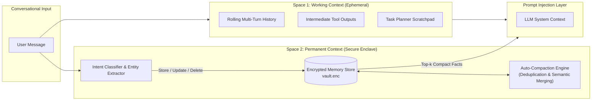
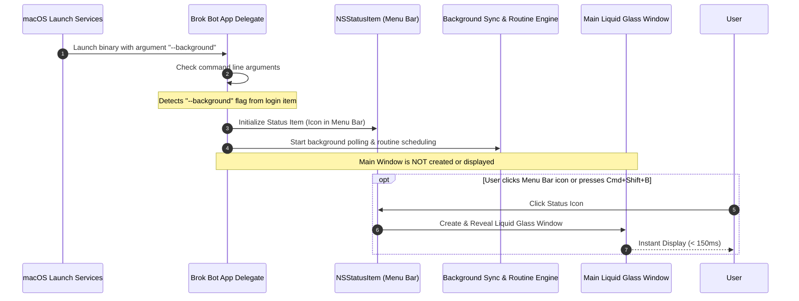
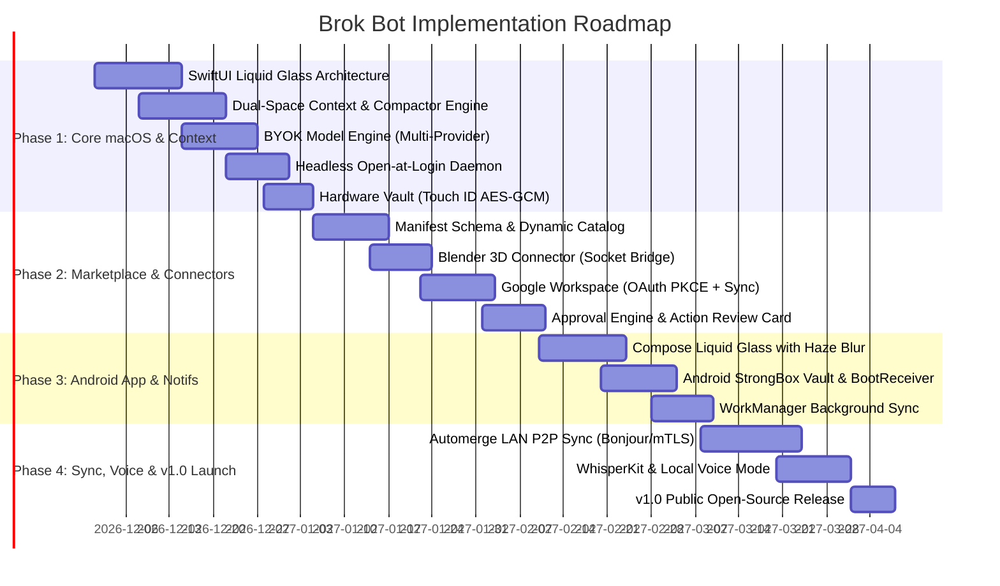

# Brok Bot: Technical Architecture & Implementation Plan

**Project Codename:** Brok Bot  
**Document Version:** 1.1.0  
**Authors:** Brok Bot Core Engineering Team  
**Target Release:** v1.0 MVP  

---

## 1. System Architecture & Component Design

Brok Bot is structured as a dual-client system (macOS Native Swift App & Android Jetpack Compose App) communicating with external LLM endpoints, local tool bridges, and remote MCP servers through a unified runtime architecture.

```mermaid
flowchart TB
    subgraph UI_Layer["Presentation Layer (Clean Minimal Liquid Glass UI)"]
        MacOS_UI["macOS SwiftUI AppKit Shell\n(NSVisualEffectView + .liquidGlass Modifier)"]
        Android_UI["Android Jetpack Compose Shell\n(Haze Library + RenderEffect Blur)"]
    end

    subgraph Core_Runtime["Brok Bot Core Runtime (Shared Logic Architecture)"]
        Orchestrator["Bot Orchestrator\n(Chief of Staff & Specialist Bots)"]
        ModelAdapter["BYOK Model Adapter\n(OpenRouter, Gemini, Claude, OpenAI, NIM)"]
        ToolRouter["Dynamic Tool Router & Approval Gate"]
        SyncEngine["Automerge CRDT P2P Sync Engine\n(Bonjour / mDNS + mTLS WebSocket)"]
        RoutineScheduler["Client-Side Routine & Polling Engine"]
        
        subgraph DualContextEngine["Dual-Space Context Management"]
            WorkingContext["Working Context Space (Ephemeral Scratchpad)"]
            PermanentContext["Permanent Memory Enclave (Auto-Compacting)"]
            MemoryRouter["Natural Language Memory Router\n('Store', 'Update', 'Delete')"]
            Compactor["Semantic Auto-Compactor Engine"]
            
            MemoryRouter --> PermanentContext
            PermanentContext <--> Compactor
        end

        subgraph ComputeSettings["Compute & Concurrency Engine"]
            ThreadPool["Worker Thread Pool (1, 2, 4 Threads)"]
            HWAccel["Hardware Acceleration (Metal / ANE / NNAPI)"]
        end
    end

    subgraph Security_Layer["Hardware Security Layer"]
        MacVault["macOS LocalAuth Vault\n(Touch ID + Argon2id + AES-256-GCM)"]
        AndroidVault["Android StrongBox Vault\n(Android Keystore + Tink + Biometrics)"]
    end

    subgraph Background_Layer["Silent Background Daemons"]
        MacDaemon["macOS SMAppService Headless Daemon\n(Open at Login, No Window)"]
        AndroidDaemon["Android WorkManager + BootReceiver\n(BOOT_COMPLETED Silent Start)"]
    end

    subgraph Connectors_Layer["Tool & Connector Bridges"]
        MarketplaceClient["Marketplace Manifest Client\n(Remote Catalog Poller & Dynamic Config)"]
        BlenderBridge["Blender Socket Bridge\n(TCP JSON-RPC to localhost:9876)"]
        GoogleBridge["Google Workspace REST Client\n(OAuth 2.0 PKCE + Delta Polling)"]
        MCPClient["Model Context Protocol Client\n(Streamable HTTP / Local Stdio)"]
    end

    MacOS_UI --> Orchestrator
    Android_UI --> Orchestrator
    Orchestrator --> DualContextEngine
    Orchestrator --> ComputeSettings
    Orchestrator --> ModelAdapter
    Orchestrator --> ToolRouter
    Orchestrator --> SyncEngine
    Orchestrator --> RoutineScheduler

    PermanentContext --> MacVault
    PermanentContext --> AndroidVault

    RoutineScheduler --> MacDaemon
    RoutineScheduler --> AndroidDaemon

    ToolRouter --> MarketplaceClient
    ToolRouter --> BlenderBridge
    ToolRouter --> GoogleBridge
    ToolRouter --> MCPClient
```



---

## 2. Technology Stack & Dependency Selection

### 2.1. macOS Client (Swift & SwiftUI)
| Component | Library / Framework | Version / Requirement | License | Justification |
| :--- | :--- | :--- | :--- | :--- |
| **Language & SDK** | Swift 6 / macOS SDK | macOS 14.0+ (Sonoma, Sequoia) | Apple | Native performance, memory safety, concurrency. |
| **UI Framework** | SwiftUI + AppKit | macOS 14.0+ | Apple | Translucent glass effects, modern lifecycle. |
| **Glass Effects** | `NSVisualEffectView` + Custom ViewModifier | AppKit Native | Apple | True system-level backdrop blur & specular highlights. |
| **Model Connectivity** | URLSession (Native async/await) | Native Foundation | Apple | Zero external dependencies for HTTP/SSE streaming. |
| **MCP Integration** | `modelcontextprotocol/swift-sdk` | Official MCP Swift SDK | MIT | Direct support for MCP tool calling & Streamable HTTP. |
| **Local Speech / Audio** | `Argmax/WhisperKit` | Latest Release | MIT | Fast, on-device Whisper speech recognition via CoreML. |
| **Hardware Accel** | Metal & Apple Neural Engine (ANE) | CoreML / Accelerate | Apple | High-speed local embeddings & audio inference. |
| **Decentralized Sync** | `automerge/automerge-swift` | Latest Release | MIT | Battle-tested CRDT for local-first peer synchronization. |
| **Local Notifications** | `UserNotifications.framework` | Built-in | Apple | Zero server push; supports interactive notification actions. |
| **Background Daemon** | `ServiceManagement` (`SMAppService`) | macOS 13.0+ | Apple | Silent "Open at Login" headless execution. |

### 2.2. Android Client (Kotlin & Jetpack Compose)
| Component | Library / Framework | Version / Requirement | License | Justification |
| :--- | :--- | :--- | :--- | :--- |
| **Language & SDK** | Kotlin 2.0+ / Android SDK | Android 9.0+ (Min SDK 28, Target 34+) | Google | Modern Android standard. |
| **UI Framework** | Jetpack Compose | Compose 1.7+ | Apache 2.0 | Declarative UI, reactive state binding. |
| **Glass Effects** | `chrisbanes/haze` | Latest Release | Apache 2.0 | Provides real-time dynamic blur on Compose surfaces. |
| **Hardware Accel** | Android NNAPI / Vulkan | Android NDK / MediaPipe | Google / Khronos | Hardware accelerated local ML & graphics. |
| **Background Tasks** | AndroidX `WorkManager` | Latest Release | Apache 2.0 | Battery-optimized periodic execution. |
| **Precise Alarms** | `AlarmManager` | Native Android | Google | Schedules morning briefings and routines down to the second. |
| **Vault & Crypto** | Android Keystore + Google Tink | Security Crypto 1.1+ | Apache 2.0 | Hardware-backed key management and encrypted DataStore. |
| **Decentralized Sync** | `automerge/automerge-kt` | Latest Release | MIT | Kotlin bindings for Automerge CRDT. |

---

## 3. Dual-Space Context Management Architecture



### 3.1. Space 1: Working Context Engine
- **Lifecycle:** Session-bound and ephemeral. Scoped to the current thread or sub-agent task.
- **Sliding Context Window:** Implements a token-bounded FIFO queue. When the conversation exceeds the model's target threshold (e.g., 8,000 tokens for working context), an automated background summarizer compresses older turns into a single synthetic turn while preserving tool call references.

### 3.2. Space 2: Permanent Context Enclave Manager
- **Storage:** Persisted strictly inside the hardware-backed encrypted vault (`vault.enc`) via AES-256-GCM. Unlocked in memory via Touch ID or Android Biometrics.
- **Natural Language Memory Commands:**
  The runtime interceptor classifies user prompts for memory intents before invoking the model:
  1. **Store Intent:** Pattern `/(?:store|remember|save)\s+(?:this\s+)?(?:in\s+(?:your\s+)?memory:?\s*)(.+)/i`
     - Action: Extracts facts, generates semantic embeddings, and stores in the enclave memory table with category tags (`preference`, `identity`, `routine`, `credential_reference`).
  2. **Update Intent:** Pattern `/(?:update\s+(?:my\s+)?memory\s+(?:about\s+)?)(.+)\s+(?:to|with)\s+(.+)/i`
     - Action: Queries existing memories with vector similarity > 0.85, updates the content in place, and logs a revision timestamp.
  3. **Delete / Forget Intent:** Pattern `/(?:forget|delete\s+(?:from\s+)?(?:your\s+)?memory:?\s*)(.+)/i`
     - Action: Locates matching records, securely overwrites the memory record with zeros, and purges the vector index.

#### Swift Implementation: Memory Intent Handler
```swift
import Foundation

public struct MemoryEntry: Codable, Identifiable {
    public let id: UUID
    public var category: String
    public var content: String
    public var lastUpdated: Date
    public var confidence: Float
}

public actor PermanentContextEnclaveManager {
    private let vault: BrokVaultManager

    public init(vault: BrokVaultManager) {
        self.vault = vault
    }

    public func executeMemoryCommand(_ input: String) async throws -> String? {
        let trimmed = input.trimmingCharacters(in: .whitespacesAndNewlines)
        
        // Match Store
        if let match = trimmed.range(of: #"(?i)^store (?:this in your )?memory:\s*(.+)"#, options: .regularExpression) {
            let fact = String(trimmed[match]).replacingOccurrences(of: #"(?i)^store (?:this in your )?memory:\s*"#, with: "", options: .regularExpression)
            try await saveFact(fact, category: "user_preference")
            return "Saved to your permanent memory in secure storage."
        }
        
        // Match Forget
        if let match = trimmed.range(of: #"(?i)^forget (?:about )?(.+)"#, options: .regularExpression) {
            let target = String(trimmed[match]).replacingOccurrences(of: #"(?i)^forget (?:about )?"#, with: "", options: .regularExpression)
            let deletedCount = try await purgeFacts(matching: target)
            return "Removed \(deletedCount) record(s) from your permanent memory."
        }
        
        return nil // Normal conversation
    }

    public func autoCompact() async throws {
        // Runs deduplication, merges conflicting records, and clusters related facts
        var entries = try await fetchAllDecryptedEntries()
        entries = SemanticCompactor.consolidate(entries)
        try await overwriteEncryptedEntries(entries)
    }
}
```

---

## 4. Clean Minimal Liquid Glass UI Architecture

### 4.1. macOS SwiftUI Liquid Glass Modifier
The macOS interface utilizes `NSVisualEffectView` with `.behindWindow` blending, complemented by a delicate specular stroke and ambient persona glow:

```swift
import SwiftUI
import AppKit

public struct LiquidGlassModifier: ViewModifier {
    var cornerRadius: CGFloat = 18.0
    var glowColor: Color = Color.cyan

    public func body(content: Content) -> some View {
        content
            .background(
                ZStack {
                    // Frosted system material
                    VisualEffectBackground(material: .sidebar, blendingMode: .behindWindow)
                    
                    // Ambient Bot Glow
                    RadialGradient(
                        colors: [glowColor.opacity(0.12), Color.clear],
                        center: .topLeading,
                        startRadius: 10,
                        endRadius: 280
                    )
                }
            )
            .clipShape(RoundedRectangle(cornerRadius: cornerRadius, style: .continuous))
            .overlay(
                // Specular Light Gradient Border
                RoundedRectangle(cornerRadius: cornerRadius, style: .continuous)
                    .strokeBorder(
                        LinearGradient(
                            stops: [
                                .init(color: Color.white.opacity(0.20), location: 0.0),
                                .init(color: Color.white.opacity(0.04), location: 0.5),
                                .init(color: Color.white.opacity(0.10), location: 1.0)
                            ],
                            startPoint: .topLeading,
                            endPoint: .bottomTrailing
                        ),
                        lineWidth: 1.0
                    )
            )
            .shadow(color: Color.black.opacity(0.15), radius: 15, x: 0, y: 8)
    }
}

public struct VisualEffectBackground: NSViewRepresentable {
    let material: NSVisualEffectView.Material
    let blendingMode: NSVisualEffectView.BlendingMode

    public func makeNSView(context: Context) -> NSVisualEffectView {
        let view = NSVisualEffectView()
        view.material = material
        view.blendingMode = blendingMode
        view.state = .active
        return view
    }

    public func updateNSView(_ nsView: NSVisualEffectView, context: Context) {}
}
```

### 4.2. Android Jetpack Compose Liquid Glass Surface
Using Chris Banes' `haze` library on Jetpack Compose:

```kotlin
import androidx.compose.foundation.background
import androidx.compose.foundation.border
import androidx.compose.foundation.layout.Box
import androidx.compose.foundation.shape.RoundedCornerShape
import androidx.compose.runtime.Composable
import androidx.compose.ui.Modifier
import androidx.compose.ui.graphics.Brush
import androidx.compose.ui.graphics.Color
import androidx.compose.ui.unit.dp
import dev.chrisbanes.haze.HazeState
import dev.chrisbanes.haze.hazeChild

@Composable
fun LiquidGlassSurface(
    hazeState: HazeState,
    glowColor: Color = Color(0xFF00E5FF),
    modifier: Modifier = Modifier,
    content: @Composable () -> Unit
) {
    val shape = RoundedCornerShape(20.dp)
    val specularBrush = Brush.linearGradient(
        colors = listOf(
            Color.White.copy(alpha = 0.22f),
            Color.White.copy(alpha = 0.05f),
            Color.White.copy(alpha = 0.12f)
        )
    )

    Box(
        modifier = modifier
            .hazeChild(state = hazeState, shape = shape)
            .background(Color.Black.copy(alpha = 0.25f), shape = shape)
            .border(width = 1.dp, brush = specularBrush, shape = shape)
    ) {
        content()
    }
}
```

---

## 5. Performance, Multithreading & Hardware Acceleration

### 5.1. Concurrency Engine Configuration
Users can choose between `1`, `2`, `4`, or `Auto` worker threads in Settings:

```swift
public final class BrokComputeEngine: @unchecked Sendable {
    public static let shared = BrokComputeEngine()
    private var workerQueue: OperationQueue

    private init() {
        workerQueue = OperationQueue()
        workerQueue.name = "org.brokbot.compute"
        setThreadCount(4) // Default
    }

    public func setThreadCount(_ threads: Int) {
        workerQueue.maxConcurrentOperationCount = max(1, min(threads, ProcessInfo.processInfo.processorCount))
    }

    public func configureHardwareAcceleration(enabled: Bool) {
        #if os(macOS)
        // Configure CoreML / Metal dispatch
        let config = MLModelConfiguration()
        config.computeUnits = enabled ? .all : .cpuOnly
        #endif
    }
}
```

---

## 6. Headless Background Startup & macOS "Open at Login"

### 6.1. Silent Login Item Architecture (`SMAppService`)
Brok Bot includes a headless execution mode that starts at login without presenting any main UI:



#### Implementation in `AppDelegate.swift`:
```swift
import AppKit
import ServiceManagement

@main
class AppDelegate: NSObject, NSApplicationDelegate {
    var statusItem: NSStatusItem?
    var mainWindowController: NSWindowController?

    func applicationDidFinishLaunching(_ notification: Notification) {
        let isHeadless = CommandLine.arguments.contains("--background")
        
        // 1. Always create the Menu Bar Status Item
        setupStatusBarItem()

        // 2. Initialize background sync workers and routine timers
        BrokBackgroundSyncManager.shared.start()

        // 3. Only show main window if NOT launched silently at login
        if !isHeadless {
            showMainWindow()
        }
    }

    func toggleOpenAtLogin(enabled: Bool) throws {
        let service = SMAppService.loginItem(identifier: "org.brokbot.mac.helper")
        if enabled {
            try service.register()
        } else {
            try service.unregister()
        }
    }

    @objc func statusBarClicked() {
        showMainWindow()
    }

    func showMainWindow() {
        if mainWindowController == nil {
            mainWindowController = MainWindowController()
        }
        mainWindowController?.showWindow(nil)
        NSApp.activate(ignoringOtherApps: true)
    }
}
```

---

## 7. Phased Implementation Roadmap



### Phase 1: Core macOS, Dual Context & Headless Daemon (Weeks 1–4)
- **Sprint 1.1:** Setup SPM project. Implement `LiquidGlassModifier` and `VisualEffectBackground`.
- **Sprint 1.2:** Build **Dual-Space Context Management**: ephemeral Working Context + permanent enclave-backed memory with regex/LLM intent parsing (`store`, `update`, `delete`).
- **Sprint 1.3:** Build the **Semantic Auto-Compactor Engine** for memory deduplication.
- **Sprint 1.4:** Implement **BYOK Model Engine** (OpenRouter, Gemini, Claude, OpenAI, NIM).
- **Sprint 1.5:** Implement **SMAppService Headless Open-at-Login** (`--background` mode) and Menu Bar status item.
- **Sprint 1.6:** Implement Settings UI: thread count (`1`, `2`, `4`), hardware acceleration toggle, and ad-hoc signing scripts.

### Phase 2: Modular Marketplace, Blender & Google Connectors (Weeks 5–8)
- **Sprint 2.1:** Deploy remote manifest registry on CDN/GitHub Pages.
- **Sprint 2.2:** Build dynamic in-app marketplace browser and installer.
- **Sprint 2.3:** Implement Blender 3D socket connector (JSON-RPC 2.0 to `127.0.0.1:9876`).
- **Sprint 2.4:** Implement Google Workspace connector with OAuth PKCE loopback redirect and incremental delta polling.
- **Sprint 2.5:** Build interactive Approval Card UI in chat for write operations.

### Phase 3: Native Android App & Background Workers (Weeks 9–12)
- **Sprint 3.1:** Setup Jetpack Compose project with Chris Banes' `haze` library for Liquid Glass blur.
- **Sprint 3.2:** Implement Android Keystore + StrongBox Tink vault.
- **Sprint 3.3:** Implement `BootReceiver` and `WorkManager` for silent post-boot background execution.
- **Sprint 3.4:** Build client-side notifications with interactive action buttons (`Approve` / `Deny`).
- **Sprint 3.5:** Multi-threading configuration (Coroutines dispatcher) and NNAPI toggle.

### Phase 4: Decentralized Sync, Voice & v1.0 Release (Weeks 13–16)
- **Sprint 4.1:** Integrate **Automerge CRDT** for local-first peer sync.
- **Sprint 4.2:** Build LAN Bonjour / mDNS discovery and QR code pairing.
- **Sprint 4.3:** Integrate **WhisperKit** for on-device voice dictation (`Cmd+D`).
- **Sprint 4.4:** Security verification, supply-chain manifest signature verification (Ed25519).
- **Sprint 4.5:** Public release: Homebrew Cask, ad-hoc signed DMG, Android APK, and F-Droid repository.

---

## 8. Verification & QA Test Plan

1. **Dual-Context Test:**
   - Prompt: *"Store this in your memory: My preferred output language is Spanish."*
   - Verify that the fact is stored in `vault.enc`.
   - Start a new conversation: ask a question without specifying the language. Verify that the answer is returned in Spanish using permanent memory.
   - Prompt: *"Forget my preferred output language."* Verify that the database record is purged.
2. **Auto-Compaction Test:** Inject 20 repetitive memory facts. Trigger auto-compaction and verify that records are consolidated into concise bullet points without data loss.
3. **Headless Login Test:** Register the app via `SMAppService`. Reboot the Mac or log out. Log back in and confirm:
   - No main window appears.
   - The menu bar icon is active.
   - Background polling processes events silently.
   - Clicking the menu bar icon reveals the main window in < 150ms.
4. **Compute Settings Test:** Toggle between 1, 2, and 4 threads in Settings. Run concurrent tool searches and verify CPU thread allocation via Activity Monitor.
