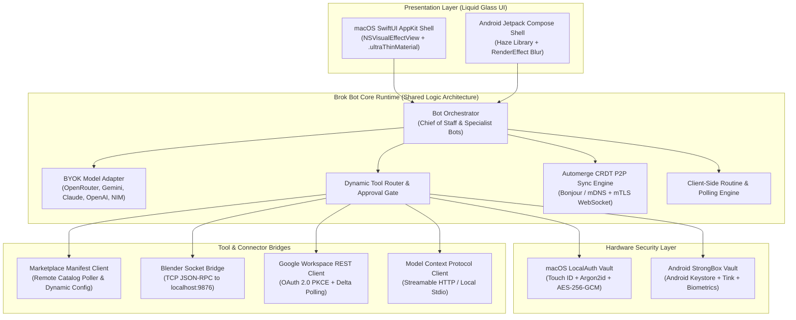
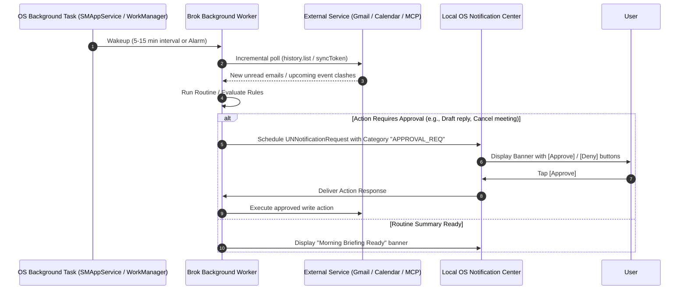
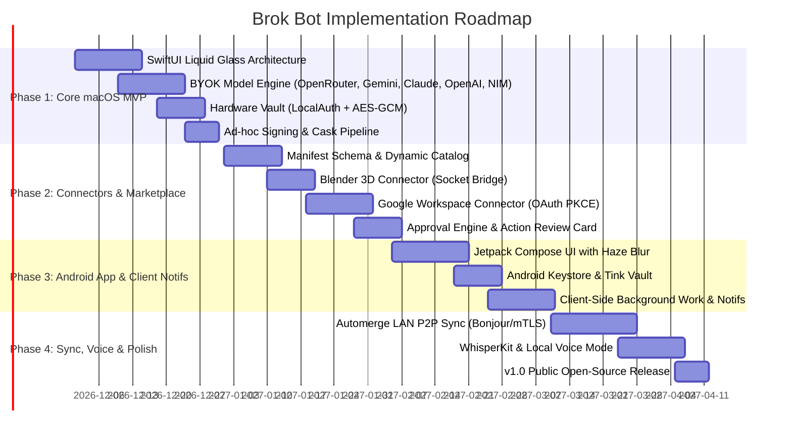

# Brok Bot: Technical Architecture & Implementation Plan

**Project Codename:** Brok Bot  
**Document Version:** 1.0.0  
**Authors:** Brok Bot Core Engineering Team  
**Target Release:** v1.0 MVP  

---

## 1. System Architecture & Component Design

Brok Bot is structured as a dual-client system (macOS Native Swift App & Android Jetpack Compose App) communicating with external LLM endpoints, local tool bridges, and remote MCP servers through a unified runtime architecture.



---

## 2. Technology Stack & Dependency Selection

### 2.1. macOS Client (Swift & SwiftUI)
| Component | Library / Framework | Version / Requirement | License | Justification |
| :--- | :--- | :--- | :--- | :--- |
| **Language & SDK** | Swift 6 / macOS SDK | macOS 14.0+ (Sonoma, Sequoia) | Apple | Native performance, memory safety, concurrency. |
| **UI Framework** | SwiftUI + AppKit | macOS 14.0+ | Apple | Translucent glass effects, modern lifecycle. |
| **Model Connectivity** | URLSession (Native async/await) | Native Foundation | Apple | Zero external dependencies for HTTP/SSE streaming. |
| **MCP Integration** | `modelcontextprotocol/swift-sdk` | Official MCP Swift SDK | MIT | Direct support for MCP tool calling & Streamable HTTP. |
| **Local Speech / Audio** | `Argmax/WhisperKit` | Latest Release | MIT | Fast, on-device Whisper speech recognition via CoreML. |
| **Decentralized Sync** | `automerge/automerge-swift` | Latest Release | MIT | Battle-tested CRDT for local-first peer synchronization. |
| **Local Notifications** | `UserNotifications.framework` | Built-in | Apple | Zero server push; supports interactive notification actions. |
| **Window Material** | `NSVisualEffectView` | AppKit Native | Apple | Real-time desktop wallpaper blur & vibrancy. |

### 2.2. Android Client (Kotlin & Jetpack Compose)
| Component | Library / Framework | Version / Requirement | License | Justification |
| :--- | :--- | :--- | :--- | :--- |
| **Language & SDK** | Kotlin 2.0+ / Android SDK | Android 9.0+ (Min SDK 28, Target 34+) | Google | Modern Android standard. |
| **UI Framework** | Jetpack Compose | Compose 1.7+ | Apache 2.0 | Declarative UI, reactive state binding. |
| **Glass Effects** | `chrisbanes/haze` | Latest Release | Apache 2.0 | Provides real-time dynamic blur on Compose surfaces. |
| **Background Tasks** | AndroidX `WorkManager` | Latest Release | Apache 2.0 | Battery-optimized periodic execution. |
| **Precise Alarms** | `AlarmManager` | Native Android | Google | Schedules morning briefings and routines down to the second. |
| **Vault & Crypto** | Android Keystore + Google Tink | Security Crypto 1.1+ | Apache 2.0 | Hardware-backed key management and encrypted DataStore. |
| **Decentralized Sync** | `automerge/automerge-kt` | Latest Release | MIT | Kotlin bindings for Automerge CRDT. |

---

## 3. Data Formats & Protocol Specifications

### 3.1. Connector Manifest Schema (`connector-manifest.json` v1.0)
The manifest describes everything required for Brok Bot to discover, authenticate, and execute tools without app rebuilds.

```json
{
  "$schema": "https://brokbot.org/schemas/v1/connector-manifest.json",
  "id": "org.brokbot.connector.gmail-calendar",
  "name": "Google Workspace (Gmail & Calendar)",
  "version": "1.2.0",
  "minAppVersion": "1.0.0",
  "author": "Brok Bot Community",
  "description": "Read, draft, and organize Gmail messages; manage events and schedules in Google Calendar.",
  "icon": "https://brokbot.org/assets/icons/google-workspace.png",
  "category": "Productivity",
  "transport": {
    "type": "native_rest",
    "baseUrl": "https://www.googleapis.com"
  },
  "auth": {
    "type": "oauth2_pkce",
    "authorizationEndpoint": "https://accounts.google.com/o/oauth2/v2/auth",
    "tokenEndpoint": "https://oauth2.googleapis.com/token",
    "revocationEndpoint": "https://oauth2.googleapis.com/revoke",
    "redirectUriMode": "loopback",
    "loopbackPortRange": [8910, 8920],
    "supportsCustomClientId": true,
    "defaultClientId": "ENV_SUPPLIED_OR_PUBLIC_DESKTOP_CLIENT_ID",
    "scopeTiers": [
      {
        "tierId": "base_read",
        "name": "Read Only (Safe)",
        "description": "Search and read emails and view calendar events.",
        "scopes": [
          "https://www.googleapis.com/auth/gmail.readonly",
          "https://www.googleapis.com/auth/calendar.readonly",
          "https://www.googleapis.com/auth/calendar.events.readonly"
        ],
        "defaultEnabled": true
      },
      {
        "tierId": "write_drafts",
        "name": "Drafts & Scheduling",
        "description": "Create drafts, schedule events, and organize labels.",
        "scopes": [
          "https://www.googleapis.com/auth/gmail.modify",
          "https://www.googleapis.com/auth/calendar.events"
        ],
        "defaultEnabled": false,
        "requiresApprovalDefault": true
      },
      {
        "tierId": "send_mail",
        "name": "Send Emails Directly",
        "description": "Send emails immediately on your behalf.",
        "scopes": [
          "https://www.googleapis.com/auth/gmail.send"
        ],
        "defaultEnabled": false,
        "requiresApprovalDefault": true
      }
    ]
  },
  "tools": [
    {
      "name": "gmail_search",
      "description": "Search messages in Gmail using query syntax.",
      "parameters": {
        "type": "object",
        "properties": {
          "query": { "type": "string", "description": "Search query" },
          "maxResults": { "type": "integer", "default": 10 }
        },
        "required": ["query"]
      },
      "destructive": false,
      "requiresApproval": false
    },
    {
      "name": "gmail_send_message",
      "description": "Send an email message to a recipient.",
      "parameters": {
        "type": "object",
        "properties": {
          "to": { "type": "string" },
          "subject": { "type": "string" },
          "body": { "type": "string" }
        },
        "required": ["to", "subject", "body"]
      },
      "destructive": true,
      "requiresApproval": true
    }
  ],
  "polling": {
    "enabled": true,
    "defaultIntervalSeconds": 300,
    "gmailStrategy": "history_list",
    "calendarStrategy": "sync_token"
  }
}
```

### 3.2. Blender Socket Bridge Protocol
- **Transport:** Raw TCP socket to `127.0.0.1:9876` (or user-configured port).
- **Format:** Line-delimited JSON-RPC 2.0 messages.
- **Request Format:**
  ```json
  {
    "jsonrpc": "2.0",
    "id": "req-001",
    "method": "execute_code",
    "params": {
      "code": "import bpy\nbpy.ops.mesh.primitive_monkey_add(size=2.0)\nbpy.context.active_object.name = 'SuzanneBot'"
    }
  }
  ```
- **Response Format:**
  ```json
  {
    "jsonrpc": "2.0",
    "id": "req-001",
    "result": {
      "status": "success",
      "output": "Created SuzanneBot at (0, 0, 0)",
      "previewBase64": "iVBORw0KGgoAAAANSUhEUgAA..."
    }
  }
  ```

---

## 4. Hardware Security & Ad-Hoc Signing Strategy

### 4.1. macOS Ad-Hoc Signing Realities & Solution
1. **The Issue:**
   - Ad-hoc signed binaries (`codesign -s -`) have `TeamIdentifier=not set`.
   - Attempting to attach entitlements like `keychain-access-groups` or `com.apple.developer.security.keychain-access-groups` causes the binary to be killed at launch by Apple Mobile File Integrity (AMFI).
   - Calling `SecItemAdd` with `kSecAttrTokenIDSecureEnclave` fails with `-34018 errSecMissingEntitlement`.
   - Modifying or rebuilding the app alters its `cdhash`, causing macOS Keychain to prompt the user repeatedly for passwords.
2. **The Brok Bot Implementation:**
   - **Vault Storage:** The vault is stored in `~/Library/Application Support/BrokBot/vault.enc` as an encrypted SQLite database using **AES-256-GCM**.
   - **Master Encryption Key (MEK) Derivation:**
     ```swift
     import LocalAuthentication
     import CryptoKit

     class BrokVaultManager {
         func unlockWithBiometrics() async throws -> SymmetricKey {
             let context = LAContext()
             context.localizedReason = "Unlock Brok Bot Vault with Touch ID"
             
             let success = try await context.evaluatePolicy(
                 .deviceOwnerAuthenticationWithBiometrics,
                 localizedReason: "Access Brok Bot API Keys and Vault"
             )
             guard success else { throw VaultError.authFailed }
             
             // Retrieve device-bound master seed from user-keychain without access groups
             let masterSeed = try retrieveDeviceSeed()
             return SymmetricKey(data: masterSeed)
         }
     }
     ```
   - **Gatekeeper & Quarantine Removal:**
     - In release instructions and docs, provide the copy-paste terminal command:
       ```bash
       xattr -cr /Applications/BrokBot.app
       ```
     - Provide a Homebrew Cask formula (`brew install --cask brok-bot`), which automatically bypasses Gatekeeper quarantine flags during installation.

### 4.2. Android Keystore Implementation
- Store secrets using Google Tink with AES256-GCM keys managed by the Android Keystore:
  ```kotlin
  val keyGenSpec = KeyGenParameterSpec.Builder(
      "BrokBotMasterKey",
      KeyProperties.PURPOSE_ENCRYPT or KeyProperties.PURPOSE_DECRYPT
  ).apply {
      setBlockModes(KeyProperties.BLOCK_MODE_GCM)
      setEncryptionPaddings(KeyProperties.ENCRYPTION_PADDING_NONE)
      setKeySize(256)
      // Request StrongBox backing if hardware is available
      if (context.packageManager.hasSystemFeature(PackageManager.FEATURE_STRONGBOX_KEYSTORE)) {
          setIsStrongBoxBacked(true)
      }
      setUserAuthenticationRequired(true)
      setUserAuthenticationParameters(0, KeyProperties.AUTH_BIOMETRIC_STRONG)
  }.build()
  ```

---

## 5. Client-Side Notifications & Background Sync



### 5.1. macOS Notification Categories
```swift
import UserNotifications

func setupNotificationCategories() {
    let approveAction = UNNotificationAction(
        identifier: "ACTION_APPROVE",
        title: "Approve & Execute",
        options: [.foreground]
    )
    let denyAction = UNNotificationAction(
        identifier: "ACTION_DENY",
        title: "Deny / Discard",
        options: [.destructive]
    )
    
    let approvalCategory = UNNotificationCategory(
        identifier: "BROK_APPROVAL_REQUEST",
        actions: [approveAction, denyAction],
        intentIdentifiers: [],
        options: [.customDismissAction]
    )
    
    UNUserNotificationCenter.current().setNotificationCategories([approvalCategory])
}
```

---

## 6. Phased Implementation Roadmap



### Phase 1: Native macOS Core & BYOK Engine (Weeks 1–4)
- **Sprint 1.1:** Initialize Swift Package Manager (SPM) workspace. Build the primary `LiquidGlassWindow` with `NSVisualEffectView` blending and specular highlights.
- **Sprint 1.2:** Implement the **BYOK Model Engine** supporting OpenRouter, Google Gemini, Anthropic Claude, OpenAI, and NVIDIA NIM with streaming and tool calling.
- **Sprint 1.3:** Implement the **Brok Bot Vault** (`vault.enc` + Touch ID / Argon2id AES-256-GCM encryption).
- **Sprint 1.4:** Build Chief of Staff bot and custom specialist bot creator (name, role, instructions, avatar color).
- **Sprint 1.5:** Configure ad-hoc signing (`codesign -s -`) and build automation scripts for DMG and Homebrew Cask releases.

### Phase 2: Modular Marketplace, Blender & Google Connectors (Weeks 5–8)
- **Sprint 2.1:** Deploy the remote Connector Registry (`catalog.json` and manifest schema) on GitHub Pages.
- **Sprint 2.2:** Build the in-app **Plugin Marketplace View** (browse, inspect permissions, install).
- **Sprint 2.3:** Develop the **Blender 3D Connector**: Python bridge addon + client TCP JSON-RPC socket connector.
- **Sprint 2.4:** Develop the **Google Workspace Connector**: OAuth 2.0 PKCE with local loopback listener, tiered permission scopes, and `users.history.list` / `events.list` delta polling.
- **Sprint 2.5:** Build the interactive **Approval Gate UI**: interactive expandable cards in chat with diff views for file/calendar changes and email drafts.

### Phase 3: Native Android App & Client-Side Notifications (Weeks 9–12)
- **Sprint 3.1:** Initialize Android Kotlin project with Jetpack Compose and Material 3 Expressive.
- **Sprint 3.2:** Implement Liquid Glass UI using Chris Banes' `haze` library and custom glass border modifiers.
- **Sprint 3.3:** Integrate Android Keystore and StrongBox-backed Tink vault.
- **Sprint 3.4:** Implement `WorkManager` background poller and `NotificationManager` with inline [Approve] / [Deny] action buttons.
- **Sprint 3.5:** Validate connector parity across Android and macOS.

### Phase 4: P2P Sync, Voice Mode & v1.0 Launch (Weeks 13–16)
- **Sprint 4.1:** Integrate **Automerge CRDT** for local-first decentralized state convergence.
- **Sprint 4.2:** Build LAN peer discovery over Bonjour / mDNS with QR code pairing.
- **Sprint 4.3:** Implement local voice input using **WhisperKit** on macOS and Android SpeechRecognizer / on-device transcription.
- **Sprint 4.4:** Complete end-to-end security audit and supply-chain verification for connector manifests.
- **Sprint 4.5:** Tag v1.0, publish ad-hoc signed macOS `.dmg` / `.zip`, Android `.apk`, and public GitHub documentation.

---

## 7. Security & Risk Mitigation Matrix

| Risk / Constraint | Severity | Root Cause | Engineering Mitigation |
| :--- | :---: | :--- | :--- |
| **macOS Sequoia Quarantine** | High | Unnotarized / Ad-hoc signed binary | Document `xattr -cr` command; provide automated Homebrew Cask installer; add step-by-step UI helper in release notes. |
| **Key Access Loss Across Builds** | High | `cdhash` mutation in ad-hoc builds invalidating Keychain ACLs | Decouple from OS keychain access-groups: use file-based AES-256-GCM vault unlocked via Touch ID biometric challenge. |
| **Malicious Marketplace Plugin** | Critical | Server-side manifest injects malicious instructions/URLs | Sign all official manifests with Ed25519; enforce strict JSON schema validation; require user confirmation for any raw code execution. |
| **Google OAuth Verification Cap** | Medium | Google limits unverified desktop apps to 100 test users | Allow users to supply their own Google Cloud Project Client ID/Secret (BYO OAuth Client), bypassing centralized quota limits entirely. |
| **Background Battery Drain** | Medium | High frequency polling for Gmail/Calendar | Implement adaptive exponential backoff; pause polling when devices are on Low Power Mode or disconnected from Wi-Fi. |

---

## 8. Verification & QA Test Plan

1. **Marketplace Test:** Add a test connector manifest to the remote repository. Verify that the client displays it immediately without an application restart.
2. **Ad-Hoc Signing & Gatekeeper Test:** Clean-install the `.dmg` on a non-developer Mac, verify the Gatekeeper prompt, run `xattr -cr`, and ensure the app launches and accesses the biometric vault.
3. **Blender Execution Test:** With Blender open and the bridge addon active, send a prompt to generate a 3D Suzanne mesh. Confirm the Approval Card renders, approve the action, and verify the resulting mesh in Blender and the preview image in Brok Bot chat.
4. **Offline Sync Test:** Take both devices offline, perform operations on each, reconnect to local Wi-Fi, and verify that Automerge converges state cleanly without conflicting histories.
