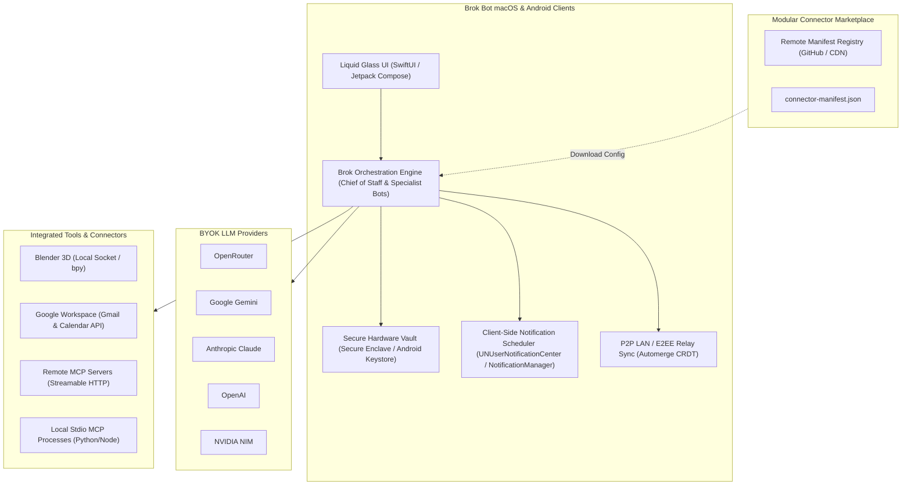

# Brok Bot: Product Requirements Document (PRD)

**Project Name:** Brok Bot  
**Document Version:** 1.0.0  
**Target Platforms:** macOS (Apple Silicon & Intel) & Android (Phone & Tablet)  
**Distribution:** Open-Source (GitHub Releases, Homebrew Cask, Direct APK, F-Droid)  
**License:** Apache 2.0 / MIT  
**Status:** Approved for Development  

---

## 1. Executive Summary & Vision

**Brok Bot** is an open-source, local-first, privacy-focused clone of xAI’s **Grok Bot**. 

While Grok Bot requires an expensive cloud subscription ($20 to $300/month) and centralizes execution on a proprietary cloud virtual computer, Brok Bot adopts a **Bring Your Own Key (BYOK)** and **Bring Your Own Compute** model. It empowers users to run their own autonomous AI teammates natively on their Mac and Android devices.

Brok Bot pairs an AI teammate architecture (Chief of Staff orchestrator + specialist sub-bots) with direct local execution and cloud tool integration. It introduces a **server-side modular connector marketplace** that enables the community to publish, update, and install integrations (Gmail, Google Calendar, Blender, Notion, Slack, GitHub, Linear, etc.) as dynamic manifests *without requiring app store updates or client rebuilds*. 

All sensitive tokens, OAuth secrets, and model API keys are shielded by hardware-backed security (macOS Secure Enclave / Keychain & Android Keystore / StrongBox). User alerts and routine triggers are handled via **client-side local notifications**, eliminating any dependency on proprietary centralized notification push servers. Both apps feature a unified **Liquid Glass** aesthetic (translucent frosted materials, specular border strokes, vibrant dynamic accent lighting).

---

## 2. Competitive Positioning: Grok Bot vs. Brok Bot

| Feature Dimension | Grok Bot (Proprietary / xAI) | Brok Bot (Open Source Clone) |
| :--- | :--- | :--- |
| **Execution Environment** | Shared cloud Linux computer per user ($20–$300/mo) | **Local-First Native Execution** on user's Mac/Android + local sandboxed runner |
| **Model Engine** | Locked to xAI Grok (Grok 2 / Grok 3 / Grok Mini) | **BYOK Multi-Model**: OpenRouter, Gemini, Claude, OpenAI, NVIDIA NIM |
| **Connector Architecture** | Hardcoded built-in OAuth + remote MCP tunnel | **Server-side Modular Marketplace**: JSON manifests downloaded dynamically |
| **Secret Storage** | Cloud-managed encrypted vault on xAI servers | **Hardware-Backed Storage**: macOS Secure Enclave/Keychain, Android Keystore |
| **Notification Pipeline** | Server-side push via proprietary gateway | **100% Client-Side Local Push**: OS-level scheduling, zero external push servers |
| **App Distribution** | Notarized DMG / Apple App Store / Google Play | **Ad-hoc signed macOS app** (`codesign -s -`) + direct APK / F-Droid |
| **Multi-Agent Coordination**| Chief of Staff orchestrating specialist Bots | **Chief of Staff + Specialist Sub-agents** in shared thread with tool delegation |
| **Approvals / Safety** | Auto Review before sending/deleting | **Explicit User Approval Gates** with interactive Action Sheets & notifications |
| **Voice Mode** | Proprietary cloud voice chat & dictation | **Local/Cloud Hybrid**: macOS Dictation / WhisperKit + provider audio |
| **UI Aesthetics** | Dark minimalist, glass overlays | **Liquid Glass UI**: Ultra-thin material, specular borders, luminous gradients |
| **Cross-Device Sync** | Centralized xAI cloud database | **P2P LAN + E2EE Relay**: Automerge CRDT over mDNS/TLS WebSockets |

---

## 3. User Personas & Core Use Cases

### 3.1. Primary Personas
1. **The Creative Technologist / 3D Artist ("Maya"):** Wants an AI assistant inside Blender to generate materials, place camera rigs, render previews, and run bpy scripts via plain English without switching windows.
2. **The Autonomous Solo Founder / Developer ("Alex"):** Needs a "Chief of Staff" to triage unread customer emails in Gmail, flag calendar scheduling conflicts, draft replies, and push daily agendas at 8:00 AM without leaking customer data to third-party SaaS vendors.
3. **The Privacy-Conscious Power User ("Jordan"):** Demands zero centralized servers. Requires all API keys, OAuth tokens, and conversation histories to remain strictly on personal hardware with biometric Touch ID / Fingerprint lock.

### 3.2. Core Use Cases & User Journeys

#### Use Case 1: Autonomous Morning Briefing
- **Trigger:** Configured routine set for 8:00 AM weekdays.
- **Workflow:**
  1. Background worker wakes up locally on macOS.
  2. Queries Google Calendar for meetings and conflicts.
  3. Queries Gmail for high-priority unread messages (`is:unread category:primary`).
  4. Chief of Staff synthesizes a structured bulleted briefing.
  5. Client-side local notification fires: *"Your morning brief is ready: 3 meetings, 1 reply needed."*
  6. User clicks notification to open the Liquid Glass thread.

#### Use Case 2: Blender 3D Scene Generation
- **Trigger:** User in chat types: *"Create an isometric low-poly room in Blender with a neon blue point light and render a 1080p preview."*
- **Workflow:**
  1. Brok Bot identifies the Blender connector tool `blender_execute_script`.
  2. Because the action executes arbitrary code, an **Approval Card** appears in chat displaying the generated `bpy` code diff.
  3. User clicks `[Approve & Run]`.
  4. Command is dispatched over local TCP socket (`127.0.0.1:9876`) to the Blender addon bridge.
  5. Addon builds the geometry, sets materials, positions the camera, and returns a PNG buffer.
  6. The rendered viewport image appears natively inline in the conversation.

#### Use Case 3: Email Triage with Explicit Send Gates
- **Trigger:** User asks: *"Draft replies to all billing questions received in the last 24 hours."*
- **Workflow:**
  1. Bot uses `gmail_search` (read-only, no approval needed).
  2. Bot finds 2 matching customer inquiries.
  3. Bot prepares draft replies and triggers `gmail_send_message`.
  4. The tool is tagged with `destructive: true` / `requiresApproval: true`.
  5. The UI halts execution and renders two interactive Draft Review Cards showing recipient, subject, and body.
  6. User can edit the text inline and click `[Send]`, or click `[Save as Gmail Draft]`.

---

## 4. Detailed Functional Requirements

### 4.1. Multi-Agent Team Architecture
- **Primary Bot ("Chief of Staff"):**
  - Default orchestrator for general queries and routine coordination.
  - Can spawn, delegate to, and summarize results from specialist bots.
  - Maintains a durable user memory profile (preferences, communication tone, saved routines).
- **Specialist Bots:**
  - Users can create unlimited custom bots with distinct names, roles, system instructions, and avatar aesthetics (geometric shape + neon color accent).
  - Can be pinned to specific tools (e.g., "Blender Operator" only has access to 3D tools; "Calendar Assistant" only has scheduling tools).
  - Multi-bot collaboration in shared threads: Bots can mention and hand off tasks to each other with full context retention.

### 4.2. Server-Side Modular Connector Marketplace
- **Dynamic Catalog Fetching:** The client app regularly checks a remote URL for `catalog.json` without requiring app updates.
- **Declarative Manifests:** Each plugin is defined by a `connector-manifest.json` describing:
  - Transport protocol (Remote MCP, Local Stdio Process, Direct Socket, Native REST).
  - Authentication method (OAuth 2.0 PKCE, API Key, Shared Secret).
  - Permission scopes and tiers (Read-only vs. Modify vs. Send).
  - Exported tools, JSON parameters, and safety flags (`requiresApproval: true/false`).
- **Dynamic Config Generation:** When a user taps "Install", the app reads the manifest, presents the permission tier choices, and guides the user through setup.
- **Zero-Code Connector Extensibility:** Community members can contribute new connectors simply by submitting a pull request with a new manifest file.

### 4.3. Hardware-Backed Vault & Identity
- **Local Credential Storage:** API keys and OAuth refresh tokens are stored locally on the user's device.
- **macOS Ad-Hoc Protection:**
  - AES-256-GCM encrypted database in `~/Library/Application Support/BrokBot/vault.enc`.
  - Unlocked in memory via Touch ID / LocalAuthentication (`LAContext`).
  - No dependency on paid Apple Developer certificate entitlements or provisioning profiles.
- **Android Hardware Protection:**
  - Android Keystore with StrongBox hardware security module (`setIsStrongBoxBacked(true)`).
  - Biometric authentication gate (`BiometricPrompt.CryptoObject`).
  - Encrypted storage via Google Tink and Jetpack DataStore.

### 4.4. Bring Your Own Key (BYOK) Model Engine
- **Supported Providers:**
  1. **OpenRouter:** Full routing across open-source and proprietary models.
  2. **Google Gemini:** Gemini 1.5 Pro / Flash, Gemini 2.0 Flash (Native REST & OpenAI compatibility).
  3. **Anthropic Claude:** Claude 3.5 Sonnet / Haiku / Opus via Messages API.
  4. **OpenAI:** GPT-4o / GPT-4o mini via Chat Completions & Responses API.
  5. **NVIDIA NIM:** Enterprise Llama 3, Mixtral, and custom microservices.
- **Provider Features:**
  - Real-time Server-Sent Events (SSE) token streaming.
  - Automatic tool call parameter parsing and function dispatch.
  - Token counting, sliding context window management, and fallback model routing.

### 4.5. Client-Side Notifications & Background Scheduling
- **Zero Server Push:** No external APNs/FCM servers or centralized notification gateways.
- **macOS Scheduler:**
  - Background helper daemon using `SMAppService` or LaunchAgent.
  - Periodic delta polling (5–30 min configurable intervals).
  - Rich notifications via `UNUserNotificationCenter` with actionable category buttons (`APPROVE_ACTION`, `DENY_ACTION`).
- **Android Scheduler:**
  - `WorkManager` for battery-efficient periodic background polling.
  - `AlarmManager` exact alarms for precisely scheduled routines.
  - `NotificationCompat` with inline interactive action buttons.

### 4.6. Real-Time Cross-Device Sync
- **Local Area Network (LAN) P2P:** Automatic device discovery over Wi-Fi via mDNS / Bonjour (`_brokbot-sync._tcp`).
- **Encrypted Pairing:** Mutual authentication via QR code scanning (exchanging device public keys).
- **Conflict-Free Convergence:** Implemented with **Automerge CRDT** for seamless offline and multi-device merging of chat logs, bot profiles, and routine configurations.
- **Optional BYO Cloud Backup:** User-configured sync to private Google Drive AppData folder, WebDAV, or self-hosted minimal E2EE WebSocket relay.

### 4.7. Liquid Glass Design System
- **Visual Aesthetic:**
  - Ultra-thin frosted glass materials with background blur.
  - Specular gradient borders (top-left light source simulation).
  - Bot persona radial glow accents.
  - Floating pill toolbars, rounded container corners, and fluid spring animations.
- **Audio & Voice:**
  - Live dictation (`Cmd+D` shortcut on macOS, mic button on Android).
  - Speech transcription powered by Apple Speech / WhisperKit on macOS, and on-device SpeechRecognizer on Android.

---

## 5. Non-Functional Requirements (NFRs)

1. **Privacy & Data Sovereignty:** No user prompt, email, calendar event, file content, or credential may ever touch Brok Bot servers. All network traffic goes strictly between the client and the user's chosen LLM/API providers.
2. **Cold Start & Latency:** macOS application must launch in < 1.0 second on Apple Silicon. Android app cold start < 1.5 seconds.
3. **Battery & Resource Efficiency:** Background polling must consume < 1% of battery per 24 hours by leveraging OS-level coalesced background triggers.
4. **Offline Capability:** Chat histories, bot configurations, and routine definitions must remain fully browsable and editable without an internet connection.

---

## 6. Release & Distribution Strategy

- **macOS Ad-Hoc Release:**
  - Distributed as a universal binary `.dmg` / `.zip` signed with `codesign -s -`.
  - Step-by-step onboarding guide to clear Gatekeeper quarantine via `xattr -cr`.
  - Available via **Homebrew Cask** (`brew install --cask brok-bot`) which automatically strips quarantine flags on install.
- **Android Release:**
  - Distributed as universal `.apk` via GitHub Releases.
  - Submission to **F-Droid** and open-source Android package repositories.
