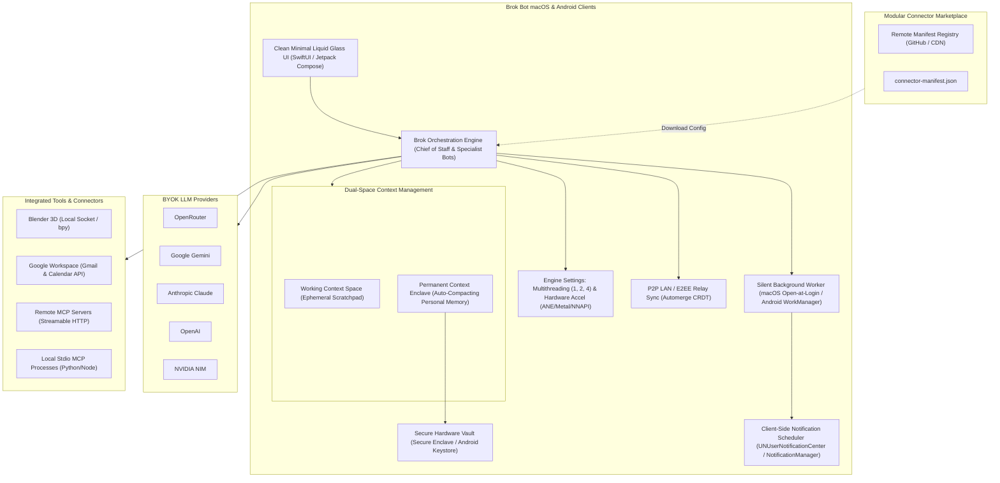
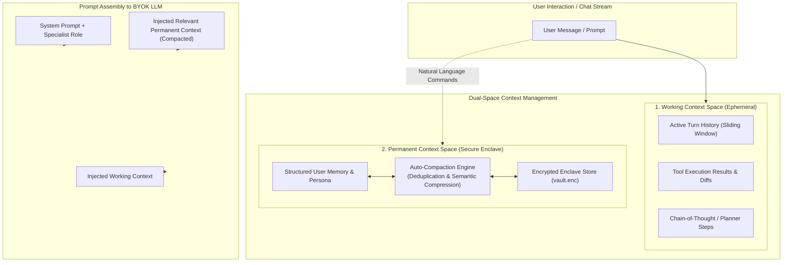

# Brok Bot: Product Requirements Document (PRD)

**Project Name:** Brok Bot  
**Document Version:** 1.1.0  
**Target Platforms:** macOS (Apple Silicon & Intel) & Android (Phone & Tablet)  
**Distribution:** Open-Source (GitHub Releases, Homebrew Cask, Direct APK, F-Droid)  
**License:** Apache 2.0 / MIT  
**Status:** Approved for Development  

---

## 1. Executive Summary & Vision

**Brok Bot** is an open-source, local-first, privacy-focused clone of xAI’s **Grok Bot**. 

While Grok Bot requires an expensive cloud subscription ($20 to $300/month) and centralizes execution on a proprietary cloud virtual computer, Brok Bot adopts a **Bring Your Own Key (BYOK)** and **Bring Your Own Compute** model. It empowers users to run their own autonomous AI teammates natively on their Mac and Android devices.

Brok Bot pairs an AI teammate architecture (Chief of Staff orchestrator + specialist sub-bots) with direct local execution and cloud tool integration. It introduces a **server-side modular connector marketplace** that enables the community to publish, update, and install integrations (Gmail, Google Calendar, Blender, Notion, Slack, GitHub, Linear, etc.) as dynamic manifests *without requiring app store updates or client rebuilds*.

Brok Bot implements a **Dual-Space Context Management Architecture**:
1. **Working Context (Ephemeral):** Task-specific reasoning scratchpad and active conversational history.
2. **Permanent Context (Personal Memory Enclave):** Hardware-encrypted, auto-compacting personal memory shielded in the device's secure enclave, dynamically updated or pruned via conversational commands (*"store this in your memory"*, *"update my memory about..."*, *"forget/delete from your memory"*).

Both apps feature a **Clean Minimal UI** styled strictly with **Liquid Glass** (ultra-thin frosted glass, dynamic specular border gradients, subtle accent glow). Both platforms support **multithreading configuration** (`1`, `2`, `4` threads), **hardware acceleration** (Apple Neural Engine / Metal on Mac, NNAPI / Vulkan on Android), **persistent background execution**, and a headless **"Open at Login"** daemon mode for macOS that wakes the bot in the background without launching the main window.

---

## 2. Competitive Positioning: Grok Bot vs. Brok Bot

| Feature Dimension | Grok Bot (Proprietary / xAI) | Brok Bot (Open Source Clone) |
| :--- | :--- | :--- |
| **Execution Environment** | Shared cloud Linux computer per user ($20–$300/mo) | **Local-First Native Execution** on user's Mac/Android + local sandboxed runner |
| **Context Management** | Unified server-side session memory | **Dual-Space Context**: Ephemeral Working Context + Enclave-Encrypted Permanent Memory with Auto-Compaction |
| **Memory Modification** | Black-box server memory adjustments | **Natural Language Commands**: *"Store in memory"*, *"Update memory"*, *"Forget/Delete"* with full user inspection |
| **Model Engine** | Locked to xAI Grok (Grok 2 / Grok 3 / Grok Mini) | **BYOK Multi-Model**: OpenRouter, Gemini, Claude, OpenAI, NVIDIA NIM |
| **Connector Architecture** | Hardcoded built-in OAuth + remote MCP tunnel | **Server-side Modular Marketplace**: JSON manifests downloaded dynamically |
| **Secret Storage** | Cloud-managed encrypted vault on xAI servers | **Hardware-Backed Storage**: macOS Secure Enclave/Keychain, Android Keystore |
| **Notification Pipeline** | Server-side push via proprietary gateway | **100% Client-Side Local Push**: OS-level scheduling, zero external push servers |
| **Background & Startup** | Always on in xAI cloud | **Silent Background Startup**: "Open at Login" wakes up headless (no window) on Mac; WorkManager on Android |
| **Performance Tuning** | Fixed cloud instance sizing | **Configurable Multithreading** (`1`, `2`, `4` threads) + **Hardware Acceleration** (ANE/Metal/NNAPI) |
| **App Distribution** | Notarized DMG / Apple App Store / Google Play | **Ad-hoc signed macOS app** (`codesign -s -`) + direct APK / F-Droid |
| **Multi-Agent Coordination**| Chief of Staff orchestrating specialist Bots | **Chief of Staff + Specialist Sub-agents** in shared thread with tool delegation |
| **Approvals / Safety** | Auto Review before sending/deleting | **Explicit User Approval Gates** with interactive Action Sheets & notifications |
| **Voice Mode** | Proprietary cloud voice chat & dictation | **Local/Cloud Hybrid**: macOS Dictation / WhisperKit + provider audio |
| **UI Aesthetics** | Dark minimalist, glass overlays | **Clean Minimal Liquid Glass UI**: Ultra-thin material, specular borders, luminous gradients |
| **Cross-Device Sync** | Centralized xAI cloud database | **P2P LAN + E2EE Relay**: Automerge CRDT over mDNS/TLS WebSockets |

---

## 3. User Personas & Core Use Cases

### 3.1. Primary Personas
1. **The Creative Technologist / 3D Artist ("Maya"):** Wants an AI assistant inside Blender to generate materials, place camera rigs, render previews, and run bpy scripts via plain English without switching windows.
2. **The Autonomous Solo Founder / Developer ("Alex"):** Needs a "Chief of Staff" to triage unread customer emails in Gmail, flag calendar scheduling conflicts, draft replies, and push daily agendas at 8:00 AM without leaking customer data to third-party SaaS vendors.
3. **The Privacy-Conscious Power User ("Jordan"):** Demands zero centralized servers. Requires all API keys, OAuth tokens, and conversation histories to remain strictly on personal hardware with biometric Touch ID / Fingerprint lock.

### 3.2. Core Use Cases & User Journeys

#### Use Case 1: Autonomous Morning Briefing (Headless Wakeup)
- **Trigger:** Configured routine set for 8:00 AM weekdays.
- **Workflow:**
  1. Brok Bot background daemon was silently launched at Mac login (no window visible).
  2. At 8:00 AM, background worker wakes up.
  3. Retrieves personal preferences from the **Permanent Memory Enclave** (e.g., *"Prefers bulleted executive summaries; focus on VIP clients"*).
  4. Queries Google Calendar for meetings and conflicts.
  5. Queries Gmail for high-priority unread messages (`is:unread category:primary`).
  6. Chief of Staff synthesizes a structured bulleted briefing.
  7. Client-side local notification fires: *"Your morning brief is ready: 3 meetings, 1 reply needed."*
  8. User clicks notification to display the Clean Minimal Liquid Glass UI.

#### Use Case 2: Blender 3D Scene Generation
- **Trigger:** User in chat types: *"Create an isometric low-poly room in Blender with a neon blue point light and render a 1080p preview."*
- **Workflow:**
  1. Brok Bot identifies the Blender connector tool `blender_execute_script`.
  2. Because the action executes arbitrary code, an **Approval Card** appears in chat displaying the generated `bpy` code diff.
  3. User clicks `[Approve & Run]`.
  4. Command is dispatched over local TCP socket (`127.0.0.1:9876`) to the Blender addon bridge.
  5. Addon builds the geometry, sets materials, positions the camera, and returns a PNG buffer.
  6. The rendered viewport image appears natively inline in the conversation.

#### Use Case 3: Conversational Memory Modification
- **Trigger:** User types in chat: *"Store this in your memory: My preferred flight seat is aisle, and my frequent flyer number is UA-98421."*
- **Workflow:**
  1. The Chief of Staff recognizes the intent to modify **Permanent Personal Memory**.
  2. Extracts the entities into structured key-value memory entries (`travel.flight_seat = "aisle"`, `travel.frequent_flyer = "UA-98421"`).
  3. Memory entries are written to the enclave-encrypted database.
  4. Bot replies: *"Saved to your permanent memory in secure storage."*
  5. Later, user says: *"Update my memory: my preferred flight seat is now window."* -> Brok Bot updates the entry in place.
  6. If user says: *"Forget my frequent flyer number"* -> Brok Bot securely purges the specific record.

---

## 4. Detailed Functional Requirements

### 4.1. Dual-Space Context Management System

Brok Bot enforces strict separation between short-term conversational context and durable personal memory:

#### 4.1.1. Space 1: Working Context (Ephemeral)
- Scoped strictly to the active task, sub-agent invocation, or conversation thread.
- Retains multi-turn conversation history, intermediate tool call payloads, and API output.
- Employs rolling token windowing: as conversation grows beyond context limits, older working turns are truncated or transiently summarized without polluting long-term memory.
- Cleared or archived on session reset.

#### 4.1.2. Space 2: Permanent Context (Personal Memory Enclave)
- **Enclave Hardware Security:** Stored inside the local hardware-encrypted vault (`vault.enc`) using AES-256-GCM, accessible only after biometric authentication (Touch ID / Android BiometricPrompt).
- **Auto-Compaction Engine:**
  - Evaluates memory entries periodically or when memory exceeds token thresholds.
  - Automatically merges duplicate facts, removes expired or superseded information, and resolves contradictions.
  - Generates compact, high-density semantic representations (e.g., transforming 10 travel notes into 1 structured travel profile block).
- **Natural Language Memory Control:**
  - **Store:** Command *"Store this in your memory: [X]"* extracts facts, assigns categorical tags, and persists to the secure enclave.
  - **Update:** Command *"Update my memory about [X] to [Y]"* locates existing entries and updates them in place with an audit trail.
  - **Delete / Forget:** Command *"Forget [X]"* or *"Delete [X] from your memory"* completely purges the entry and its cryptographic index from the database.
- **Manual Memory Management UI:** A clean, minimal viewer in Settings allows users to inspect, edit, or delete individual permanent memory items with one click.

### 4.2. Clean Minimal Liquid Glass UI
- **Design Philosophy:** Utmost minimalism. Zero unnecessary chrome, borders, or clutter. Focus is 100% on the conversation and tool deliverables.
- **Visual Aesthetic (Strict Liquid Glass):**
  - **Window Backdrop:** Ultra-thin frosted glass (`NSVisualEffectView` with `.behindWindow` blending on macOS; Chris Banes' `haze` library with `RenderEffect` on Android).
  - **Luminescence:** Subtle specular gradient borders (`Color.white.opacity(0.18)` at top-left to `Color.white.opacity(0.04)` at bottom-right).
  - **Persona Accent Glow:** Ambient radial glow behind the active bot's header reflecting the bot's custom accent color.
  - **Controls:** Minimalist floating pill toolbar, translucent message cards, and subtle spring micro-interactions.

### 4.3. Performance, Multithreading & Hardware Acceleration Settings
Both macOS and Android apps must include a dedicated **Performance & Compute** settings panel:
- **Multithreading Configuration:**
  - Configurable worker thread count: `1`, `2`, `4`, or `Auto (System Default)`.
  - Controls concurrency for local background polling, vector embeddings, Automerge CRDT sync calculations, and local MCP execution.
- **Hardware Acceleration:**
  - **macOS:** Toggle for **Apple Neural Engine (ANE) & Metal Acceleration** for local WhisperKit voice transcription and on-device embedding generation.
  - **Android:** Toggle for **NNAPI / Vulkan GPU Acceleration** for on-device ML models and speech processing.
  - Graceful CPU fallback when battery saver mode is active.

### 4.4. Silent Background Execution & macOS "Open at Login"
- **macOS Open at Login (Headless Mode):**
  - Uses `SMAppService.agent` or user LaunchAgent.
  - **Key Requirement:** At system boot or user login, Brok Bot **does NOT launch its main window**. It starts silently as a background service with an optional menu-bar status icon.
  - Stays active in the background to handle connector polling, routine execution, and client-side notifications.
  - The main Liquid Glass window appears instantly only when the user clicks the menu bar icon, summons via global hotkey (`Cmd+Shift+B`), or clicks a notification.
- **Android Background Execution:**
  - Registered with `BOOT_COMPLETED` broadcast receiver to initialize `WorkManager` background pollers and `AlarmManager` routine triggers immediately after boot without displaying an activity.

### 4.5. Multi-Agent Team Architecture
- **Primary Bot ("Chief of Staff"):**
  - Default orchestrator for general queries and routine coordination.
  - Can spawn, delegate to, and summarize results from specialist bots.
- **Specialist Bots:**
  - Users can create unlimited custom bots with distinct names, roles, system instructions, and avatar aesthetics.
  - Pinned tools and multi-bot collaboration in shared threads.

### 4.6. Server-Side Modular Connector Marketplace
- **Dynamic Catalog Fetching:** Client polls remote `catalog.json` without requiring app updates.
- **Declarative Manifests:** `connector-manifest.json` specifies transport, auth, permission tiers, tools, and safety flags (`requiresApproval: true/false`).
- **Dynamic Setup UI:** Automatically generated from the downloaded manifest.

### 4.7. Bring Your Own Key (BYOK) Model Engine
- Supported: OpenRouter, Google Gemini, Anthropic Claude, OpenAI, NVIDIA NIM.
- Features: Real-time SSE token streaming, normalized tool calling, and token counting.

### 4.8. Client-Side Notifications
- 100% client-side push using `UNUserNotificationCenter` on macOS and `NotificationManager` on Android.
- Actionable notification categories with `[Approve]` and `[Deny]` buttons for write operations.

### 4.9. Real-Time Cross-Device Sync
- P2P LAN sync via Bonjour / mDNS and TLS WebSockets.
- State convergence via **Automerge CRDT**.

---

## 5. Non-Functional Requirements (NFRs)

1. **Privacy & Data Sovereignty:** Zero user data or permanent memory ever touches Brok Bot servers. All communication occurs directly between the device and chosen provider endpoints.
2. **Launch & Window Reveal Latency:** Main window must reveal in < 200ms when invoked from the background menu-bar daemon. Cold boot < 1.0s.
3. **Memory Footprint in Background:** The headless background daemon must consume < 45 MB of RAM on macOS and < 25 MB on Android when idling.
4. **Battery Efficiency:** Background polling throttles dynamically based on battery level and network state.

---

## 6. Release & Distribution Strategy

- **macOS Ad-Hoc Release:** Universal binary `.dmg` / `.zip` signed with `codesign -s -`. Automated Homebrew Cask installer (`brew install --cask brok-bot`) to bypass Gatekeeper quarantine.
- **Android Release:** Universal `.apk` via GitHub Releases and F-Droid.
